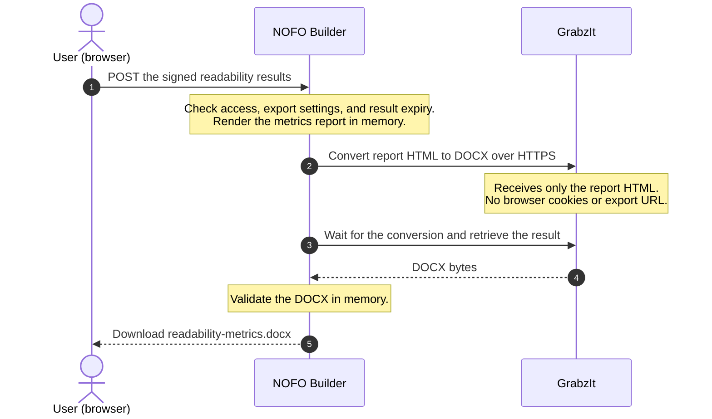
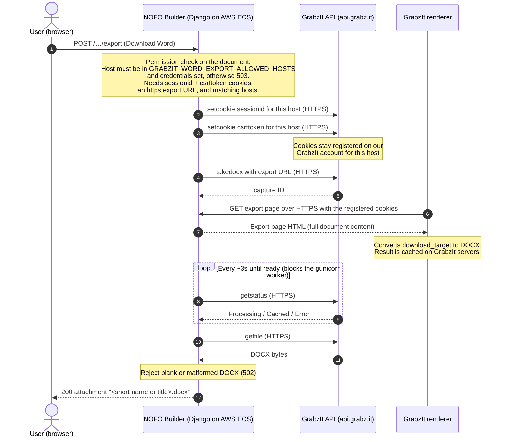
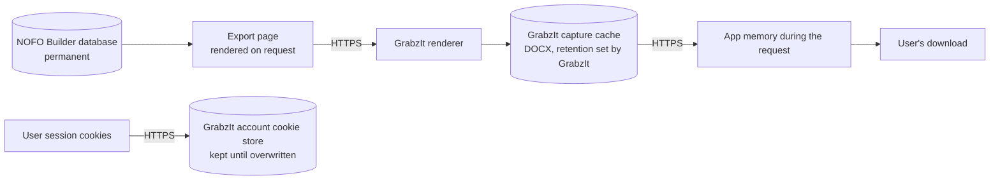

# Word (DOCX) export workflow

This page explains how a "Download Word" request becomes a `.docx` file, which systems see NOFO content along the way, and where (and for how long) that content is stored.

For why we chose GrabzIt over other converters, see the ADR: [HTML to DOCX solution](adr/2026-01-12-html-to-docx-solution.md). For which environments may use GrabzIt credentials, see [`DEPLOYMENT.md` § Word export environment isolation](../DEPLOYMENT.md#word-export-environment-isolation).

- **Related issue:** [#1351](https://github.com/HHS/simpler-grants-pdf-builder/issues/1351)
- **Source baseline:** `main` at release 3.59.1. See [Keeping this page current](#keeping-this-page-current).

## Where it is used

Full-document Word downloads use `generate_docx_download_response` in [`nofos/bloom_nofos/utils.py`](../nofos/bloom_nofos/utils.py).

| Feature | POST handler | Page GrabzIt converts |
| --- | --- | --- |
| NOFO export, including "Download for Clearance" when `HHS_NOFO_POLICY_EXPORT_ENABLED` is on | `NOFOsExportView.post` ([`nofos/nofos/views.py`](../nofos/nofos/views.py)) | `nofos:nofo_export` (`/nofos/<pk>/export`, plus `?policy_stripped=1` for the clearance copy) |
| Composer content guide export | `ComposerExportView.post` ([`nofos/composer/views.py`](../nofos/composer/views.py)) | `composer:composer_export` |
| Composer writer draft NOFO download | `WriterInstancePreviewView.post`, `action=download` ([`nofos/composer/views.py`](../nofos/composer/views.py)) | `composer:writer_instance_export` (`WriterInstanceExportView`) |

Each export template wraps the document in `
`. GrabzIt converts only that element (`targetElement = "#download_target"`), so the page header, navigation and buttons are left out of the Word file.

### Readability metrics reports

The Readability Checker’s **Download Word** action and the NOFO Builder
readability panel’s **Download metrics as Word** action use
`generate_html_docx_download_response` in the same module. Both paths use the
same configured credentials, host allowlist, HTTPS connection, in-memory DOCX
validation, and attachment handling as full-document Word downloads.

The app sends a small, dedicated report directly to GrabzIt with
`HTMLToDOCX`. The request contains four Tier 2 clearance metrics, one Tier 1
drafting measure, and a description of the measurement scope. The standalone
report includes available counts for recovered words, complete sentences and
words excluded from sentence-based scores. Word uploads explain which categories of
recognized content the Checker skips. PDF uploads identify the extraction
method and report page coverage when available. Every report also has a
**Document check** section (see below). The Builder report adds the NOFO
title and opportunity number when available, after checking access to the
NOFO. A signed-in Checker report can include a detected opportunity number
and Assistance Listing number. The download requires the same signed-in user
who ran the check. The signed-out report explains that the document was not
saved. All Checker reports omit the uploaded filename and title.
No report includes source content. Neither report forwards session cookies or
gives GrabzIt a URL to fetch.

The browser submits a signed copy of the displayed values that expires after
one hour. An expired download opens the [readability recovery
dialog](UI_PATTERNS.md#expired-readability-downloads) with instructions to
refresh the results. The readability download button is disabled while its request is
in progress and re-enabled when it finishes or fails. Generating the report does not save a readability checkpoint. As with
other Word exports, GrabzIt may retain the generated document in its capture cache.

`HHS_NOFO_READABILITY_WORD_EXPORT_ENABLED` is off by default. Enable it in
Django Constance after checking the intended export hosts, GrabzIt account and
available conversion capacity. Each surface must also have readability
enabled. To roll back, turn the switch off in Constance. This hides the
actions on new results and blocks requests from pages already open.

#### Readability report download flow

#### Standalone Checker report content

The report includes four Tier 2 clearance metrics, the Tier 1 drafting
measure, a **Document check** section and a **Text measured** section. An
unavailable metric is labeled **Not available**. A thin grey horizontal rule
separates the metrics from the **Document check** and **Text measured** notes
in every report, including the Builder report.

What the report adds depends on whether the user is signed in:

| User | Added to the report |
| --- | --- |
| Signed in | **Opportunity number** and **Assistance Listing number**, when detected. |
| Signed out | A note that the document was not saved: the Checker processed it temporarily on HHS-operated systems, did not add it to NOFO Builder, and kept no copy or report history. The note also says the Word report contains only scores and measurement notes, not the document's name, text or identifiers. This matches the notice on the Checker page. |

The Checker finds an opportunity number only when it is labeled and in the
expected format, in the first five pages or PDF metadata of a PDF, or near the
beginning of a Word document. It misses unlabeled numbers, numbers that appear
only later, and template placeholders such as `HHS-2026-XXX-XXX`. A document
without a findable opportunity number can still be analyzed when other
recognition signals are present. The Builder report shows the NOFO's saved
opportunity number when available.

Recognition returns only the matched identifier (for example
`HRSA-26-106`), never the surrounding text. The view removes it from the
report before rendering the results page or staging a Word comparison, and
adds it only to a signed-in user's signed Word report token.

#### Document check

The **Document check** section has two lines. Both use fixed wording; no
document text is used.

| Line | Checker (Word) | Checker (PDF) | Builder |
| --- | --- | --- | --- |
| Recognized as a likely HHS NOFO | **Yes**. Only recognized uploads get a report. Lists the details found, such as an HHS agency name, opportunity number, Assistance Listing number or Grants.gov reference. | Same as Word. | **Yes**. The NOFO was created in NOFO Builder. |
| NOFO template structure | **Yes** when the Checker recognized a template cover page, table of contents or template instructions, and names them. Otherwise **Couldn’t verify**, with a note that this does not mean the document is not a NOFO. | **Couldn’t verify**. The Checker does not compare a PDF's layout or sections with the NOFO template. | **Yes**. Builder measured the NOFO's own sections. |

The result is never "No": a document that fails recognition gets an error
instead of a report, and a missing template element only means the Checker
could not confirm the structure. Neither line is a template compliance,
accessibility, policy or clearance check. Recognition still means only "likely
HHS NOFO", as described in [Loose NOFO recognition](readability/PDF_READABILITY_PILOT.md#loose-nofo-recognition-969).

| Upload or extraction result | What **Text measured** says |
| --- | --- |
| Word | The word count uses recovered Word text after skipping recognized covers, tables of contents, template instructions, and Builder metadata. Other draft material may count, and text in headers, footers, text boxes, and images may be missed. |
| Word with zero words skipped across all recognized categories | The report also says that the Checker recorded no words skipped in those categories. |
| PDF with usable structure tags | The Checker recovered text using the PDF's structure tags. The report gives the number of pages with extractable text out of the total. |
| PDF measured from page layout | The Checker reconstructed text from the page layout. Draft instructions and placeholders may count. The report gives the number of pages with extractable text out of the total, which can reveal partial coverage. |
| Missing measurement counts | The report omits unavailable counts and explains the measurement scope in words. The current PDF analyzer supplies a count of pages with extractable text for every successful PDF result. A PDF with no extractable text yields an analysis error. |

For either file type, the scope section gives the recovered word count and,
when available, the number of words in complete sentences and the number
excluded from sentence-based scores. The Word report describes the categories
of skipped content without listing their individual counts. Its conversion
input never includes source excerpts or the uploaded file. Only signed-in Checker downloads can include detected opportunity and
Assistance Listing numbers.

For the exact phrasing, see the [report template](../nofos/bloom_nofos/templates/readability_word_report.html)
and [scope notes](../nofos/nofos/readability_word_export.py). See the [rendered
examples](review-evidence/1412/README.md#standalone-report-variations) for sample
results. The numbers in those examples are illustrative.

## How it works

### Full-document download flow

For a full-document download, the app sends GrabzIt a URL and the user’s session cookies. GrabzIt fetches the export page using the cookies registered for that host and converts the `#download_target` element to DOCX.

Step by step:

1. The user selects a Word download button, which POSTs to the export view. The normal login and group permission checks apply.
2. The helper returns `503 Word export is not available in this environment.` unless GrabzIt credentials are configured and the request host is in `GRABZIT_WORD_EXPORT_ALLOWED_HOSTS`. Only production is allowed today, and the button is disabled with an explanation in every other environment.
3. The helper needs the `sessionid` and `csrftoken` cookies, an `https` export URL, and a request host that matches the export URL host. The host check means cookies are only handed over for the host they came from.
4. `UseSSL(True)` switches the GrabzIt client to HTTPS before any call. The SDK defaults to HTTP; this was fixed in [#883](https://github.com/HHS/simpler-grants-pdf-builder/pull/883).
5. The helper registers the user's `sessionid` and `csrftoken` with GrabzIt for that host (`SetCookie`), then asks GrabzIt to convert the URL (`URLToDOCX`). If registration is refused or raises (for example, a timeout reaching GrabzIt), the helper returns `500` without logging the cookie values or the provider's error text.
6. GrabzIt's renderer fetches the export page from our app using the cookies registered for that host. The app applies its usual permission checks to the session GrabzIt presents.
7. `SaveTo` waits about 3 seconds, then checks status every 3 seconds until the result is ready, and downloads it. The request is **synchronous**: the gunicorn worker is busy for the whole conversion, and gunicorn stops requests after 89 seconds (see the `Dockerfile`).
8. The app receives the DOCX bytes in memory.
9. `is_valid_docx` rejects an empty or malformed result with `502`, including a package whose compressed contents are corrupt. Otherwise the DOCX is returned as an attachment.

When the helper returns an error, the download modal shows "Sorry — something went wrong generating the document. Please try again."

## What data is stored, and where

### Full-document data flow

| Data | Where | How long | Notes |
| --- | --- | --- | --- |
| NOFO or content guide content | NOFO Builder database | Permanent (normal app data) | Export does not change it. |
| Rendered export page | Produced on request for GrabzIt's renderer | Not stored by us | Sent to GrabzIt over HTTPS. |
| User's `sessionid` and `csrftoken` | GrabzIt account cookie store, keyed by host | Until replaced or removed. The code does not call `DeleteCookie`. | See [#1330](https://github.com/HHS/simpler-grants-pdf-builder/issues/1330) for account cleanup. |
| Generated DOCX | GrabzIt servers (capture cache) | Retention period set by GrabzIt | We don't set the SDK's `encryptionKey` option. See the [GrabzIt Trust Center](https://grabz.it/trust/). |
| Generated DOCX (temporary copy) | App memory | During the download request | The app streams no intermediate file to disk. |
| Generated DOCX (download) | User's browser or device | Up to the user | The final file. |
| Download outcome (no content) | NOFO Builder database (`WordDownloadAttempt`), only when the `WORD_DOWNLOAD_ATTEMPT_RECORDING_ENABLED` Constance switch is on. Not copied into EasyAudit. | Until `cleanup_word_download_attempts` removes it under `WORD_DOWNLOAD_ATTEMPT_RETENTION_DAYS` | Source, outcome, status, duration, signed-in state, group and NOFO. No document text, readability values, filenames or user IDs. See [Builder metrics § Word download recording](BUILDER_METRICS.md#word-download-recording-1432). |

For both export paths, the app keeps the generated DOCX in memory during the
request and returns it to the browser. GrabzIt may retain the file in its
capture cache. Only the full-document path registers session cookies.

## Troubleshooting

Once [#1354](https://github.com/HHS/simpler-grants-pdf-builder/pull/1354) is deployed, Word export warnings and errors appear in the application console as JSON. See [Word export environment isolation](../DEPLOYMENT.md#word-export-environment-isolation) for the messages to search for.

## Known gaps

- **Overlapping full-document exports can use a different session.** Full-document exports on the same host register cookies under the same names on the GrabzIt account. If another export overwrites those cookies before the renderer fetches the first export page, the app can evaluate its permissions against the other session.
- **GrabzIt retains cached DOCX files and cookies registered by full-document exports.** Cleaning up the account's stored cookies and choosing a cache retention suitable for pre-decisional content are tracked in [#1330](https://github.com/HHS/simpler-grants-pdf-builder/issues/1330).
- **No customer encryption key.** The ADR lists encryption at rest with a customer-provided key as a reason for choosing GrabzIt. The code does not set `encryptionKey`.

## Configuration

- `GRABZIT_APPLICATION_KEY`, `GRABZIT_APPLICATION_SECRET` and `GRABZIT_WORD_EXPORT_ALLOWED_HOSTS` are environment settings in [`nofos/bloom_nofos/settings.py`](../nofos/bloom_nofos/settings.py). Configure them together, as described in [`DEPLOYMENT.md` § Word export environment isolation](../DEPLOYMENT.md#word-export-environment-isolation).
- Full-document exports require GrabzIt to reach the app’s public HTTPS host.
  Readability report exports send HTML directly and still require configured
  credentials and an allowed host.
- Never test Word export from a non-production environment with production credentials.
- The `WORD_DOWNLOAD_ATTEMPT_RECORDING_ENABLED` Constance switch (default off; changes apply without restarting workers) and the `WORD_DOWNLOAD_ATTEMPT_RETENTION_DAYS` environment setting (unset) control download outcome recording for usage metrics. The NOFO export view, the readability panel export view and the Checker export view each record one row per attempt; Composer downloads are not recorded. See [Builder metrics § Word download recording](BUILDER_METRICS.md#word-download-recording-1432).

## Workarounds in the export templates

- `
&nbsp;
` spacers marked `<!-- remove this if grabzit fixes their issue -->` in `composer_export.html` and `nofo_export_document.html` work around a GrabzIt layout issue.
- Heading IDs and anchor links are shortened for DOCX by the `truncate_anchor_links_for_docx` template tags.

## Keeping this page current

Update this page in the same PR as any change to Word export code. The
[`Word Export Docs Check`](../.github/workflows/docx_export_docs.yml) workflow fails a PR that
changes the files below without changing this page. If nothing described here has changed, add the
`docs-not-needed` label to the PR and explain why in its description.

Any change to these files triggers the check:

- `nofos/bloom_nofos/templates/includes/docx_download_button_form.html`
- `nofos/bloom_nofos/templates/includes/download_docx_button.html`
- `nofos/bloom_nofos/templates/readability_word_report.html`
- `nofos/nofos/readability_word_export.py`
- `nofos/composer/templates/composer/composer_export.html`
- `nofos/composer/templates/composer/writer/docx_export.html`
- `nofos/nofos/templates/nofos/includes/nofo_export_document.html`
- `nofos/nofos/templates/nofos/nofo_export.html`
- `nofos/nofos/templatetags/truncate_anchor_links_for_docx.py`

These shared files trigger the check only when the change touches Word export code (GrabzIt, the
DOCX helpers, `download_target`, the export views or the gunicorn `--timeout`):

- `Dockerfile`
- `nofos/bloom_nofos/settings.py`
- `nofos/bloom_nofos/utils.py`
- `nofos/bloom_nofos/views.py`
- `nofos/composer/views.py`
- `nofos/nofos/views.py`

In `nofos/bloom_nofos/utils.py`, the check also tracks the full hostname
normalization helper and the constants that identify the required DOCX package
parts and Word text elements.

The check also tracks changes inside the HTML-to-DOCX conversion helper,
the shared DOCX attachment helper, and both readability Word export views.

When you add or move Word export code, update this list and the matching lists in the workflow,
[`AGENTS.md`](../AGENTS.md#keep-word-export-docs-current) and the PR template.
