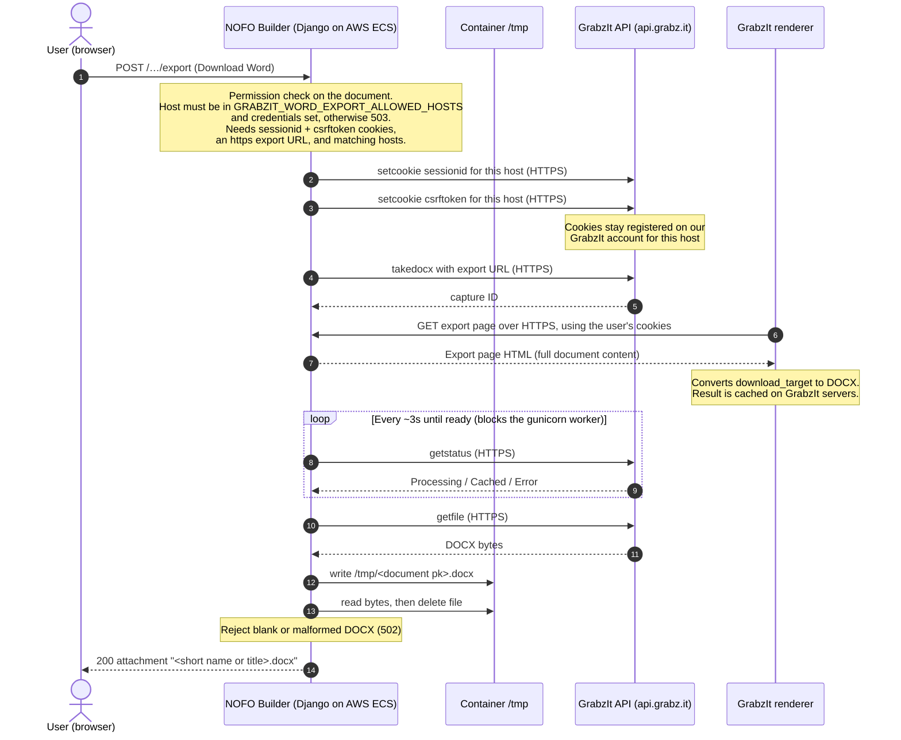
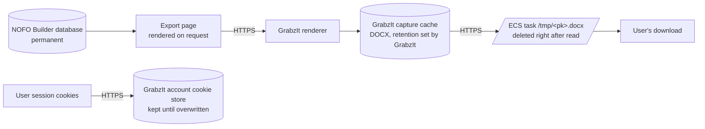

# Word (DOCX) export workflow

This page explains how a "Download Word" request becomes a `.docx` file, which systems see NOFO content along the way, and where (and for how long) that content is stored.

For why we chose GrabzIt over other converters, see the ADR: [HTML to DOCX solution](adr/2026-01-12-html-to-docx-solution.md). For which environments may use GrabzIt credentials, see [`DEPLOYMENT.md` § Word export environment isolation](../DEPLOYMENT.md#word-export-environment-isolation).

- **Related issue:** [#1351](https://github.com/HHS/simpler-grants-pdf-builder/issues/1351)
- **Source baseline:** `main` at release 3.59.1. Recheck this page when `generate_docx_download_response` changes.

## Where it is used

All Word downloads go through one helper, `generate_docx_download_response` in [`nofos/bloom_nofos/utils.py`](../nofos/bloom_nofos/utils.py).

| Feature | POST handler | Page GrabzIt converts |
| --- | --- | --- |
| NOFO export, including "Download for Clearance" when `HHS_NOFO_POLICY_EXPORT_ENABLED` is on | `NOFOsExportView.post` ([`nofos/nofos/views.py`](../nofos/nofos/views.py)) | `nofos:nofo_export` (`/nofos/<pk>/export`, plus `?policy_stripped=1` for the clearance copy) |
| Composer content guide export | `ComposerExportView.post` ([`nofos/composer/views.py`](../nofos/composer/views.py)) | `composer:composer_export` |
| Composer writer draft NOFO download | `WriterInstancePreviewView.post`, `action=download` ([`nofos/composer/views.py`](../nofos/composer/views.py)) | `composer:writer_instance_export` (`WriterInstanceExportView`) |

Each export template wraps the document in `
`. GrabzIt converts only that element (`targetElement = "#download_target"`), so the page header, navigation and buttons are left out of the Word file.

## How it works

**We do not send NOFO HTML to GrabzIt.** We send GrabzIt a URL, along with the user's own session cookies. GrabzIt's servers then load that page from our app as the user, render it, and turn the `#download_target` element into a DOCX.

Step by step:

1. The user selects a Word download button, which POSTs to the export view. The normal login and group permission checks apply.
2. The helper returns `503 Word export is not available in this environment.` unless GrabzIt credentials are configured and the request host is in `GRABZIT_WORD_EXPORT_ALLOWED_HOSTS`. Only production is allowed today, and the button is disabled with an explanation in every other environment.
3. The helper needs the `sessionid` and `csrftoken` cookies, an `https` export URL, and a request host that matches the export URL host. The host check means cookies are only handed over for the host they came from.
4. `UseSSL(True)` switches the GrabzIt client to HTTPS before any call. The SDK defaults to HTTP; this was fixed in [#883](https://github.com/HHS/simpler-grants-pdf-builder/pull/883).
5. The helper registers the user's `sessionid` and `csrftoken` with GrabzIt for that host (`SetCookie`), then asks GrabzIt to convert the URL (`URLToDOCX`).
6. GrabzIt's renderer fetches the export page **from our app**, logged in as the user through those cookies. The page goes through the usual permission checks, so GrabzIt sees exactly what that user could see.
7. `SaveTo` waits about 3 seconds, then checks status every 3 seconds until the result is ready, and downloads it. The request is **synchronous**: the gunicorn worker is busy for the whole conversion, and gunicorn stops requests after 89 seconds (see the `Dockerfile`).
8. The bytes are written to `/tmp/<document pk>.docx`, read back, and the file is deleted in a `finally` block.
9. `is_valid_docx` rejects an empty or malformed result with `502`. Otherwise the DOCX is returned as an attachment.

When the helper returns an error, the download modal shows "Sorry — something went wrong generating the document. Please try again."

## What data is stored, and where

| Data | Where | How long | Notes |
| --- | --- | --- | --- |
| NOFO or content guide content | NOFO Builder database | Permanent (normal app data) | Export does not change it. |
| Rendered export page | Produced on request for GrabzIt's renderer | Not stored by us | Sent to GrabzIt over HTTPS. |
| User's `sessionid` and `csrftoken` | GrabzIt account cookie store, keyed by host | **Until the next export replaces them.** The code does not call `DeleteCookie`. | The token stops working when the Django session expires. |
| Generated DOCX | GrabzIt servers (capture cache) | Retention period set by GrabzIt | We don't set the SDK's `encryptionKey` option. See the [GrabzIt Trust Center](https://grabz.it/trust/). |
| Generated DOCX (temporary copy) | ECS task `/tmp/<document pk>.docx` | Removed right after it is read | If removal fails, the file stays until the task is replaced. |
| Generated DOCX (download) | User's browser or device | Up to the user | The final file. |

We do not store the generated Word file in our database, S3 or logs.

## Known gaps

These are open as of the source baseline above:

- **Failure logs are discarded in deployed environments.** `generate_docx_download_response` logs through the `bloom_nofos.utils` logger. That logger has no handler of its own, so its records reach the root logger, which uses a `NullHandler` outside tests. "GrabzIt Word export request failed", "GrabzIt returned an invalid or empty DOCX" and "GrabzIt Word export blocked for unconfigured host" therefore never reach the console or log aggregation. Users still see the modal's error message.
- **Session cookies stay with GrabzIt after the export.** Calling `DeleteCookie` afterwards is not a safe fix on its own. Cookies are shared across the GrabzIt account per host, so deleting them could log out another user's export that is still running. That user's Word file could then contain the login page instead of the document. Safer options are a short `expires` on `SetCookie`, or a short-lived signed export URL instead of cookies.
- **Concurrent exports share cookies.** Two users exporting at the same moment can have one conversion run with the other user's session. The POST view has already checked the requesting user's permissions, so the likely result is a failed or wrong-permission render, not access to another document.
- **No customer encryption key.** The ADR lists encryption at rest with a customer-provided key as a reason for choosing GrabzIt. The code does not set `encryptionKey`.
- **Temporary file names can collide.** Concurrent exports of the same document on the same task share `/tmp/<pk>.docx`, for example the standard and clearance copies of one NOFO.

## Configuration

- `GRABZIT_APPLICATION_KEY`, `GRABZIT_APPLICATION_SECRET` and `GRABZIT_WORD_EXPORT_ALLOWED_HOSTS` are environment settings in [`nofos/bloom_nofos/settings.py`](../nofos/bloom_nofos/settings.py). Configure them together, as described in [`DEPLOYMENT.md` § Word export environment isolation](../DEPLOYMENT.md#word-export-environment-isolation).
- GrabzIt has to reach the app's public HTTPS host. Local `http://localhost` exports don't work.
- Never test Word export from a non-production environment with production credentials.

## Workarounds in the export templates

- `
&nbsp;
` spacers marked `<!-- remove this if grabzit fixes their issue -->` in `composer_export.html` and `nofo_export_document.html` work around a GrabzIt layout issue.
- Heading IDs and anchor links are shortened for DOCX by the `truncate_anchor_links_for_docx` template tags.
