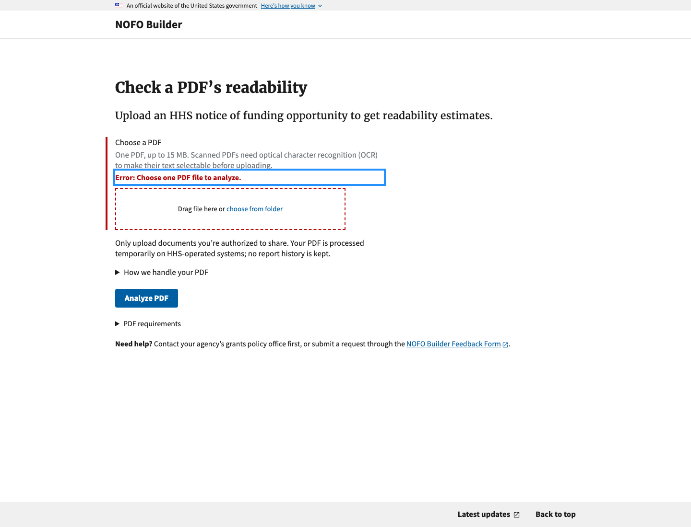

# UI patterns

Use this guide when adding or changing Builder screens. Start with an existing
component and its behavior before creating a new variation. This is a small,
incremental catalog of verified patterns, not an audit of every screen.

Before implementing UI, identify the closest existing screen and its shared
components, even when the pattern is not cataloged here. Reuse those components,
or explain in the PR why a different implementation is needed. Scope this check
to the UI being changed; it does not require an application-wide component audit.

## Typography when an editor loads Bootstrap

The [root README's USWDS implementation note](../README.md#a-note-on-our-implementation-of-the-us-web-design-system-uswds)
explains the bundled static assets and how to update them. This section covers
using those existing utilities consistently; it does not introduce a Sass or
frontend build requirement.

Builder uses Merriweather for page and section headings and Source Sans Pro for
body copy and alert headings. Some editors load Bootstrap for Martor after the
shared USWDS styles. Bootstrap's global heading rules can make bare `h2` elements
inherit the body font and reduce heading weights to 500, even when the correct
web fonts are successfully loaded.

For new headings on these pages, use the established USWDS utilities explicitly:

```html
<h1 class="font-heading-xl text-bold">Page title</h1>
<h2 class="font-heading-lg text-bold">Section heading</h2>
<h2 class="usa-alert__heading text-bold">Warning heading</h2>
```

Reuse an existing page's heading scale for the same role. Alert headings retain
USWDS's sans-serif styling; avoid applying the serif heading utility to them.
Do not solve an editor override by adding a second font family or changing the
shared stylesheet order without checking editor behavior and other pages.

Before publishing UI screenshots, compare the computed font family, size, and
weight with an existing Builder page that uses the same role. Confirm the actual
rendered web font, not just the requested CSS family, and check desktop and
narrow layouts. A page can load all its stylesheets and fonts yet still apply
the wrong heading rule. The [subsection conflict capture notes](review-evidence/subsection-conflicts-1075/README.md#typography-verification)
record a verified example of this failure and correction.

Explicit utilities prevent this known typography override on the elements using
them. The broader architectural fix would be isolating Bootstrap to the editor
or replacing its global stylesheet with only the editor dependencies. That needs
a separate change with visual and interaction checks for Martor tabs, toolbar,
preview, fullscreen behavior, and the other Bootstrap-dependent screens.

## Alert text and spacing

Follow the [USWDS alert component](https://designsystem.digital.gov/components/alerts/)
for alert headings and body text. Start the description directly below the
heading, using the component's built-in spacing. Do not insert an empty paragraph,
a `<br>`, or extra top margin to create a blank line before the description.

Apply `usa-alert__heading` to the heading and `usa-alert__text` to **each body
paragraph**, including additional paragraphs. This keeps the same compact spacing
in one-paragraph and multi-paragraph alerts. Let text wrap naturally; do not add
empty paragraphs or manual line breaks between body paragraphs.

```html
<div class="usa-alert usa-alert--info" role="note">
  <div class="usa-alert__body">
    <h2 class="usa-alert__heading">How to read these results</h2>
    <p class="usa-alert__text">Explain what the results mean.</p>
    <p class="usa-alert__text">Add any necessary context or next step.</p>
  </div>
</div>
```

Choose the heading level for the page's hierarchy and retain the alert's
sans-serif heading style. If a wrapper is needed for a script or identifier,
keep it neutral and put `usa-alert__text` on its paragraphs. Putting that class
only on a wrapper leaves ordinary child paragraphs with default margins, which
can introduce unintended blank-looking space.

The [Word/PDF readability report](../nofos/bloom_nofos/templates/pdf_readability.html)
uses this pattern for both its introductory and reliability alerts. When adding
or changing alerts, compare their heading-to-body and paragraph spacing at wide
and narrow widths, and check for page-specific typography overrides described
above.

## File-upload errors

Use the shared [`file_input.html`](../nofos/bloom_nofos/templates/includes/file_input.html)
component for a file field's error state. NOFO Compare and the PDF checker are
examples of this pattern.

### What the user sees

- The label and file requirements remain visible.
- The field group has a red left border.
- A bold red `Error: …` message appears between the hint and file picker.
- The file picker has a red dashed border and remains available for correction.
- The submit action remains available so the user can choose another file and retry.

The screenshot below shows the PDF checker's missing-file state. Its blue outline
is keyboard focus on the error message, rather than part of the red error styling.



### Implementation

Pass the user-facing error to the shared include instead of recreating its markup:

```django

```

The component adds `usa-form-group--error`, the inline `usa-error-message`,
`aria-invalid="true"`, and an `aria-describedby` reference to the hint and error.
Use a stable, unique field ID. Preserve these associations when customizing a form.

For this server-rendered pattern, do not pass `required=True` if it would make
browser constraint validation intercept an empty submission with a native tooltip.
The server must still validate missing files, file counts, formats, and size;
removing the browser constraint does not make the upload optional.

For the PDF checker, JavaScript focuses the inline error using a temporary
`tabindex="-1"`. Missing-file submissions reach server validation without opening
the processing modal or disabling the submit button. Keep the same error usable
when JavaScript is unavailable.

Write an error that explains the problem and the next action, such as
“Choose one PDF file to analyze.” Avoid raw exceptions or technical diagnostics.
For a single file field, avoid repeating the same message in a separate alert.
A multi-field form may need an error summary linking to its invalid fields; that
pattern is outside this guide's current scope. Operational failures unrelated to
file correction may also need different feedback.

### Verify before shipping

1. Submit without a file: verify the inline error, invalid field association,
   and absence of a competing browser tooltip.
2. Upload a rejected file: verify a useful correction message and no normal result.
3. Use keyboard navigation: verify error focus and that the picker and submit
   action remain usable for retry.
4. Correct the file and resubmit: verify successful processing and cleared errors.
5. Check narrow screens and server validation with JavaScript unavailable.

Useful references:

- [PDF upload page](../nofos/bloom_nofos/templates/pdf_readability.html)
- [PDF interaction behavior](../nofos/bloom_nofos/static/js/pdf_readability.js)
- [PDF page tests](../nofos/bloom_nofos/tests_bloom_nofos/test_pdf_readability.py)
- [Import error codes](IMPORT_ERROR_CODES.md), for blocking NOFO import messages

## Loading progress modals

Use the running-horse progress modal when an action blocks the user for several
seconds, such as Word export or PDF analysis. The Download Word modal in
[`docx_download_button_form.html`](../nofos/bloom_nofos/templates/includes/docx_download_button_form.html)
is the reference implementation; the PDF checker's analysis modal follows it.

For inline progress below an import or upload form, use
[`loading_horse.html`](../nofos/bloom_nofos/templates/includes/loading_horse.html)
instead.

### What the user sees

- A USWDS modal with no close button, a heading such as “Generating Word document…”,
  and a sentence explaining roughly how long it takes.
- The horse runs from the left edge of the track to the right, looping until
  the work finishes, with “Working…” centered below it.
- On success, the modal says the result is ready and closes itself after
  3 seconds. On failure, it shows an error and an OK button.

### Implementation

Include the shared styles and use the track and horse classes:

```django

<div class="margin-top-2">
  <div class="docx-horse-track" id="my-progress-horse" aria-hidden="true">
    
  </div>
  <p class="margin-top-1 text-center" aria-hidden="true">Working…</p>
</div>
```

Don't render the track with `is-running` already set. Add `is-running` from
JavaScript at the moment the modal opens, so the horse starts from the left edge
every time, and remove it when the work ends or the page is restored with the
Back button (`pageshow` with `event.persisted`). If the result appears in
the same page, set `is-finished` so the horse glides to the right edge instead
of jumping. If `is-running` is in the markup, the animation starts on page
load and the horse appears mid-track when the modal opens.

The horse is decorative: keep `aria-hidden="true"` on the track and `alt=""`
on the image, and announce progress through a `role="status"` or `aria-live`
region instead.

### Verify before shipping

1. Trigger the action: verify the modal opens and the horse starts at the left edge.
2. Trigger it again after waiting on the page: verify the horse still starts at the left.
3. Let it finish: verify the success state and auto-close, or the error state and OK button.
4. Go Back after a full-page submit: verify the modal is closed and the button is enabled.
5. Check that a screen reader announces progress and not the image.

Useful references:

- [Word export modal](../nofos/bloom_nofos/templates/includes/docx_download_button_form.html)
  and [its behavior](../nofos/bloom_nofos/static/js/nofo_export_button.js)
- [Shared progress styles](../nofos/bloom_nofos/templates/includes/document_progress_styles.html)
- [PDF analysis modal](../nofos/bloom_nofos/templates/pdf_readability.html)

## Import recovery: buttons and strong navigation links

For import recovery, choose the control based on what activating it does. An
operation can run on the server or in JavaScript; JavaScript alone does not
make something a button action.

| User intent | Behavior | Control |
| --- | --- | --- |
| Import the selected file | Submits the upload form and starts processing | Submit button, styled with `usa-button` |
| Try the import again after an error | Opens the upload form so the user can select a corrected file | Navigation link, styled with `usa-link text-bold` |

### Implementation

Use a native submit button for starting the import:

```html
<button type="submit" class="usa-button">Import</button>
```

Use an anchor with a real destination for returning to the upload form:

```django
<a class="usa-link text-bold" href="{{ retry_url }}">{{ retry_label }}</a>
```

Keep the link label specific to its destination. "Try the import again" opens the
form; it does not resubmit the previous file. Preserve any destination-specific
label, such as "Change this NOFO’s status" when that is the required next step.
Do not use browser-history navigation: the relevant form should remain reachable
when the error page was opened in a new tab or after other navigation.

The reference is [`import_error.html`](../nofos/bloom_nofos/templates/import_error.html).
Its recovery steps begin with an H2. The retry link precedes a separated support
section rendered by
[`import_error_support.html`](../nofos/bloom_nofos/templates/includes/import_error_support.html),
with an H2, contact instructions, and the error code. This support layout is scoped
to import errors; see [Import error page layout](IMPORT_ERROR_CODES.md#import-error-page-layout).
The PDF checker's "Analyze another PDF" link is an existing example of the same
strong navigation-link styling.

### Verify before shipping

1. Follow the retry link: verify it opens the relevant form without starting an import.
2. Use keyboard navigation: verify visible focus and that Enter follows the link.
3. Submit a corrected file: verify the form's submit button starts processing.

This guidance covers this recovery workflow. It does not call for a site-wide
button audit or changes to existing download, export, or other controls. Extend
the catalog as those use cases are reviewed.

## Readability estimate reliability alerts

**Word exception (#1169):** when a Word report has no supplied rating, use ordinary
paragraphs under **Measurement scope**, not a second informational alert. Put
conversion/preparation guidance in `readability-word-guidance`, beginning with
bold **Why “Estimated”?** so readers can find the label’s meaning, and the single
explanation of absent conversion-completeness assessment in
`readability-reliability`. Metric cards say **Estimated** without repeating
“Reliability not assessed.” Actual converter warnings remain in **Calculation
notes**. Copy and print retain the same explanation. No supplied rating is
discarded. See [the investigation and decision](readability/WORD_READABILITY_RELIABILITY.md).
The tables and absent-rating alert wording below apply to PDF reports; assessed
Word results retain their supplied-rating notice.

The PDF/Word readability report uses a USWDS alert to explain confidence in the
estimates derived from extracted text. Reliability describes confidence in
those estimates, not how readable the document is. High reliability does not
guarantee accuracy or establish compliance, accessibility, or clearance.

| Report reliability | Alert variant | Purpose |
| --- | --- | --- |
| High | `usa-alert--info` (blue) | Informational context for interpreting estimates |
| Moderate | `usa-alert--info` (blue) | Informational context for interpreting estimates |
| Low | `usa-alert--warning` (yellow) | Caution about estimates that need careful interpretation |
| Not assessed | `usa-alert--info` (blue) | Extraction scope without an invented confidence rating |

The supported assessed levels are high, moderate, and low; there is no
“extremely low” level. Missing or unrecognized engine ratings are unassessed,
not low. The report uses “What this report includes” with scope guidance and
an explicit statement that reliability has not been assessed. Metric cards say
“Reliability not assessed” instead of inheriting another metric's rating.
Generic PDF extraction retains its explicit low-confidence policy.
The presentation does not change how reliability is calculated.

### Report headings, metric labels and rating selection

| State | Report alert heading | Calculated metric card |
| --- | --- | --- |
| High | Reliability of these estimates: High | Estimated · High reliability |
| Moderate | Reliability of these estimates: Moderate | Estimated · Moderate reliability |
| Low | Reliability of these estimates: Low | Estimated · Low reliability |
| Not assessed | What this report includes | Estimated · Reliability not assessed |
| Metric unavailable | Does not by itself select the report heading | Unavailable (no reliability label) |

Unavailable means no finite numeric metric result can be displayed. Not assessed
means a result can be displayed but no recognized reliability rating was supplied.
The source-specific extraction explanation appears independently of those states;
a successful calculation can still have extraction limits or unassessed reliability.

The metrics engine supplies individual ratings; Builder does not assign numeric
confidence thresholds here. The overall report uses the lowest recognized supplied
metric rating. Missing ratings are omitted from that selection, not treated as Low
or High. Consequently, one High metric and otherwise unassessed metrics can yield
High overall; it does not establish High reliability for every metric. If no rating
is supplied, overall reliability is not assessed. Generic PDF extraction explicitly
forces Low overall and on displayed metric cards. Other metric cards use their own
ratings, without inheriting the report rating; the sentences-per-paragraph component
uses its parent words-per-sentence rating. The label is Moderate, not Medium.

### Source-specific alert copy

[USWDS alert guidance](https://designsystem.digital.gov/components/alert/#accessibility-guidance)
defines informational alerts as non-critical status information, warnings as
potentially critical information that might require action, and errors as
failed actions. A low-confidence report still contains results, so its
reliability notice uses a warning rather than a red error alert.

Keep the reliability level in the heading and the explanation in the body so
users can understand the notice without relying on color or the icon. Preserve
the source-specific explanation and the existing `role="note"`; changing the
visual variant does not make this notice an urgent announcement.

Each source explanation stays in one paragraph:

- **Word:** general preparation guidance is ordinary Measurement scope text, not an alert. It describes text boxes, headers, footers, images and unused template options without claiming any of those were detected. An unassessed report explains once: “This analysis does not check how completely the Word document was converted, so it does not assign a reliability rating. This does not mean a problem was detected in your upload. Any conversion warnings appear in Calculation notes.”
- **PDF with usable tags:** “PDF structure tags helped the tool read the text in order, but some text may still be missed or read out of order, especially in columns and tables. These scores describe the text the tool recovered and may not reflect the entire PDF.”
- **PDF without usable tags (authenticated tool):** “The tool could not reliably determine the order of text in this PDF, so the scores may be less reliable. For your next upload, try uploading the original Word document instead. If you need to use a PDF, save it from Word using ‘Save as PDF’ rather than ‘Print to PDF.’”

**PDF without usable tags (public PDF-only route):** “The tool could not reliably determine the order of text in this PDF, so the scores may be less reliable. For your next upload, save the original document from Word using “Save as PDF” rather than “Print to PDF.””

Word is supported only on authenticated `/nofos/readability-checker/`; public
`/readability-checker/` accepts PDFs only. The public variant therefore does not recommend
a Word upload. These suggestions do not guarantee accurate scores. The source
explanation is one paragraph. When overall reliability is not assessed, the alert
also includes the separate sentence: “Reliability has not been assessed for these
estimates.” This sentence can accompany tagged-PDF source copy. Unassessed Word
reports use the plain scope explanation above instead.

The upper **How to read these results** alert is shared across source types:

> These metrics can help you identify opportunities to improve your document’s readability. They are not a compliance, accessibility, or clearance determination.
>
> The tool uses shared metric formulas for Word documents, PDFs, and Builder drafts. Scores can differ because each format can preserve different text, sentence boundaries, and paragraph structure. When tracking revisions, use the same format and analysis method for a more consistent comparison.

Keep this comparison explanation in that upper alert rather than repeating it in
the source-specific reliability alert. Source explanations describe recovered
text and preparation steps; they do not ask users to verify an extracted-text
transcript, because the report does not provide one.

The verified implementation is
[`pdf_readability.html`](../nofos/bloom_nofos/templates/pdf_readability.html),
with rendered-report coverage in
[`test_pdf_readability.py`](../nofos/bloom_nofos/tests_bloom_nofos/test_pdf_readability.py).
[Before-and-after screenshots](review-evidence/readability-reliability-alert/README.md)
show the three assessed levels at the time of that capture; they are historical
layout evidence, not the current copy catalog. The Word-upload evidence in
[PR #1112](review-evidence/word-readability-1111/README.md) includes the unassessed
state; its existing screenshots predate the later plain-language copy update.
The template is the executable source of truth; this section catalogs the current
wording and variants. When changing this notice, verify the level, alert variant,
source/route-specific text and metric labels together.

This entry covers the readability reliability notice. Add other verified
alert patterns here as they are reviewed; a site-wide alert audit is not
required to extend this catalog.

## Leftover template instruction warning after Word import

This is a fallback review warning for a successful Word import, not an import
error. Builder retains text boxes it cannot confidently classify instead of
risking removal of applicant-facing content. It does not block the import,
require another upload, or have an import-error code. Keep
[IMPORT_ERROR_CODES.md](IMPORT_ERROR_CODES.md) focused on blocking failures.

### Trigger and placement

The warning appears when Word preprocessing encounters an unknown or conflicting
text-box fill, incompatible compatibility copies, or an unsupported container.
Recognized pale-blue instruction boxes are removed without this warning; known
white, unfilled, and transparent content boxes are kept without it. See
[IMPORT-058](IMPORT_RULES.md#import-058--pale-blue-word-instruction-container-cleanup)
for the exact detection and preservation rules. The warning itself does not
change saved content or perform cleanup when a NOFO is opened or exported.

- After a new import, show the warning on **Name your NOFO**. Saving the name
  returns the user to **All NOFOs**, so do not say the editor is the next page.
- After a successful re-import, show it on the NOFO edit page and give steps
  starting in the current NOFO.

Use the existing yellow USWDS warning alert with a visible heading and body.
The shared template uses `usa-alert--warning`, `text-bold` on the heading, and
`role="alert"`. This is a Django message displayed on the destination page,
not a permanent warning stored on the NOFO record.

### Approved wording and user action

**Check for leftover template instructions**

Your document was imported. Some boxes were kept because we couldn’t tell
whether they contained template instructions or NOFO content.

For a new import:

After saving the NOFO name, open your NOFO from **All NOFOs**. Look for notes
meant for template managers or NOFO writers, such as “Instructions for NOFO
writers” or template option labels. Find the subsection containing those notes
and select **Edit** in its row. In the content editor, remove only the template
notes, then select **Save subsection**. Keep information applicants need, such
as application deadlines, key facts, and instructions for applying.

For a re-import, replace the first sentence and the start of the second with
“In this NOFO, look for notes meant for template managers or NOFO writers”;
the rest of the instructions are the same.

Describe the content to review and the actual editor actions. Avoid converter
terms such as “fill” or “preserved Word text boxes.” Do not instruct users to
delete an entire subsection that also contains applicant-facing content or to
remove all text containing “instructions.” The navigation and button labels
follow [TASK-SUBSECTION-EDIT](EDITOR_TASKS.md#task-subsection-edit); editing the
content ends with **Save subsection**.

### Implementation and verification

- Shared alert: [`word_import_review.html`](../nofos/nofos/templates/nofos/includes/word_import_review.html).
- Trigger/message: [`word_instruction_boxes.py`](../nofos/nofos/word_instruction_boxes.py), passed through the import views.
- Placement: [`nofo_import_title.html`](../nofos/nofos/templates/nofos/nofo_import_title.html) and [`nofo_edit.html`](../nofos/nofos/templates/nofos/nofo_edit.html).
- Workflow coverage: [`test_word_instruction_boxes.py`](../nofos/nofos/tests_nofos/test_word_instruction_boxes.py).
- Local evidence and pending production checks: [issue #1089 evidence](review-evidence/1089/README.md). Earlier screenshots show the previous wording.

When changing this warning, check new-import and re-import navigation separately,
confirm uncertain content remains available for review, and verify that known
instruction removal and content-callout preservation still work. Do not claim
production verification from local tests or screenshots.

## Word list numbering review warning

Unsupported native numbering formats or ambiguous style/numbering associations
use a nonblocking yellow USWDS warning after import, not a blocking import error.
Reuse `word_import_review.html` with the `word-list-review` Django message tag.
The heading is **Check list numbering**, with `usa-alert__heading text-bold`;
body text explains that some numbering could not be preserved automatically.
New imports direct users to save the name and open the NOFO from **All NOFOs**;
reimports start in the current NOFO. Both direct users to compare source lists,
use the subsection's **Edit** action, select **Save subsection**, and check the PDF.
Do not show instruction-box cleanup guidance for a numbering warning.

The [local verification evidence](review-evidence/native-word-lists-1121/README.md)
includes the actual new-import warning. Its computed heading uses Source Sans
Pro Web at weight 700, matching the existing USWDS alert pattern. Automated
tests verify unsupported import remains successful and guidance is shown.
No new blocking error code or persistent warning field is introduced.

## Subsection save conflicts

Use this recovery pattern when saving an out-of-date subsection form would
replace newer saved content. The response stays on the subsection edit page and
returns HTTP 409 with a USWDS warning alert. This is an editing conflict, handled
by the editor's template rather than the import error page or import error-code
catalog.

### What the user sees

Ordinary editing keeps the existing form and **Save subsection** action. If the
same subsection's editable fields changed after the form was opened, show:

> This subsection changed since you opened it.
> Your changes have not been saved. Your work is preserved below. Review it
> against the latest saved version before saving.

Show both the submitted fields and the latest saved fields. Preserve the name,
heading level, callout setting, HTML class/page-break setting, and content.
Read-only content fields can be scrolled, selected, and copied. On narrow screens,
stack the columns and wrap the recovery editor's toolbar. Use `font-heading-lg`
with `text-bold` for the comparison/review headings and `text-bold` on the alert
heading. The editor loads Bootstrap after USWDS; without these explicit
utilities, Bootstrap makes the section headings inherit the body font and
reduces heading weights. Keep the page title bold with its existing
`font-heading-xl` utility. The intended faces are Merriweather for page/section
headings and Source Sans Pro for the alert and body copy.

| Action | Behavior |
| --- | --- |
| **Review and combine changes** — primary submit button | Opens an editor initialized with the latest saved version, with the unsaved version alongside it for reference. Reviewing does not save anything. |
| **Save combined version** — primary submit button in review | Saves the user's reconciled fields, checking again for changes made during review. A new conflict preserves that combined draft and shows the new latest saved version. |
| **Discard my changes and return** — secondary outlined navigation link | Returns to the NOFO edit page without writing. The unsaved draft is abandoned. |

Forms opened before deployment have no edit token. Use the heading **The editor
was updated while this page was open.**, with the same preserved fields and
recovery actions. Do not silently accept those saves.

The draft stays in the recovery response and subsequent review form; it is not a
separately saved draft in the database. Support should tell users to keep the
page open or copy their work before leaving or refreshing. Do not direct them to
refresh as the first recovery step. The warning does not identify another editor
or edit time: the token alone cannot establish that attribution.

### Implementation

Use the existing USWDS alert, grid, and subsection editor components. The signed
version token covers this subsection's five editable fields and its identity;
changes to another subsection or NOFO metadata do not cause a conflict. Compare
with the freshly fetched saved fields and save within a transaction holding the
subsection row lock. A valid token with submitted fields already identical to
the latest saved fields can return normally without a write.

Keep the submitted version unchanged across ordinary validation errors. Only an
explicit review action starts a form with the latest saved fields and a fresh
token. Do not issue a fresh token for the stale draft and let a second Save click
bypass reconciliation. Recheck on the eventual combined save.

### Verify before shipping

1. Save different changes from two tabs or two users: the later stale submission
   must preserve both versions and leave the first save intact.
2. Review: verify the editor starts with the latest saved fields, retains the
   unsaved reference, and performs no write until Save combined version.
3. Save another change during review: verify the combined draft is preserved and
   another conflict is shown. Verify validation errors preserve the edit token
   and unsaved reference.
4. Follow Discard my changes and return: verify navigation without a write.
5. Submit a predeployment form without a token: verify the editor-update heading
   and recovery flow. Check that edits elsewhere in the NOFO save normally.
6. Check narrow screens, keyboard navigation, selectable read-only content, and
   simultaneous saves against a database that supports row locks.

References:

- [Before-and-after screenshots and capture notes](review-evidence/subsection-conflicts-1075/README.md)
- [`subsection_edit.html`](../nofos/nofos/templates/nofos/subsection_edit.html)
  and [read-only comparison fields](../nofos/nofos/templates/nofos/includes/subsection_conflict_values.html)
- [Signed edit and recovery tokens](../nofos/nofos/subsection_conflicts.py),
  [save handler](../nofos/nofos/views.py), and [regression tests](../nofos/nofos/tests_nofos/test_subsection_edit.py)
- [Deployment considerations](../DEPLOYMENT.md#subsection-conflict-protection-rollout)

## HHS footer identifier

Application pages extending `base.html` or `pdf_readability_base.html` use the shared
[`hhs_identifier.html`](../nofos/bloom_nofos/templates/includes/hhs_identifier.html)
above the existing footer navigation. Reuse the bundled USWDS identifier masthead,
the existing HHS SVG, and Builder's `--color--dark-blue` background with a white
logo, sized to 3rem with 0.25rem vertical margins around the crest. The agency name links to `https://www.hhs.gov/` in the same tab. The logo is
decorative because the adjacent text identifies the agency. Give its SVG title a
footer-specific ID so it does not collide with other uses of the logo.

Keep the identifier in the application shell; NOFO document and PDF templates
continue to use their own branding. Verify signed-in and signed-out layouts,
keyboard focus, and wrapping at mobile and desktop widths with
`tests/js/footer.browser.cjs`.

## Metrics page headings and back navigation

Metrics subpages reuse
[includes/page_heading.html](../nofos/bloom_nofos/templates/includes/page_heading.html).
It supplies the existing blue back-arrow link, body-sized navigation text,
spacing and page-title typography. Use a named destination rather than browser
history so direct links behave consistently.

The Readability Checker usage overview and comparison list link back to
**Usage & quality metrics**. Keep the overview/comparison tabs below the
shared heading; they navigate between peer views rather than replacing the
parent back link. Render this peer navigation with the shared
[nofos/includes/metrics_navigation.html](../nofos/nofos/templates/nofos/includes/metrics_navigation.html)
component, also used by the metrics landing page: bold blue text links separated
by a decorative vertical bar, with aria-current on the current Readability Checker view.
Do not style these navigation links as buttons. Do not introduce an additional breadcrumb trail or a separately
styled plain back link for these pages.

Pass the title, back_text and back_href to the shared include with **only**.
For example, resolve nofos:builder_metrics into metrics_href and use
back_text="Back to usage &amp; quality metrics". Check the arrow, link focus,
title spacing and wrapping on desktop and narrow layouts.

## Saved readability tables

Use the saved NOFO readability history as the reference for saved-result tables.
Keep a caption describing the order (for comparisons, **Saved results, newest
first**), standard usa-table styling, a focusable horizontal-scroll region,
and pagination links only when there is more than one page.
These tables do not need filters or an Apply button.

Show **Calculation version** in the row as **Metrics v[number]**, followed by a
native **View details** disclosure for profile and input-processing identities.
Reuse [readability_calculation_version.html](../nofos/nofos/templates/nofos/includes/readability_calculation_version.html),
shared by NOFO history and Word comparisons. Show schema/result basis only when
those identities are available; do not invent them for uploaded Readability Checker runs.


### Inline passive-percentage entry and trend

The comparison MVP keeps the single Microsoft Word for Windows percentage field
on the completed Readability Checker report. Follow the existing short-name edit
form's shared text-field rendering:
[form_macro.html](../nofos/bloom_nofos/templates/includes/form_macro.html) /
[_text_input.html](../nofos/bloom_nofos/templates/includes/_text_input.html).
The comparison uses the text-field include directly for its one small field,
including label, hint, red inline error and invalid-field association.
Like upload errors, the error receives keyboard focus and remains correctable.

Saving is a normal server-rendered form POST and full document reload, not
background saving or autosave. Reuse Django success messages and
[includes/alerts.html](../nofos/bloom_nofos/templates/includes/alerts.html), as on
the NOFO index/edit screens. Render its non-fixed success variant on the report;
do not introduce a custom success banner or a new entry page. The alert remains
visible rather than auto-dismissing. Comparison responses must not reopen the
upload-analysis progress/ready modal.

Use the metrics chart card treatment for **Difference over time**: signed
percentage-point differences, a clearly labelled zero reference, native SVG
title/description, and a native **View chart data** disclosure with exact values.
Do not add totals, averages or thresholds. Missing differences are omitted;
a single available pair still renders a point.
