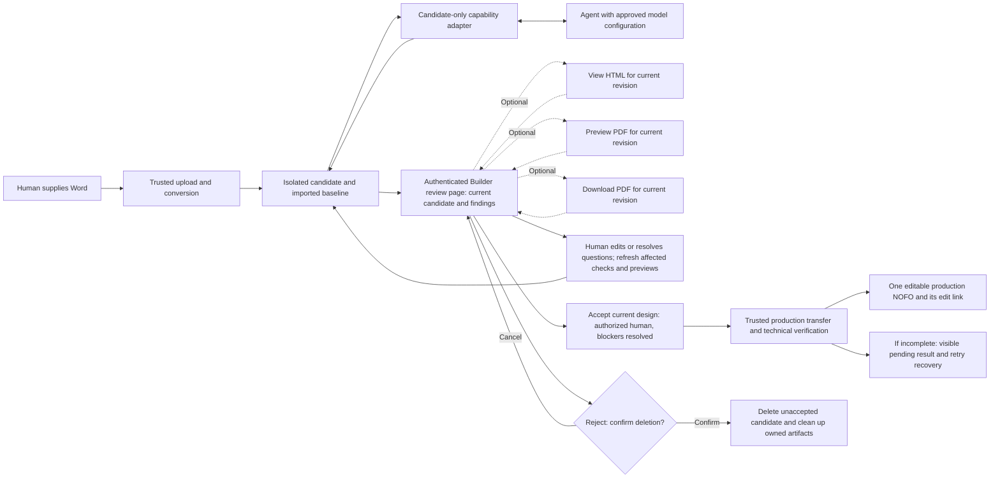

# Human-initiated design pilot boundary

Status: accepted direction for the first local synthetic proof, following Ben's
October 20, 2026 review. Runtime isolation is not yet proven. Real-data use,
shared operation and production integration remain unapproved.
Related: #902, #1145, #1146. Source inspected: main at `5fe16ad6`.

## Accepted direction for the initial synthetic proof

Start with one locally operated, isolated Builder instance using a fresh temporary
database and artifact directory. Reuse Builder's import, themes, templates and
PDF service rather than build another document renderer. Keep the agent behind
a candidate-specific capability adapter. Do not give it the operator's browser
session, shell, database credentials or production API credentials.

This is option 2 below, operated locally for the first synthetic proof, not a
proposal to provision a second shared platform. The adapter and trusted
acceptance path do not exist yet. Running the existing app alone does not
enforce the proposed agent boundary.

The synthetic launch profile must fail closed: load only explicit test settings,
not the checkout's normal `.env` files or ambient provider/AWS credentials. Do
not expose credential files, workload roles or metadata-service access to the
agent or candidate process. Deny network by default and enable only the chosen
model/render broker when needed. Existing S3 read/upload/delete and external-link
checking paths must be disabled or replaced with local owned-asset resolution.
This is required isolation work, not behavior supplied by a fresh database.

## Alternatives

| Option | Reuse and cost | Main gap | Position |
| --- | --- | --- | --- |
| Document bundle, no Builder instance | Reuses the framework-independent HTML processor; least application setup | Word conversion, defaults, model-backed rendering and editable-result mapping still need adapters | Good later portability boundary; more reconstruction for this pilot |
| Isolated Builder instance | Reuses current Word import, model-backed render context and controls | Needs candidate-only tools, restricted egress and trusted transfer of the reviewed result | Selected direction for synthetic proof |
| Restricted production draft | Existing review UI and no cross-instance transfer | Existing group access is not candidate-only isolation; drafts, logs and backups enter production before acceptance | Not recommended for the first pilot |

No option removes the need for human review, version binding or operating rules.

## Proposed data flow

All boxes describe proposed responsibilities, not deployed services. The pilot
starts when a human provides a file. AS/S3 delivery is separate under #950.
No automatic PDF return or publication is introduced. #1145 owns this maintained
workflow; #1148, #1149 and #1150 reference it for review, transfer and discard.
Dashed preview/download paths are optional user actions, served through trusted
sanitized rendering and controlled asset handling. None is a prerequisite for
the direct acceptance path from the review page.

## Minimum capability boundary

| Capability | Agent | Trusted host / human |
| --- | --- | --- |
| Read submitted candidate, findings and revision-bound previews | Yes, only current candidate | Resolves identity and checks access |
| Set theme/cover, subsection break or section table width | Only declared legal values and current revision | Validates operation and returns new revision |
| Rewrite body, dates, amounts, eligibility or policy | No autonomous write | Explicit attributable human correction only |
| Custom CSS, heading restructuring or uncertain branding | Suggest only in first slice | Human decides; rendered evidence required |
| Fetch arbitrary links or external assets | No | Explicit controlled asset acquisition only |
| Read/list unrelated NOFOs, raw SQL, arbitrary file paths or shell | No | Not exposed in agent tools |
| Accept, promote, discard, change access or publish | No | Separate authenticated human operation |

Declare legal values from current application choices, not a second hardcoded
theme list. Treat document text and model output as data, never authorization.
Candidate IDs, target IDs, operations and expected revisions must be validated
server-side even if an agent supplies syntactically valid JSON.

## Persistence, recipients and rendering

- Preserve the source bytes, converted/imported baseline, candidate revisions,
  decisions, preview digests and owned assets in the isolated run directory/DB.
  Do not point the instance at a production database or copy production data.
- Agent/model calls can transmit extracted text, page images, findings and tool
  results. Verify the actual organization account/product, retention, logging
  and data permissions before real content is sent. Repository access is not
  evidence of provider configuration or approval.
- `pdf_service.generate_nofo_pdf` submits the complete rendered HTML to
  DocRaptor. Its trusted base URL can lead to asset retrieval. Local execution
  is not local-only rendering. Use no production renderer credential for this
  investigation. A mocked PDF is not a rendered-PDF quality result.
- Use a controlled asset manifest, not arbitrary uploaded HTML resource URLs.
  Validate image, CSS and link handling before renderer egress is enabled.
  Browser review content must also be sanitized and must not execute scripts.
  Existing `get_cover_image` can try S3 before a local/external fallback, and
  settings normally load `.env` files. The synthetic proof must exercise these
  paths with egress and credential discovery blocked, not assume local assets
  or synthetic content prevent outbound requests.
- The application adapter writes a body snapshot when DEBUG is enabled. The
  pure content core does not do so by default. Disable content debug capture for
  a real-data pilot; account for exception logs, model traces, browser caches,
  temporary files, renderer retention and backups in the approved boundary.
- Do not put candidate content in telemetry or notification messages. Expiry,
  active cleanup, crash recovery and backup handling need an operating policy;
  AS exchange-copy retention does not establish candidate retention.

## Review, acceptance and discard

The Builder review page is the acceptance interface. It shows the current
candidate, agent changes, evidence and human questions, and allows corrections,
explicit acceptance or confirmed discard. Offer View HTML, Preview PDF and
Download PDF; the user chooses any combination or may accept without opening a
preview. Do not require a preview/download event or recorded PDF inspection to
enable acceptance. Resolve blocking findings before acceptance. Review links
need authentication and current document/group authorization; an unguessable
URL is not sufficient. Local proof reviewer access must be documented before use;
a shared review service is a separate operating decision.

Each review package must identify source digest, imported-baseline digest,
candidate revision, allowed design settings and owned-asset manifest. Record exact
digests and inputs for previews that have been generated; mark others not generated
rather than requiring a PDF to exist before acceptance. Bind the candidate also to
the Builder commit, templates/styles, relevant feature flags, render options and
immutable asset bytes. A stable candidate revision alone does not freeze the
generated document. Changing these inputs invalidates affected evidence and stale
acceptance requests, regardless of which optional views the human used.

The agent has no acceptance token. A separate trusted Builder operation rechecks
the human's current group authority, candidate revision and unresolved blockers.
An explicit acceptance applies to the exact current candidate, independent of
preview choice. Transfer its content, settings, assets and links exactly; simply
reimporting the original Word can lose design changes and is not acceptance.
Use a unique acceptance identity, atomic creation/linkage and retry reconciliation
so a repeat request yields the same production result. Verify the saved result
before declaring success; return its normal editable Builder link or a clear
incomplete/pending status. Do not promote the temporary SQLite database.

This ADR defines the transfer boundary and outcome. #1149 owns the transfer
format, field/asset/link mapping, validation, concurrency, partial-failure and
retry implementation. Establish a feasible transfer path before scaling the
isolated design workflow; it is not a ready-made capability of this proposal.

Destination IDs and asset URLs may be remapped; record that mapping and compare
all reviewed record fields, ordered content, design settings and asset bytes
after the transfer. Check destination rendering against the reviewed package,
including its actual flags/templates/styles. Do not require identical PDF bytes
when harmless generated metadata changes, but do not treat a content digest as
layout verification. Technical content/asset/link checks and rendering validation
remain required implementation work; engineering HTML/PDF quality checks do not
require the accepting user to open either format. If destination inputs or output
materially differ from the accepted candidate, surface the difference and require
a fresh human decision on the current version through the review page, retaining
the same optional viewing choices. An interrupted verification leaves a recoverable
pending result, not another NOFO on retry or an automatically completed design.

Discard requires human confirmation and revision/state checks. Cancel leaves the
candidate intact. Confirm removes only the unaccepted candidate and its owned
artifacts. Accepted results and unrelated documents must not be deletable through
this operation. Acceptance/discard races and partial transfer/cleanup need tests.

The existing handoff state machine is a source of transition patterns, not proof
of reviewer authentication, artifact binding or promotion. External source identity
is optional for a manually supplied file; same-version S3 replacement must not
be mistaken for immutable candidate identity.

## Evidence and next decision

Existing processing and lifecycle tests were rerun on October 20: 16 tests passed,
including the fresh-process content-core check that blocks application imports,
network and file writes. This proves that bounded core can be reused; it does
not prove that a model-equipped agent cannot escape a complete runtime.

Before #1145 can close:

1. Record the accepted local isolated-Builder direction for the synthetic proof
   and confirm implementation home, operator and reviewer access. Recommend keeping
   the initial adapter in Builder to avoid synchronizing another full fork;
   independent packaging is not required. Reopen architecture selection only
   if new evidence warrants a material change.
2. Implement the smallest synthetic candidate-only adapter proof. Include another
   candidate and test cross-candidate reads, unknown operations, stale revisions,
   document-borne instructions, path/URL escape, ambient credential discovery,
   S3/URL-check side effects and attempted acceptance. These
   must be rejected by code, not just instructions in a prompt.
3. Record actual model/renderer configuration, handling approvals, functional
   operating/support owners, resource limits and cleanup behavior before real-data
   or shared operation. No new account or service is assumed necessary; the
   applicable configuration and permissions still need verification.

Proposed initial resource scope: one document, one operator, bounded attempts and
rendering calls. Choose numeric limits from the synthetic measurement rather than
claiming an unmeasured cost or treating the AS 45 MB limit as a safe expanded-ZIP,
image, token or renderer limit.

## Reuse references

- [Shared processor](../DOCUMENT_PROCESSING.md) and
  [application adapter](../../nofos/nofos/document_processing.py).
- [PDF service](../../nofos/nofos/pdf_service.py), which retains caller-owned
  authorization and trusted base-URL responsibilities.
- [Handoff identity](../WORD_HANDOFF_IDENTITY.md) and
  [lifecycle](../WORD_HANDOFF_LIFECYCLE.md); neither is a ready-made ingress or
  promotion boundary.
- [Pilot design rules and baseline plan](../AGENT_DESIGN_PILOT.md).
- Assess `duplicate_nofo` and its tests for existing graph-copy and introductory
  section-role behavior before building transfer logic. It is not a cross-instance
  promotion API: shared asset references and its field changes need explicit
  mapping/verification, not blind reuse.
