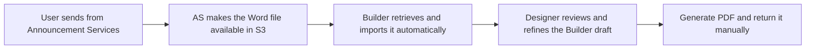
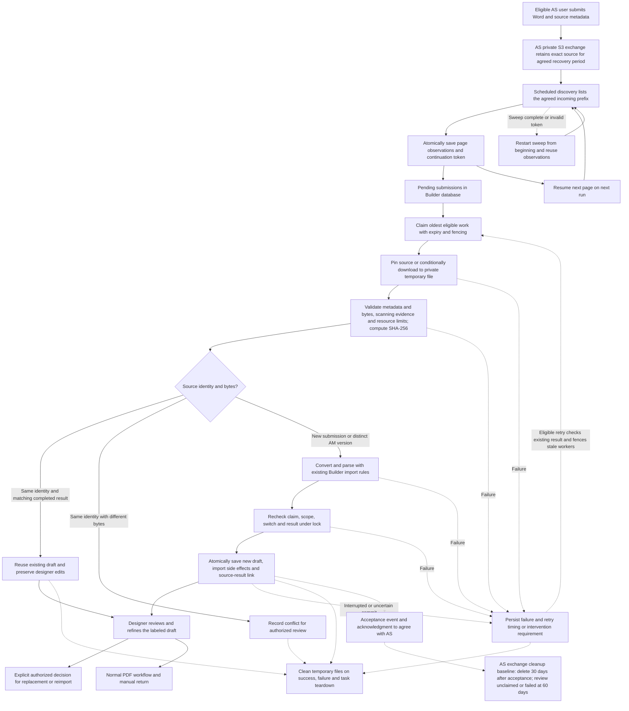

# Automated Word retrieval: proposed minimum release

**Proposal for [#1278](https://github.com/HHS/simpler-grants-pdf-builder/issues/1278),
reviewed November 4, 2026. Not implemented, approved, or scheduled for deployment.**
The [manual pilot](https://github.com/HHS/simpler-grants-pdf-builder/issues/950)
can proceed separately. [Dated findings and verification](../../review-evidence/1278/README.md)
pin the source examined and distinguish existing capabilities from this proposal.

## Flow at a glance

An eligible user sends a Word document from GrantSolutions Announcement Services. Builder retrieves it automatically and prepares an editable draft using its existing import rules. A designer reviews the imported content, completes the design and uses the normal PDF workflow.

Identical repeat submissions reuse their existing draft. Each new AS source version creates a separate labeled draft, preserving earlier design work. Replacement requires an explicit human decision. Builder removes its temporary Word copy after processing, while AS retains the exchange copy according to the agreed retention approach.

For current delivery dates, estimates and planning assumptions, see [#954’s estimate and proposed schedule](https://github.com/HHS/simpler-grants-pdf-builder/issues/954#estimate-and-proposed-schedule).

## Recommendation

Build one narrow Announcement Services (AS) S3 retrieval adapter, run as a bounded
task alongside Builder, and reuse Builder's Word conversion, content processing,
metadata inference and draft editing. Do not build another integration platform,
public upload API, permanent Word store, design agent or PDF-return service for
this release.

The agreed product approach, confirmed November 6, 2026, is automatic creation of a new source-linked Builder draft after an eligible user submits through the AS handoff. Enable only the agreed source/group cohort. Reuse the existing import rules to prepare editable content for human review and design refinement.

- Repeated delivery of the same source identity and matching file bytes returns the existing result. Preserve any subsequent designer edits.
- A distinct AM source version creates a separate draft linked to the same funding opportunity and labeled with its source version. Preserve the earlier draft and its design work. Source version labels remain opaque.
- The same source identity with different file bytes is a conflict requiring review.
- Replacing or reimporting into existing design work requires an explicit authorized human decision.

Automatic draft creation is the selected policy for the implementation estimate. The acceptance event that starts AS exchange cleanup still requires agreement with AS, including whether successful import or explicit designer acceptance supplies that event.

## Proposed flow

The diagram describes the proposed automated implementation. Discovery and import have independent bounded budgets. Database uniqueness and an atomic draft/result transaction protect concurrent retries. Distinct AM versions produce separate drafts while earlier design work remains available. File cleanup applies to every processing exit, including early validation failure. The acceptance event, acknowledgment, cleanup ownership and 60-day review-clock start require agreement with AS.

Every solid arrow is proposed integration work, not evidence that an exchange or
worker is deployed. Download is not handoff acceptance, and import is not design
completion. There is no automatic move to `processed`/`failed`, source deletion,
publication, existing-NOFO replacement, or PDF return in this minimum release.

### Trigger, runtime and permissions

Start with a bounded scheduled invocation using the existing service-module
scheduled-task pattern in the infrastructure repository. NOFO-specific scheduled
and upload-event maps are currently empty; this is reusable infrastructure code,
not an existing approved AS job. Agree a discovery interval and maximum batch
size from the actual volume and turnaround requirement. Each invocation exits;
overlap must not admit a second attempt for the same receipt.

Polling avoids a new cross-account event-delivery contract for the first release
and can discover missed work. It requires prefix-scoped listing as well as reads.
If AS permits events but not listing, use its approved event route with the same
adapter instead; do not assume cross-account delivery exists. S3 notifications
can be duplicated and out of order, so events do not remove the receipt/retry
requirement. The existing event adapter needs review before reuse: it passes
object keys into command inputs and enables execution-data logging.

Use a dedicated machine task role, not a designer's credentials or a broader web
application role. The infrastructure team owns the task, network/DB reachability,
alerts and runtime permissions; AS owns exchange policy and source availability.
Grant only agreed-prefix `ListBucket`, `GetObject` or `GetObjectVersion`, plus
scoped `kms:Decrypt` when required by the exchange encryption key. Constrain
trusted source identity and destination group in server-side configuration.
No source payload can supply an access group or choose a destination NOFO.
Writing, moving and deleting AS objects are unnecessary for this release.

Add a default-off Constance operational switch, checked at runtime before taking
new work and before committing a result. Keep credentials, fixed AWS identity,
bucket configuration and network configuration in startup/infrastructure settings.
Stopping intake must not delete or hide imported drafts or receipt history.

### Infrastructure responsibilities

These are proposed functional responsibilities. Confirm the specific owners, approval authority and handoff dates through #952 and #1302.

| Team | Responsibility |
| --- | --- |
| GrantSolutions / Announcement Services | Configure source-side S3 access, bucket permissions and encryption-key access where needed. Confirm source-file availability, version preservation and exchange retention/cleanup. |
| NOFO Builder / SGG infrastructure maintainers | Configure the scheduled task, machine identity, CPU/memory, network and database connection, private temporary storage, deployment and monitoring. Identify which changes the existing pipeline can apply and which require administrator intervention. |
| System owners / security functions | Assess authorization impact and applicable controls, determine required agreements and approvals, and identify the responsible approval authority for each system. |
| Both delivery teams | Verify cross-system access and end-to-end behavior, agree support handoffs and failure handling, and coordinate operational readiness and rollout. |

NOFO Builder deployment infrastructure is maintained in the simpler-grants-gov repository. Repository maintenance responsibility and authority to approve or apply AWS changes must be confirmed separately. Track machine-access provisioning under #1302 and authorization decisions under #952.

### Discovery progress and import scheduling

Use the existing Django/PostgreSQL database for discovery checkpoints and pending work. Each scheduled invocation has separate discovery and processing budgets. Discovery records metadata before any Word conversion starts. A failed or slow import therefore cannot consume the discovery budget of subsequent invocations.

Persist one discovery checkpoint per configured exchange prefix. Serialize checkpoint updates with an expiring database claim and fencing revision. Fetch a page outside the database transaction, then atomically upsert its object observations and save its next S3 continuation token after verifying the claim. Commit the entire page before advancing the checkpoint. A crash before commit repeats the page safely. A crash after commit resumes at the next page. Use unique observation identities and leave completed results and retry counts intact when observations repeat.

At the end of the listing, mark the sweep complete and clear its token so the next sweep begins at the prefix start. This catches arrivals whose keys sort before the saved position. If S3 rejects an invalid saved continuation token, reset that checkpoint and restart the sweep, preserving observations and import history. Authentication, permission and transient network errors retain the checkpoint and follow their respective intervention or retry paths. Record completed-sweep age and alert when discovery stops making progress.

ListObjectsV2 discovers current keys. Capture VersionId through object metadata lookup before retrieval when versioning is available, or use a conditional read against the observed object. Persist the listing observation first so metadata lookup failures remain actionable pending work. AS must retain discoverable submissions until pickup and the exact observed source through the agreed recovery window. If every overwritten historical version must be discovered, agree version-aware listing or delivery events before implementation. A current-key sweep cannot guarantee discovery of versions overwritten between sweeps.

Process eligible pending work in first-discovered order with a stable ID tie-breaker. Store next-attempt time separately. Claim each item exclusively with an expiring lease and fencing revision, and check for a completed result before downloading or importing. A failed item's backoff allows other eligible items to proceed. Repeated discovery cannot reset exhausted retries. Record SHA-256 of retrieved bytes and bind the result to that exact source. Same source identity with different bytes requires review.

Recover expired processing claims through the durable attempt record. A stale worker must fail its fencing check before the atomic draft/result transaction. Database rollback and lookup of an existing committed result make retries safe across interruption. Temporary files are cleaned up on exit, with task-storage teardown covering abrupt termination.

Verification under #954 must include multiple listing pages and more pending files than one invocation can import, completed files at the beginning of the prefix, an arrival before the current cursor, crashes on either side of checkpoint commit, an invalid token, overlapping runs, delayed retries, expired claims and stale workers. Verify eventual discovery and processing of every eligible retained submission without duplicate drafts. Validate concurrency and recovery against PostgreSQL.

### Exact source, retries and persistence

- Map FON to generic `source_record_id`; preserve the actual AM version as an
  opaque label. Do not numerically sort versions or treat arrival order as
  supersession. Keep AS source identity, S3 object version and Builder revision
  separate.
- Prefer a pinned S3 `VersionId`. Otherwise require a conditional read against
  the observed object plus a contract preventing its disappearance/overwrite
  during the retry window. Do not silently read the new current object after a
  precondition failure. Compute SHA-256 from retrieved bytes; an S3 ETag is not
  the application's payload digest. Bind validation/scanning evidence to those
  bytes, not merely the filename.
- Extend the existing immutable receipt/result model with a separate delivery
  observation and durable attempt record. Retain the tuple uniqueness and trusted
  principal checks. Same tuple/same digest resumes or returns its existing result;
  same tuple/different digest is a visible conflict, not a replacement.
- Parse outside long database locks. Use a database-backed, expiring attempt
  claim and fencing revision so a stale worker cannot commit after its claim is
  recovered. Recheck scope, switch, digest, claim and existing result under lock.
  In one transaction, persist the complete new draft, required import side effects
  and source result selection. A receipt's uniqueness alone does not prevent a
  crash between draft creation and linkage from leaving an unlinked duplicate.
- `create_nofo()` is transactional, but the entire current request workflow is
  not one outer import-and-link transaction. Factor the existing application
  persistence sequence into a reusable service rather than calling a web view
  with a fabricated request or copying only `create_nofo()`. Preserve headings,
  inferred fields, warnings, audit attribution and readability checkpoints, with
  explicit system attribution instead of pretending a human uploaded the file.
- Do not mutate frozen receipt state through a bypass. The pure lifecycle
  function is not durable coordination; integrate attempts/events through an
  explicit persistence adapter. Never treat `ReviewDecision` construction as
  human authentication.
- Retry only transient failures, with finite attempts and backoff. Validation,
  unsafe-file, identity-conflict and authorization failures need intervention.
  A later poll must not reset a terminal failure into an endless retry loop.
  After ambiguous commit failure, look up the committed result before repeating.
  Missing/expired source becomes a stable actionable failure; no hidden local
  archive exists to rescue it.

## Where the bytes live

| Copy or record | Proposed location and lifetime | Controls and recovery |
| --- | --- | --- |
| AS authoritative source and exchange Word | AS-controlled storage. Exchange copy remains the retry source until the agreed handoff/retention policy permits removal. | AS owns encryption, permissions, backups, versions and cleanup. The agreed-in-principle baseline is deletion 30 days after design-handoff acceptance and review of unclaimed/failed submissions at 60 days. Confirm acceptance recording, cleanup ownership and the start of the 60-day clock. Resolve exact pinning and availability for retries. |
| Downloaded original Word | Seekable temporary file in the single task's private ephemeral filesystem, only for that attempt. Confirm the exported Word size limit and exact units with AS before automated rollout. The previously reported 45 MB AS attachment limit is a planning input; enforce and test the agreed export boundary. Do not rely on declared length alone. | Restricted directory/file permissions, encrypted approved task storage, no shared mount, persistent volume, public URL or backup. Always close/unlink in `finally`. Task termination ends crash leftovers; verify actual task storage and cleanup configuration. This is not a secure-erasure guarantee. |
| Conversion buffers and intermediates | Process memory and the same attempt-local scratch directory, only until conversion/validation ends. | Word helpers can rebuild ZIPs and hold multiple copies in memory. Bound expanded ZIP size, entries, conversion memory/time and output size as well as compressed bytes. `DEBUG=False`; prohibit debug HTML dumps, crash payload dumps and content-bearing exception logs. |
| Imported NOFO and embedded content/assets | Existing Builder database and approved asset locations after successful transaction. Persist intentionally as draft content, not as the original Word archive. | Normal Builder access, editing, retention and backups apply. Embedded images can survive as data in imported content; inspect/test all asset paths. Any external object writes need attempt ownership plus compensating cleanup; database rollback does not delete S3 objects. Never delete shared assets as compensation. |
| Receipt, digest, attempts and result linkage | Builder database; minimal source/correlation IDs, object observation, digest, timestamps, state/error codes and result UUID. | Restricted access and approved retention. These are not automatically public or content-free simply because they are metadata. Keep raw keys/FONs out of ordinary operational logs and alerts. Existing tombstones are not a complete legal/records policy. |
| Generated PDF | None generated by the retrieval task. | A human later uses normal configured Builder PDF actions. Lower environments keep DocRaptor disabled. PDF lifecycle and automated return remain #951/#957. |

The application cannot parse Word inside S3: it must download bytes into memory
or a seekable local copy. “Use the exchange copy directly” therefore means **no
second durable Word repository**, not zero local bytes. Prefer task-local disk
over forcing a large original plus expanded conversions into RAM. If approved
AS retention cannot support retries, revisit private staging explicitly with
security/records owners; do not silently repurpose the existing image bucket.

### Exchange retention baseline and acceptance

The October 20 meeting and October 21 written follow-up record AS alignment in principle with deleting retrieved exchange copies 30 days after the design team accepts the handoff and reviewing unclaimed or failed submissions at 60 days before deciding cleanup. AS confirmed it can configure lifecycle rules. Carry these periods into implementation planning, subject to final records and operating agreement.

Agree whether successful automated import constitutes acceptance or an authorized designer explicitly accepts afterward. Record the chosen event and timestamp durably, define how AS receives the acknowledgment, assign cleanup ownership, and confirm whether the 60-day review clock starts at submission. A 60-day review requires a cleanup decision. Task-local temporary files are removed after each attempt. Preserve access to the exact source version throughout the agreed recovery period.

## Decisions required before connectivity or enablement

These are functional owners, not requests for an individual to find another owner.

| Decision / risk | Recommended handling | Responsible function |
| --- | --- | --- |
| Immutable retrieval, exact keys/metadata, FON/version correction and scan evidence | Confirm a pinned object or conditional-read contract, exact exported-byte validation and availability until recovery/acceptance. Resolve conflicting October overwrite/new-version proposals. | AS integration and Builder product functions (#888) |
| Automatic draft creation, agreed November 6 | Confirm eligible cohort and version labels in the UI. Create a separate draft for each distinct source version; preserve prior design work and require explicit human authorization for replacement. | Builder product/design operations (#954) |
| Machine identity, task/storage/data boundary, encryption and minimum permissions | Review dedicated role, private temporary disk, DB access, derived content/backups and content-free operational events. Existing app hosting is not proof this new path is approved. | Builder infrastructure/security and AS infrastructure (#952) |
| Malware/untrusted ZIP resource risk | Reuse verified approved AS scanning if evidence covers the exact exported bytes. If not adequate, agree a downstream control before parsing. Format checks alone are not malware scanning; do not invent a duplicate scanner by default. | AS security and Builder security (#952/#954) |
| Exchange/local/metadata retention and source expiry | Approve separate lifecycles; implement cleanup and recoverable failure, without a second Word bucket unless justified. | AS storage operations, Builder operations and records/security functions (#952) |
| Discovery latency, volume, support and alerts | Select bounded cadence/batch/retry budget and private alert route; alert on missed job, oldest pending age, failure rate and exhausted retries. No content/keys in workflow inputs or logs. | Builder operations with AS support (#954) |
| UAT cohort and rollout | Reconcile ACL staffed manual midpoint with HRSA end-to-end requirement; the deck's partner rollout is not Builder deployment approval. | Joint AS/Builder product and testing functions (#954), informed by #956 |

## November 9 requirements reconciliation

NB returned v2 requirements to AS on November 9 with clarifications for manual pickup and later automated retrieval/import. The revised proposal aligns with separate drafts for new source versions, duplicate reuse, human-controlled replacement, temporary-file cleanup and manual fallback reconciliation. AS agreement on the revisions remains to be recorded under #888.

The supplied document retains original result-writing/source-deletion and archive instructions alongside later qualifications about retry availability, acceptance and cleanup. Keep the current retrieval design while resolving result contents, acknowledgment, folder movement, archive meaning and corresponding permissions under #888/#952/#1302. Final contract decisions must be reflected here before implementation.

The 45 MB figure comes from an earlier AS attachment limit. Confirm its applicability to exported Word, exact units and NB handling before automated rollout. Human-download access and machine provisioning are separate milestones. #956 owns manual validation; #954/#1303 own automated integration and UAT.

## Implementation tracking and schedule

[#954](https://github.com/HHS/simpler-grants-pdf-builder/issues/954) owns the implementation backlog, current effort estimates, milestone descriptions, proposed calendar and planning assumptions. Maintain changes to those items in the epic and its child tickets. This guide maintains the technical workflow and design decisions.

- [Current work packages and dependencies](https://github.com/HHS/simpler-grants-pdf-builder/issues/954#implementation-tickets-and-sequence)
- [Current estimate, proposed schedule and IT Ops planning assumption](https://github.com/HHS/simpler-grants-pdf-builder/issues/954#estimate-and-proposed-schedule)
- [Release acceptance criteria](https://github.com/HHS/simpler-grants-pdf-builder/issues/954#acceptance-criteria)

Establish the shared tracking interface first. Retrieval and draft import can then proceed in parallel where staffing permits, while infrastructure coordination begins early. Full integration testing follows the assembled implementation and verified machine access. The epic and child tickets track progress through this sequence.

### Proposed calendar for AS coordination

Use the [milestone table in #954](https://github.com/HHS/simpler-grants-pdf-builder/issues/954#estimate-and-proposed-schedule) when discussing timing with the GrantSolutions Announcement Services team or preparing the Agile Six schedule slide. Its planning assumption records how additional requirements identified by HHS ASFR IT Ops may affect timing.

### Verification coverage

Minimum verification includes wrong-role/group rejection; malformed/oversized/
unsafe/expanded ZIP limits; changed object between observation and GET; duplicate
and concurrent delivery; same identity/different digest; skipped/out-of-order
versions; crash before/after commit; expired claim and stale worker; source expiry;
temporary cleanup on error/termination; switch-off without worker restart; human
review warnings and normal draft access; rollback to manual intake. Do not call
synthetic/offline tests proof of live IAM, malware coverage or production readiness.

## Alternatives

- **Keep manual S3 download/import:** immediate fallback, smallest operational
  change. Does not meet automatic retrieval/draft creation.
- **Events first:** useful if notification permissions and low latency are already
  available. Reuses processing but needs cross-account routing, log/input hygiene
  and reconciliation; events are not exactly-once processing.
- **Replicated durable Word bucket:** supports retries independent of AS retention,
  but adds encryption, access, backup and cleanup obligations. Avoid unless source
  availability makes it necessary.
- **New upload API or agent orchestrator:** unnecessary for S3 Word retrieval. The
  slide deck's older API/JSON drawing is not a reason to implement a second path.

AWS references: [S3 notification delivery](https://docs.aws.amazon.com/AmazonS3/latest/userguide/EventNotifications.html),
[GetObject version/conditional reads](https://docs.aws.amazon.com/AmazonS3/latest/API/API_GetObject.html),
[scheduled ECS tasks](https://docs.aws.amazon.com/AmazonECS/latest/developerguide/tasks-scheduled-eventbridge-scheduler.html).
These describe platform capabilities, not this project's deployed configuration.

## Verification baseline and rollout evidence

The spike reported 24 passing synthetic foundation tests and one PostgreSQL-only test skipped under SQLite. Run that existing PostgreSQL test early in the tracking package. Implement and pass PostgreSQL concurrency/recovery tests alongside tracking and draft import, then link results from the automated integration/UAT ticket. Passing those tests and the joint integration/UAT criteria are release requirements under #954. Accepting the spike plan completes the investigation milestone; implementation tickets establish operational evidence.
