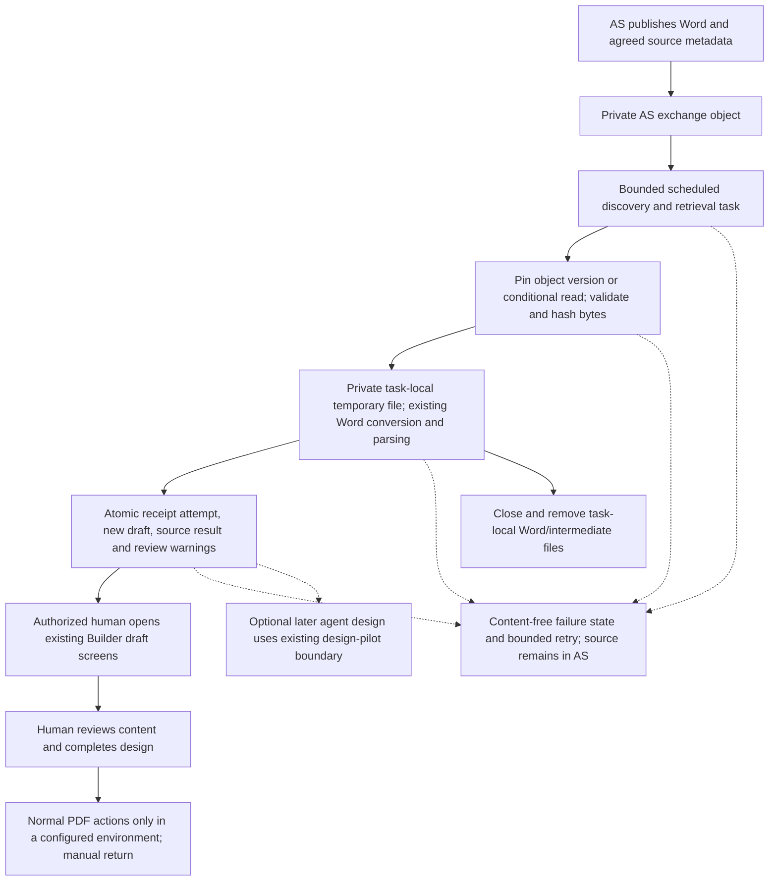

# Automated Word retrieval: proposed minimum release

**Proposal for [#1278](https://github.com/HHS/simpler-grants-pdf-builder/issues/1278),
reviewed November 4, 2026. Not implemented, approved, or scheduled for deployment.**
The [manual pilot](https://github.com/HHS/simpler-grants-pdf-builder/issues/950)
can proceed separately. [Dated findings and verification](../../review-evidence/1278/README.md)
pin the source examined and distinguish existing capabilities from this proposal.

## Recommendation

Build one narrow Announcement Services (AS) S3 retrieval adapter, run as a bounded
task alongside Builder, and reuse Builder's Word conversion, content processing,
metadata inference and draft editing. Do not build another integration platform,
public upload API, permanent Word store, design agent or PDF-return service for
this release.

The proposed outcome is a **new, source-linked draft for human review**, not a
published NOFO or an automatically replaced document. Enable only an agreed
source/group cohort. Before enabling automatic creation, the Builder product
function must confirm whether every eligible handoff should create a new draft
or require a designer's selection first. The latter uses the same retrieval and
receipt service but adds an authenticated import action; it changes the UI and
estimate. Neither policy changes the current manual pilot by implication.

## Proposed flow

Every solid arrow is proposed integration work, not evidence that an exchange or
worker is deployed. Download is not handoff acceptance, and import is not design
completion. There is no automatic move to `processed`/`failed`, source deletion,
publication, existing-NOFO replacement, or PDF return in this minimum release.

### Trigger, runtime and permissions

Start with a bounded scheduled invocation using the existing service-module
scheduled-task pattern in the infrastructure repository. NOFO-specific scheduled
and upload-event maps are currently empty; this is reusable infrastructure code,
not an existing approved AS job. Agree a discovery interval and maximum batch
size from the actual volume and turnaround requirement. Each invocation exits;
overlap must not admit a second attempt for the same receipt.

Polling avoids a new cross-account event-delivery contract for the first release
and can discover missed work. It requires prefix-scoped listing as well as reads.
If AS permits events but not listing, use its approved event route with the same
adapter instead; do not assume cross-account delivery exists. S3 notifications
can be duplicated and out of order, so events do not remove the receipt/retry
requirement. The existing event adapter needs review before reuse: it passes
object keys into command inputs and enables execution-data logging.

Use a dedicated machine task role, not a designer's credentials or a broader web
application role. The infrastructure team owns the task, network/DB reachability,
alerts and runtime permissions; AS owns exchange policy and source availability.
Grant only agreed-prefix `ListBucket`, `GetObject` or `GetObjectVersion`, plus
scoped `kms:Decrypt` when required by the exchange encryption key. Constrain
trusted source identity and destination group in server-side configuration.
No source payload can supply an access group or choose a destination NOFO.
Writing, moving and deleting AS objects are unnecessary for this release.

Add a default-off Constance operational switch, checked at runtime before taking
new work and before committing a result. Keep credentials, fixed AWS identity,
bucket configuration and network configuration in startup/infrastructure settings.
Stopping intake must not delete or hide imported drafts or receipt history.

### Exact source, retries and persistence

- Map FON to generic `source_record_id`; preserve the actual AM version as an
  opaque label. Do not numerically sort versions or treat arrival order as
  supersession. Keep AS source identity, S3 object version and Builder revision
  separate.
- Prefer a pinned S3 `VersionId`. Otherwise require a conditional read against
  the observed object plus a contract preventing its disappearance/overwrite
  during the retry window. Do not silently read the new current object after a
  precondition failure. Compute SHA-256 from retrieved bytes; an S3 ETag is not
  the application's payload digest. Bind validation/scanning evidence to those
  bytes, not merely the filename.
- Extend the existing immutable receipt/result model with a separate delivery
  observation and durable attempt record. Retain the tuple uniqueness and trusted
  principal checks. Same tuple/same digest resumes or returns its existing result;
  same tuple/different digest is a visible conflict, not a replacement.
- Parse outside long database locks. Use a database-backed, expiring attempt
  claim and fencing revision so a stale worker cannot commit after its claim is
  recovered. Recheck scope, switch, digest, claim and existing result under lock.
  In one transaction, persist the complete new draft, required import side effects
  and source result selection. A receipt's uniqueness alone does not prevent a
  crash between draft creation and linkage from leaving an unlinked duplicate.
- `create_nofo()` is transactional, but the entire current request workflow is
  not one outer import-and-link transaction. Factor the existing application
  persistence sequence into a reusable service rather than calling a web view
  with a fabricated request or copying only `create_nofo()`. Preserve headings,
  inferred fields, warnings, audit attribution and readability checkpoints, with
  explicit system attribution instead of pretending a human uploaded the file.
- Do not mutate frozen receipt state through a bypass. The pure lifecycle
  function is not durable coordination; integrate attempts/events through an
  explicit persistence adapter. Never treat `ReviewDecision` construction as
  human authentication.
- Retry only transient failures, with finite attempts and backoff. Validation,
  unsafe-file, identity-conflict and authorization failures need intervention.
  A later poll must not reset a terminal failure into an endless retry loop.
  After ambiguous commit failure, look up the committed result before repeating.
  Missing/expired source becomes a stable actionable failure; no hidden local
  archive exists to rescue it.

## Where the bytes live

| Copy or record | Proposed location and lifetime | Controls and recovery |
| --- | --- | --- |
| AS authoritative source and exchange Word | AS-controlled storage. Exchange copy remains the retry source until the agreed handoff/retention policy permits removal. | AS owns encryption, permissions, backups, versions and cleanup. Existing 30-day-after-acceptance/60-day-review ideas are proposals, not approved periods or task-local retention. Resolve exact pinning and availability first. |
| Downloaded original Word | Seekable temporary file in the single task's private ephemeral filesystem, only for that attempt. Stream with the 45 MB inbound Word limit recorded in [#950, phase one](https://github.com/HHS/simpler-grants-pdf-builder/issues/950); agree decimal/binary units and test boundaries. Do not rely on declared length alone. | Restricted directory/file permissions, encrypted approved task storage, no shared mount, persistent volume, public URL or backup. Always close/unlink in `finally`. Task termination ends crash leftovers; verify actual task storage and cleanup configuration. This is not a secure-erasure guarantee. |
| Conversion buffers and intermediates | Process memory and the same attempt-local scratch directory, only until conversion/validation ends. | Word helpers can rebuild ZIPs and hold multiple copies in memory. Bound expanded ZIP size, entries, conversion memory/time and output size as well as compressed bytes. `DEBUG=False`; prohibit debug HTML dumps, crash payload dumps and content-bearing exception logs. |
| Imported NOFO and embedded content/assets | Existing Builder database and approved asset locations after successful transaction. Persist intentionally as draft content, not as the original Word archive. | Normal Builder access, editing, retention and backups apply. Embedded images can survive as data in imported content; inspect/test all asset paths. Any external object writes need attempt ownership plus compensating cleanup; database rollback does not delete S3 objects. Never delete shared assets as compensation. |
| Receipt, digest, attempts and result linkage | Builder database; minimal source/correlation IDs, object observation, digest, timestamps, state/error codes and result UUID. | Restricted access and approved retention. These are not automatically public or content-free simply because they are metadata. Keep raw keys/FONs out of ordinary operational logs and alerts. Existing tombstones are not a complete legal/records policy. |
| Generated PDF | None generated by the retrieval task. | A human later uses normal configured Builder PDF actions. Lower environments keep DocRaptor disabled. PDF lifecycle and automated return remain #951/#957. |

The application cannot parse Word inside S3: it must download bytes into memory
or a seekable local copy. “Use the exchange copy directly” therefore means **no
second durable Word repository**, not zero local bytes. Prefer task-local disk
over forcing a 45 MB original plus expanded conversions into RAM. If approved
AS retention cannot support retries, revisit private staging explicitly with
security/records owners; do not silently repurpose the existing image bucket.

## Decisions required before connectivity or enablement

These are functional owners, not requests for an individual to find another owner.

| Decision / risk | Recommended handling | Responsible function |
| --- | --- | --- |
| Immutable retrieval, exact keys/metadata, FON/version correction and scan evidence | Confirm a pinned object or conditional-read contract, exact exported-byte validation and availability until recovery/acceptance. Resolve conflicting October overwrite/new-version proposals. | AS integration and Builder product functions (#888) |
| Automatic new draft versus human-select-first | Agree eligible cohort and how a designer chooses among versions; never overwrite current work automatically. | Builder product/design operations (#954) |
| Machine identity, task/storage/data boundary, encryption and minimum permissions | Review dedicated role, private temporary disk, DB access, derived content/backups and content-free operational events. Existing app hosting is not proof this new path is approved. | Builder infrastructure/security and AS infrastructure (#952) |
| Malware/untrusted ZIP resource risk | Reuse verified approved AS scanning if evidence covers the exact exported bytes. If not adequate, agree a downstream control before parsing. Format checks alone are not malware scanning; do not invent a duplicate scanner by default. | AS security and Builder security (#952/#954) |
| Exchange/local/metadata retention and source expiry | Approve separate lifecycles; implement cleanup and recoverable failure, without a second Word bucket unless justified. | AS storage operations, Builder operations and records/security functions (#952) |
| Discovery latency, volume, support and alerts | Select bounded cadence/batch/retry budget and private alert route; alert on missed job, oldest pending age, failure rate and exhausted retries. No content/keys in workflow inputs or logs. | Builder operations with AS support (#954) |
| UAT cohort and rollout | Reconcile ACL staffed manual midpoint with HRSA end-to-end requirement; the deck's partner rollout is not Builder deployment approval. | Joint AS/Builder product and testing functions (#956) |

## Implementation backlog and preliminary schedule

Reuse existing issues, not a parallel epic. The estimates are judgment, not
measured throughput: one experienced Builder engineer with infrastructure support,
review capacity and an available AS counterpart; low-volume pilot; unchanged Word
contract and existing manual design. **15–23 engineering days, roughly 4–6 working
weeks elapsed with review/UAT**, after the enabling contract/access is usable.
External approval, provisioning and partner availability have no reliable duration
yet and are additional, potentially overlapping lead time. Confidence: medium-low.

| Order / issue | Deliverable and acceptance boundary | Engineering effort |
| --- | --- | --- |
| 1. [#888](https://github.com/HHS/simpler-grants-pdf-builder/issues/888), [#952](https://github.com/HHS/simpler-grants-pdf-builder/issues/952) | Confirm source identity/immutability, group mapping, storage/scanning/retention and restricted machine access. Synthetic contract work can start now; actual access/approval is external. | 2–3 days Builder support, external lead time unknown |
| 2. [#953](https://github.com/HHS/simpler-grants-pdf-builder/issues/953) within [#954](https://github.com/HHS/simpler-grants-pdf-builder/issues/954) | Digest-bound observations, durable fenced attempts and atomic import/result service; tests for retries, conflicts, crashes and concurrency. Preserve immutable history. | 4–6 days |
| 3. [#954](https://github.com/HHS/simpler-grants-pdf-builder/issues/954) | Bounded retrieval/validation and task-local cleanup; reuse converter and core; new draft with review warnings/source linkage; no auto replacement or PDF. | 4–6 days |
| 4. [#954](https://github.com/HHS/simpler-grants-pdf-builder/issues/954) with infrastructure review | Dedicated task role, scheduler, default-off switch, private monitoring, kill/recovery runbook; synthetic integration and restart/cleanup tests. Can overlap step 3 after service contract. | 2–3 days |
| 5. [#956](https://github.com/HHS/simpler-grants-pdf-builder/issues/956) | AS integration tests, authorized designer UI/UAT, failure recovery, limited cohort rollout and manual fallback. Update current manual-only scope with agreed automated coverage before scheduling. | 3–5 days, plus partner calendar |
| Later. [#955](https://github.com/HHS/simpler-grants-pdf-builder/issues/955) / [#902](https://github.com/HHS/simpler-grants-pdf-builder/issues/902) | Optional agent-assisted design and trusted human acceptance. Reuse the existing design pilot; not on the retrieval/import critical path. | Separate estimate after remaining pilot work is resolved |
| Later. [#951](https://github.com/HHS/simpler-grants-pdf-builder/issues/951)/[#957](https://github.com/HHS/simpler-grants-pdf-builder/issues/957) | Automated PDF availability/return. | Outside this estimate |

**Deck-ready milestones:** contract/security and access ready → receipt/import
foundation (about week 1–2) → synthetic integrated retrieval/draft review (week 3–4)
→ partner UAT and bounded rollout (week 4–6), with manual S3 handoff retained as
fallback. These are relative planning windows, not delivery promises. February/
March 2027 is a plausible coordination target only after reconciling dependencies;
it is not committed by this spike or the November deck.

Minimum verification includes wrong-role/group rejection; malformed/oversized/
unsafe/expanded ZIP limits; changed object between observation and GET; duplicate
and concurrent delivery; same identity/different digest; skipped/out-of-order
versions; crash before/after commit; expired claim and stale worker; source expiry;
temporary cleanup on error/termination; switch-off without worker restart; human
review warnings and normal draft access; rollback to manual intake. Do not call
synthetic/offline tests proof of live IAM, malware coverage or production readiness.

## Alternatives

- **Keep manual S3 download/import:** immediate fallback, smallest operational
  change. Does not meet automatic retrieval/draft creation.
- **Events first:** useful if notification permissions and low latency are already
  available. Reuses processing but needs cross-account routing, log/input hygiene
  and reconciliation; events are not exactly-once processing.
- **Replicated durable Word bucket:** supports retries independent of AS retention,
  but adds encryption, access, backup and cleanup obligations. Avoid unless source
  availability makes it necessary.
- **New upload API or agent orchestrator:** unnecessary for S3 Word retrieval. The
  slide deck's older API/JSON drawing is not a reason to implement a second path.

AWS references: [S3 notification delivery](https://docs.aws.amazon.com/AmazonS3/latest/userguide/EventNotifications.html),
[GetObject version/conditional reads](https://docs.aws.amazon.com/AmazonS3/latest/API/API_GetObject.html),
[scheduled ECS tasks](https://docs.aws.amazon.com/AmazonECS/latest/developerguide/tasks-scheduled-eventbridge-scheduler.html).
These describe platform capabilities, not this project's deployed configuration.
