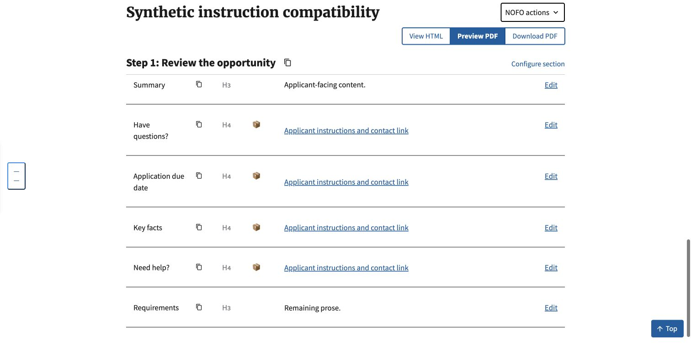
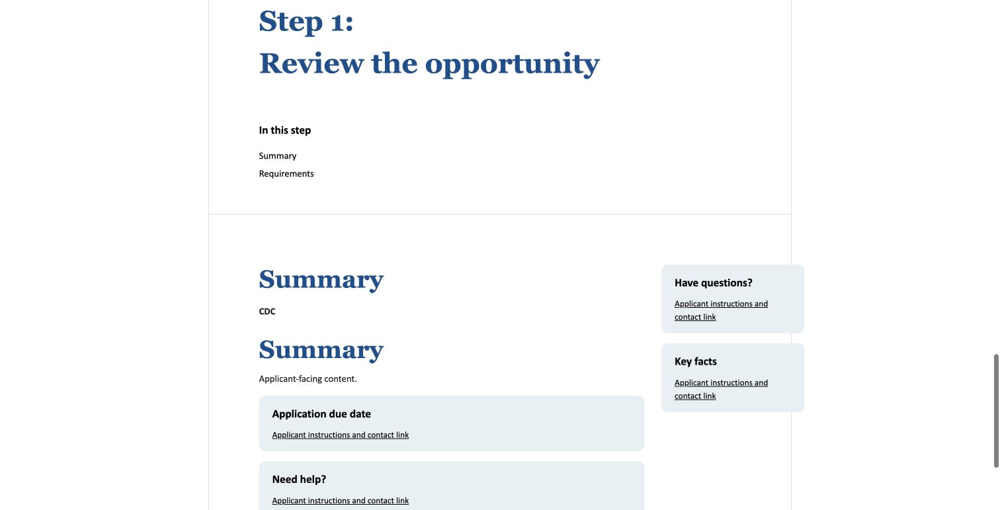
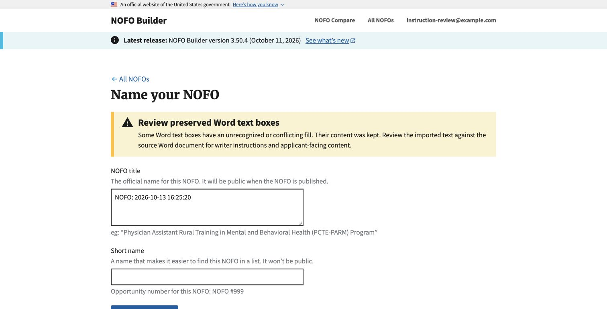

# Word instruction containers: #1089

## Plan and scope

Detect the verified pale-blue shape fill before Mammoth discards boundaries and
formatting. Use the existing table-cleanup and callout pipeline afterward. No
new template classification, date gate, schema or record-cleanup job is needed.
Composer and Compare opt out of shape cleanup; their current conversion and
Composer's instruction-table reattachment remain unchanged.

Fixtures are generated synthetic DOCX packages using the repository's existing
test package. Private master/agency documents are not committed or attached.

## Supplied master checks

In-memory inspection on October 13, 2026:

- August 11 master: 78 logical boxes (156 compatibility copies) removed; all 18
  tables outside text boxes unchanged.
- Newly supplied October 5 draft: 83 logical boxes (166 compatibility copies)
  removed; all 17 tables outside text boxes unchanged. No unknown-fill warnings.
- The October 5 file supplied for this run has three nonempty one-cell content
  tables: Application due date, Key facts and Need help?, plus an empty table.
  These three survive Word-to-HTML conversion, including their two links.
  Have questions? is absent from this source, unlike the earlier issue inventory.
  Synthetic tests cover all four requested callouts; do not claim a fourth
  callout was verified against this file.

The full master still contains alternative Step 3 headings. This work verifies
container cleanup, not successful end-to-end import of an unselected master.

## Verification coverage

Final local checks at code commit `7b5488ea`: 2,459 Django tests succeeded with three skips; all 56
JavaScript tests passed; all 26 focused instruction-container tests passed.
No migration changes; touched-file pre-commit and whitespace checks passed.
The warning matches the existing alert typography (Source Sans Pro Bold,
23.36 px/700) and was visually checked at desktop and 390 px widths. This is
not an accessibility certification. Local code review checked removal scope,
namespace preservation, entity rejection, fallback handling and rollback.

## Independent review fixes

Astra independently reviewed the implementation and reproduced preservation
edge cases. Corrections cover OOXML tint direction, accent/hyperlink color
mappings, unsupported theme-level transforms, independent grouped boxes,
source Word prefixes, DrawingML-only compatibility fallbacks, and inherited
namespace bindings. Ben also reproduced tooltip-only compatibility differences;
these now retain one logical box without weakening link destination comparison.
Each reproduced case has regression coverage. No source document was modified.
Astra's final independent follow-up at `7b5488ea` found no remaining blockers
within the reviewed scope and independently passed all 26 focused tests.

Tests cover DrawingML theme mappings and direct colors, luminance, tint/shade,
VML, paired compatibility representations, surrounding bookmarks/text, white,
unfilled and transparent content, unknown/conflicting fills, unchanged older
instruction tables, four content callouts and links, both import formats, all
four re-import transitions, failed/status-blocked re-imports, untouched saved
records on view, and Composer's existing instruction reattachment.

Unknown patterns are retained and produce a non-dismissed review alert on the
new-import naming page or re-import editor. They are not silently treated as
writer instructions. Retained modern text is supplied to Mammoth where it would
otherwise ignore DrawingML; this does not promise shape-layout fidelity.

Chrome verification used only a disposable local database and synthetic files:
new-format upload, naming, saved editor, older-format replacement through the
Re-import action, and rendered HTML. All four callouts and their links remained;
writer instructions were absent. A separate unknown-fill upload displayed the
review alert and retained its text. Normal strict-formatting checks still apply;
this change does not bypass them. No production credentials or real NOFOs were used.

## Remaining boundaries

- The exact pale-blue pattern is evidence for the supplied masters, not a
  universal agency-template guarantee. Other colors require review.
- Duplicate Step 3 alternatives remain. This cleanup does not choose content or
  fix the separate duplicate-heading failure.
- No production deployment or production import was performed. Production
  validation remains pending; the issue must not be considered fully verified
  solely because automated tests or a local import passed.
- The merge decision remains with the human reviewer.

## Post-deployment production procedure

1. Record the deployed version and commit. Use designated draft test records,
   never an active user's NOFO. Record the structure of each source document.
2. Import an older document containing recognized writer-instruction tables and
   intended callouts. Inspect the saved subsections and editor, then rendered
   HTML/PDF preview: instructions absent, callout text, links and classification
   retained. Upload success alone is not sufficient.
3. Repeat with the new text-box structure. Compare removed/preserved containers
   with the source; review any unknown-fill warning rather than ignoring it.
4. Re-import designated drafts with new and older replacement structures.
   Confirm normal identity, metadata and status behavior. Test a rejected
   replacement and confirm the prior record is unchanged.
5. Check unrelated pre-existing records for unchanged bodies and rendered output.
   Record expected/actual content and any limitations. Leave validation pending
   if production access or deployment has not happened.
