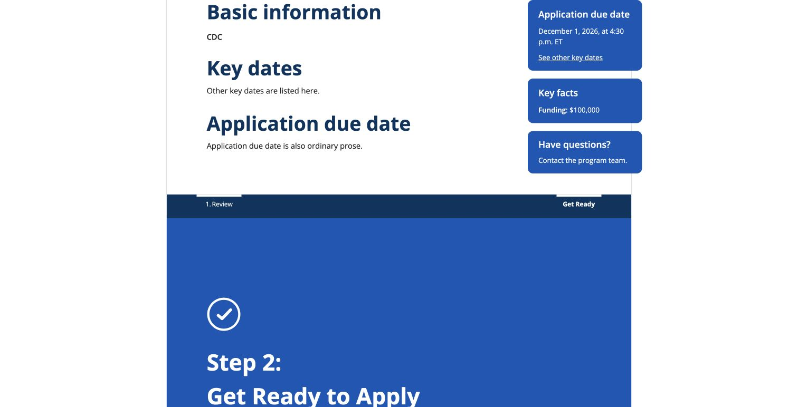
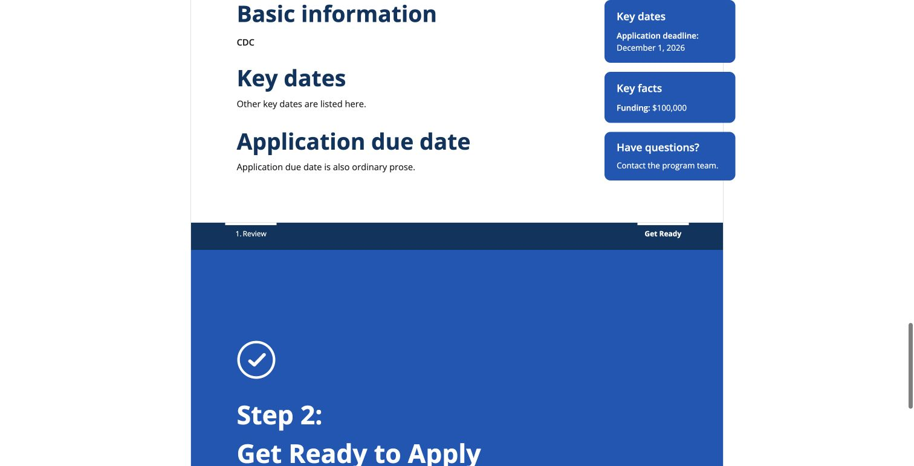

# Deadline sidebar compatibility

## Scope and design

Reuse IMPORT-024/IMPORT-025 for single-cell tables and the existing first-section
portrait sidebar. Add Application due date alongside legacy Key dates; keep the
source's deadline title, date and link rather than synthesizing or renaming boxes.
Ordinary headings/prose are not callouts. No migration, backfill, template flag,
date gate, new dependencies, CSS change or content-selection flow is introduced.
If both deadline callouts are supplied, both retain normal source ordering.

The supplied October 5 master's deadline container was inspected read-only: one
row, one cell, Heading 4 title. No private source content is committed. Generated
Word fixtures exercise the same one-cell structure through normal import routes.

## Local verification

October 13, 2026, code commit `6ba6a1f1`:

- Full Django suite: 2,438 tests, three skips, successful.
- Five focused workflow tests cover case/spacing, normal headings/prose, saved
  fields, internal-link targets, both formats, all four re-import transitions,
  both supplied deadline boxes, edited title variants and unchanged saved bodies.
- HTML and PDF-template assertions check the actual right-column markup, not
  just the callout flag. Legacy bold labels and line breaks are verified; the
  new simple time is not interpreted as a colon-based label/value paragraph.
- No migration changes; touched-file formatting/pre-commit checks pass.
- Astra independently reviewed the code, reproduced an edited-title formatting
  issue, and verified the shared-predicate fix. Final follow-up found no remaining
  actionable findings; 236 workflow/template-tag tests passed independently.

Chrome used synthetic files and a disposable local database, not shared records:
upload new Word, name/save record, inspect sidebar, follow See other key dates,
then replace that draft with legacy Word using the normal Re-import action.
The link reached the ordinary Key dates heading; both sidebar versions retained
Key facts and Have questions?. Record: `2578c900-825b-4a2e-a952-94891dab2420`,
CDC portrait default, text-only cover, no custom CSS.

## Release check still required

Local verification includes rendered HTML and the shared PDF-generation template,
not a generated DocRaptor PDF: this isolated environment has no PDF-provider key.
Do not treat screenshots as production PDF verification or accessibility approval.

After deployment, record the deployed revision and use designated draft records:

1. Import a new one-cell Application due date box with its date and See other key
   dates link. Inspect saved fields, HTML and the regenerated PDF sidebar beside
   Basic information. Follow the link and verify its ordinary content target.
2. Import legacy Key dates; verify its existing sidebar, bold labels and line
   breaks in HTML and regenerated PDF. Do not replace an active user's record.
3. Re-import test drafts across formats; verify supplied titles/content and
   normal identity/metadata behavior. Do not create a second box automatically.
4. Verify an unrelated existing legacy record without editing its saved body.
   Record results and any limitations before marking #1091 fully validated.

Instruction-box removal (#1089), Step 3 selection and final-template clearance
remain separate work. #801 is superseded by #1091; coordinate compatibility with
#811 without introducing another template-classification mechanism.
