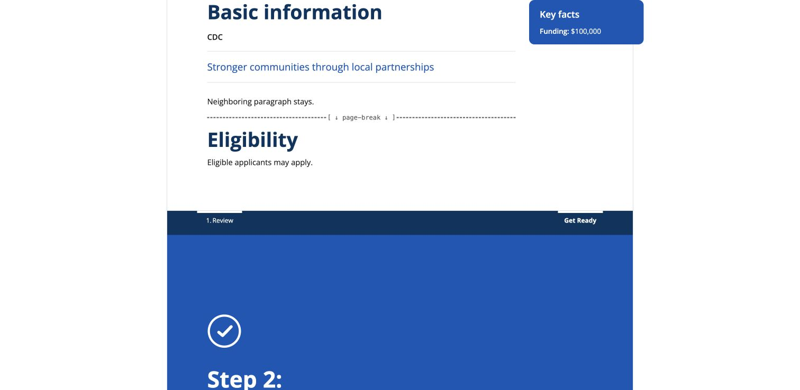
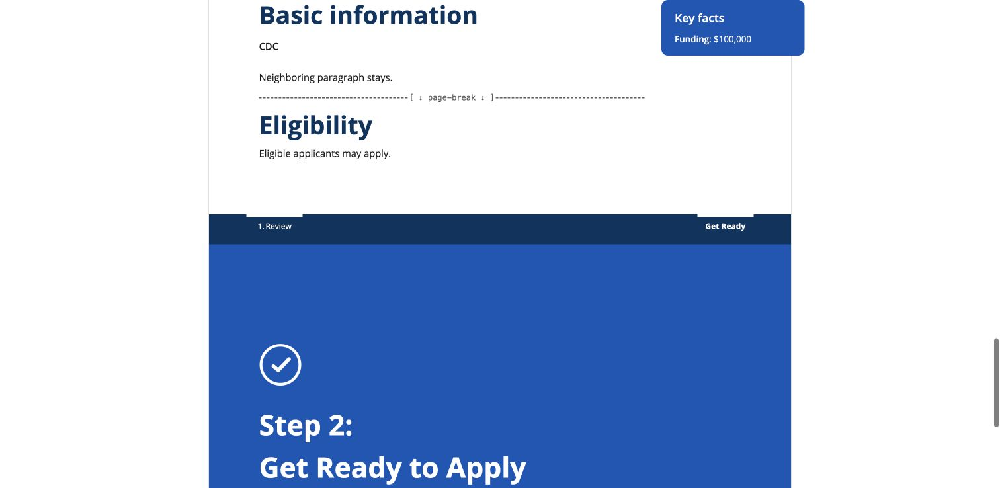

# Scoped tagline import verification

## Design and boundaries

Reuse the optional Tagline field, editing UI, Markdown representation and import
normalization. Match the actual heading hierarchy: Step 1: Review the Opportunity
→ Basic information → Tagline. Choose only the immediately following paragraph.
Present-but-blank takes precedence over legacy `Tagline:`; missing new heading
retains the legacy scanner and underscore-only blank handling.

Builder-only staging preserves empty Word paragraphs until the source decision.
The selected paragraph stays through normal link repairs, then is consumed.
Sectioning consumes the marked source heading but retains a nameless boundary
when neighboring body content remains; it drops that boundary when empty.
Extracted links reuse the normal heading-ID mapping; links to the consumed heading
reach Basic information, including blank-source cases. Internal source markers
are cleared from uploads before Builder adds them. Composer and Compare do not
opt in. No migration, backfill, field validation, alert or render-time cleanup.

Re-import continues the existing incoming-document metadata contract: tagline
can be replaced or cleared; manual edits are not preserved. Theme/cover/identity,
authorization, status restrictions and rollback remain intact. Number confirmation
carries the explicit source value and an intact soup, avoiding callout loss when
the source is parsed again.

## Verification

- Fifteen focused tests cover structural scope, case/spacing, empty/missing
  values, paragraph/heading/table/list boundaries, punctuation, placeholder
  preservation, neighbors and callouts, legacy underscores, blank precedence,
  all four re-import transitions, number confirmation, rollback/status blocking,
  editing, saved-record stability, actual Composer/Compare import routes and
  incoming/outgoing internal links.
- HTML and the shared PDF-generation template are checked for duplicate/empty
  headings, dedicated field presentation and visible neighboring content.
- Independent Astra review reproduced content-boundary and link problems; fixes
  have regression coverage. Clean final follow-up at `2d099ba8`: 720 scoped,
  core parsing and import tests passed independently.
- No migration changes; touched-file formatting and pre-commit checks passed.
- Final full Django suite at reviewed code `2d099ba8`: 2,448 tests, three skips, successful.

## Chrome trial

October 13, 2026: local disposable database, synthetic Word fixtures, record
`e379f098-e047-427c-913d-124a92df1721`, CDC portrait default/text-only cover.
No source master or private content was uploaded or attached.

1. Imported new-source Word; saved value appeared in the existing Tagline row,
   without an editable Tagline subsection.
2. Edited and saved through the existing Tagline form without a final period.
3. Inspected dedicated rendered tagline, visible neighboring paragraph and
   intact Key facts callout.
4. Re-imported legacy Word; the field changed to its supplied legacy value.
5. Re-imported blank new-source Word; the field cleared, with no empty public
   tagline block or source heading and with neighboring content still visible.

## Release boundary

These screenshots verify local HTML. PDF-template tests are not a generated
DocRaptor PDF check; this isolated environment has no provider key. No deployment
or production record mutation was performed, and no accessibility approval is
claimed. After deployment, use designated new/legacy draft records to verify the
saved field, editability, absence of duplicate/empty headings, preserved neighbors
and links in HTML and regenerated PDFs. Confirm blank-source re-import and record
the deployed revision and results. Final-template clearance remains separate.

Durable behavior: [IMPORT-041/IMPORT-059](../../IMPORT_RULES.md#import-059--scoped-basic-information-tagline-extraction)
and [Tagline import and editing](../../TAGLINE_IMPORT.md).
