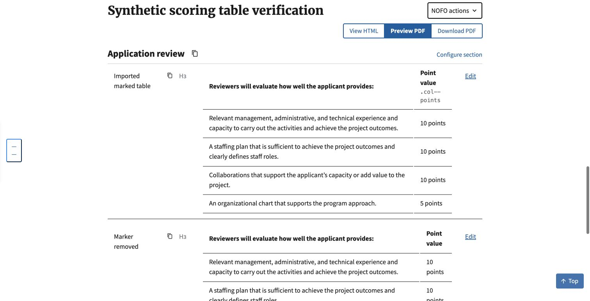

# Marked scoring-table editor styling (#1139)

## Scope

Points-column detection still runs only during import/re-import (IMPORT-054).
Rendering copies an existing header marker to short points body cells; it does
not detect unmarked columns or rewrite saved content. Removing the marker turns
styling off. An explicit width class wins. Long text and spanned tables retain
the existing safeguards. The import/render helper is unchanged from the PR base.

The only production change is the shared editor stylesheet: shrink already-marked
cells to fit and keep marked body values together, matching the existing PDF CSS.
This is related to #1138, not a fix for every unmarked existing or pasted table.

## Local browser verification

October 20, 2026. Actual authenticated local Builder, Chrome, isolated SQLite
with synthetic records only. The marked table was created with the existing
HTML-to-Markdown import converter using the wording reported in #1138. The
same table was saved separately with its marker removed and with a width override.
This tests the converter and real saved-content editor, not a full Word-upload
or production-record reproduction.

Before capture temporarily omitted only the new CSS block; the marker-only
render helper and all content were identical. The CSS was restored before the
after capture and final tests. No source PDF or production converter was used.

| Case in the NOFO edit-page content preview | Before | After |
| --- | --- | --- |
| Marked body values | normal wrapping | nowrap; all four values on one line |
| Marker removed | normal wrapping, no points classes | unchanged |
| Explicit w-25 override | normal wrapping, no points classes | unchanged |
| Nested table width | 642.08px | 642.08px |

The header may wrap, including Builder's existing visible class label. This
change keeps body values together; it does not hide editor annotations.

## Limits

Martor's live subsection Preview tab does not call the saved-content table-class
filter, so it does not copy the header marker to body cells. Its header receives
the new width rule, but body nowrap is not guaranteed there. That existing
pipeline difference is not broadened in this CSS-only fix. PDF generation was
not exercised; its stylesheet and rendering behavior are unchanged.

The original `editor-before.png` and `editor-after.png` are historical standalone
fixtures from the withdrawn render-time-detection proposal. They are superseded
by the real Builder screenshots above and are not evidence for the final scope.

## Automated verification

320 template-tag and HTML-to-Markdown tests passed. A new regression runs the
reported table through import conversion, verifies the marker and rendered body
classes, removes the marker, and verifies that repeated rendering leaves it off
without calling the detector. Existing tests cover unmarked content, explicit
widths, long text, empty cells and merged cells.
