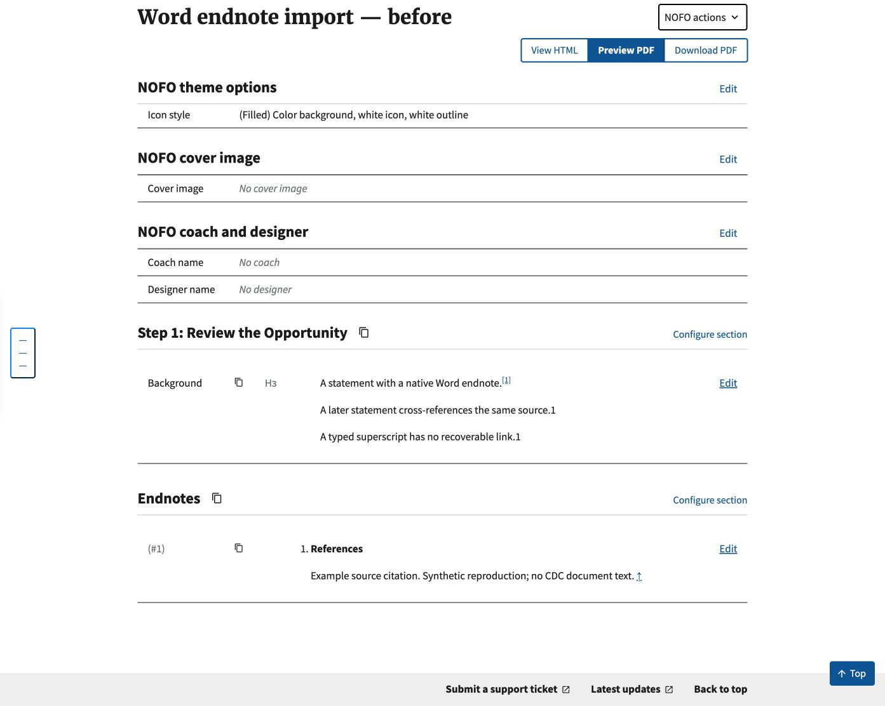
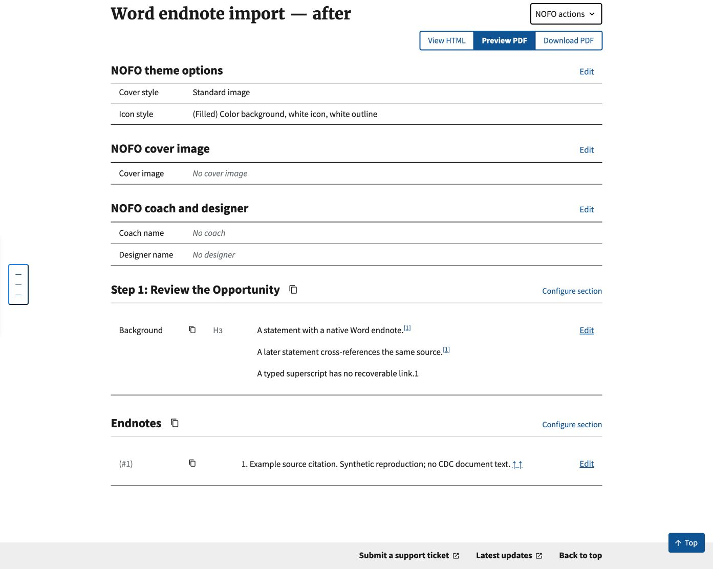

# CDC Word endnote import feedback

Source: CDC email feedback relayed by the requester. The document was authored
in Microsoft Word, not exported from GrantSolutions Announcement Module. The
original email, Word attachment, and production record are not included here.

## Before and after

These screenshots show actual Builder editor HTML rendered by Django's test
client from an isolated local SQLite database, displayed in Chrome using the
repository's static assets. Both records import the same synthetic Word file:
one native endnote, one explicit complex NOTEREF cross-reference to that note,
a typed superscript, and a bold References paragraph inside the first note.
The source contains only demonstration text, not CDC document content.

The before conversion disables the new DOCX preprocessing and uses the actual
upstream/main `process_nofo_html` and `add_endnotes_header_if_exists` functions.
The after conversion uses this PR. Both go through Mammoth, sectioning, Markdown
storage, and the real Builder editor template. They are local snapshots, not
production screenshots or a production import/reimport.

- Before: the later reference is a plain `1`, References sits inside citation 1,
  and the citation has one return arrow.
- After: the later reference is linked as `[1]`, the title is outside the citation
  as the synthesized Endnotes heading, and the citation has two return arrows.
- The typed superscript is not inferred to be a link in either result.

## Scope and checks

IMPORT-076 preserves supported explicit Word cross-references; IMPORT-072 repairs
unambiguous repeated native IDs and adds individual return links; IMPORT-073
extracts a standalone title from the first native note. Distinct accessible names are restored for the repeated citation return arrows
after Markdown sanitization. Existing stored records are not mutated on view. Manual bracketed repeats still require correction.

Tests cover simple/complex fields, split instructions, stale cached numbers,
missing/ambiguous bookmarks, unsupported/nested/incomplete fields, drawings in
field control runs, repeated native
HTML links, ID/label/target conflicts, mixed native/manual numbering, source-byte
preservation, Markdown storage, and all shared import consumers.

The requester's real attachment was inspected locally: its native notes already
imported, while its Word NOTEREF relationship needed recovery. Previously
observed duplicate IDs in saved production content differ from the fresh import;
the available evidence does not establish how those IDs were introduced.

Screenshots establish local HTML behavior only. Deployed DocRaptor PDF link
navigation and tagged-PDF accessibility remain release-verification tasks.
