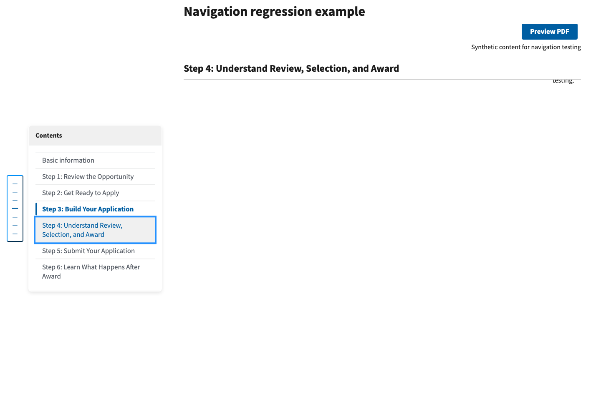
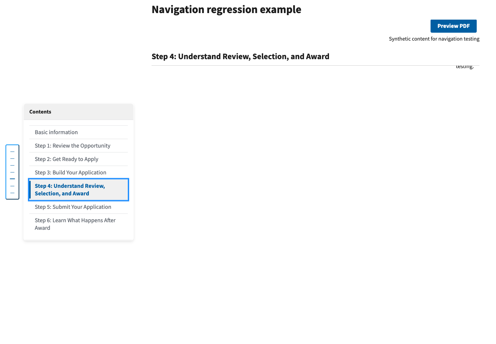

# Contents active-section highlighting — issue #1217

Captured October 26, 2026 in local headless Chrome at 1440 × 1000.
Both images use the same invented section tables, the real shared Contents
component, and Builder's bundled USWDS/shared/page styles, local fonts, and
edit-page toolbar offset script. These are synthetic component reproductions,
not captures of a deployed NOFO or verification of a PDF.

The baseline is upstream `main` at
`b3e23b2f33515fe28482108cff9a2016f9a88ca6`. After each click the capture waits
2.2 seconds for the long smooth scroll and debounced active-state update.

## Before

Step 4 retains focus, but Step 3 has the bold blue current-section decoration
and active pipe indicator.



## After

Step 4 retains focus and has both active-section indicators after scrolling.
The script asserts the focused, active-link, and active-pipe IDs in both states.



## Reproduce

With Playwright available to Node and `PYTHON` pointing to a Django environment:

```sh
PYTHON=/path/to/python node tests/js/side_navigation.browser.cjs
```

The baseline reference is pinned in the capture script; `BEFORE_REF` overrides it.
The script also verifies an Enter-key jump to the next section and a manual scroll
back above all sections. Automated unit coverage verifies sticky headings,
manual scrolling in both directions, restored scroll position, fractional
scroll rounding, immediate link/pipe synchronization, and mobile close behavior.

## Validation and limits

- All 61 JavaScript unit tests pass, including four new navigation regressions.
- Chrome confirms the before/after mismatch, keyboard jump, and manual scroll reset.
- `git diff --check` passes.
- `make test` on this upstream base stops before executing its 2,845 discovered
  tests: conflicting `nofos` migration leaves `0154_design_pilot_candidate` and
  `0155_backfill_document_audit_index`. This PR does not modify migrations.
- Repository-wide formatting checks also find existing upstream failures:
  isort flags `test_policy_language.py`; Black flags `policy_language.py`,
  `test_metrics.py`, and `test_policy_language.py`. These files are unchanged.
- `EDITOR_TASKS.md`, especially `TASK-SUBSECTION-EDIT`, was reviewed. No instruction
  change is needed: the same Contents links and section-jump steps remain in use;
  this fix corrects the active decoration without changing the user's actions.
- No production, PDF-generation, or full accessibility-compliance claim is made.
