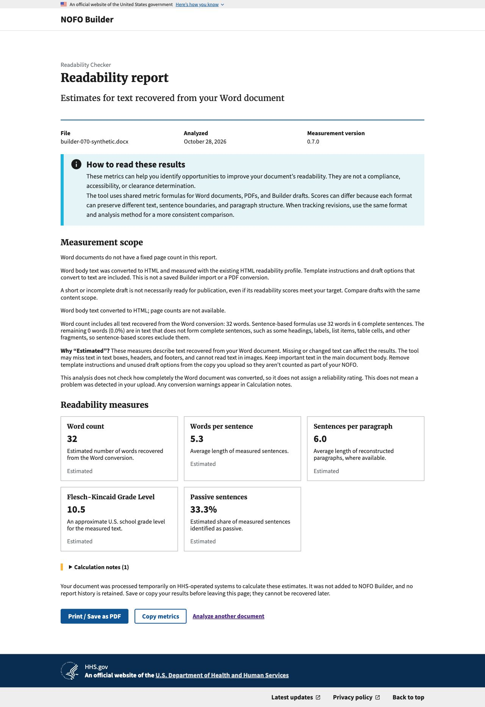
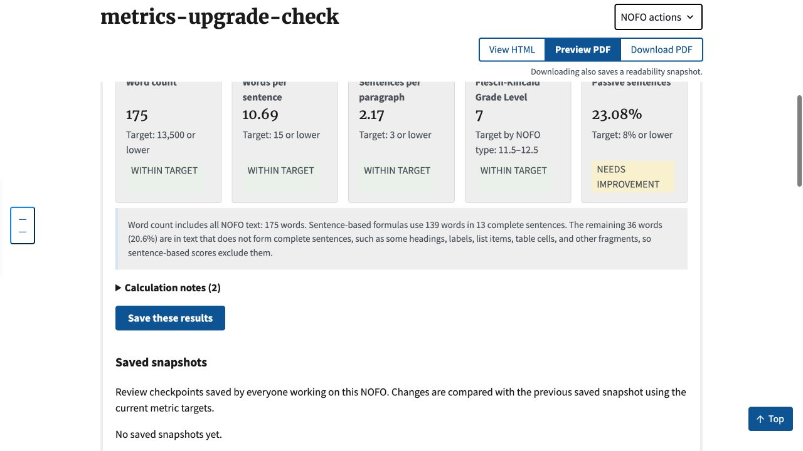

# Readability metrics 0.7.0 upgrade validation

Date: October 28, 2026. Related: [Builder #1231](https://github.com/HHS/simpler-grants-pdf-builder/issues/1231).
This is consumer-upgrade evidence using invented text, not a real-NOFO cohort or
Microsoft Word parity evaluation. Current behavior and rollback guidance live in
[Readability metrics](../../readability/READABILITY_METRICS.md#measurement-version-070).

## Package and selected contracts

The dependency and lockfile pin the published 0.7.0 wheel with SHA-256
`12b7af8292552096e05dceb7911981b93ec4eb5bc6120a7622befea646ab7966`.

| Application path | Profile | Other identity |
| --- | --- | --- |
| Saved Builder panel and checkpoints | HTML 0.6.0 | Reader input contract stays reader-content-v4 |
| Authenticated Word upload | HTML 0.6.0 | Same semantic profile as Builder |
| Tagged PDF upload | Tagged estimate 0.7.0 | Support inspection adapter 0.1.8 |
| Untagged PDF upload | Generic estimate 0.6.0 | Existing generic path retained |

These profiles select passive method 0.5.0-provisional. Selection is automatic;
users have no profile selector. Existing feature and permission controls remain.
Historical results keep their versions; no data migration is introduced.

Package 0.7.0 also contains a bounded nested-table extraction repair. Other
metric values can change when PDF extraction scope changes. For a fixed resolved
inventory, this passive-method change preserves denominators and other metrics.
The broader real-document package gate was explicitly deferred, not passed;
see the [published release](https://github.com/agilesix/hhs-nofo-metrics/releases/tag/v0.7.0).

## Automated checks

- Full Django suite: 2,916 tests, passed with 3 existing skips.
- Focused readability/authenticated-upload suite: 111 tests passed.
- JavaScript suite: 61 tests passed.
- Poetry dependency/lock consistency and changed-file pre-commit checks passed.
- Existing adapter-pin test verifies inspection uses the adapter actually shipped.
- New Word fixture retains six sentences, including two identifier sentences;
  passive matches change from three to two. Finite passives remain recognized.
- New tagged/generic PDF fixtures each retain four body sentences; matches change
  from three to two. Worker reports 0.7.0 and other metric values are unchanged.
- The saved Builder test uses its actual rendered export. Exactly one controlled
  modifier match disappears; standard applicant text and other passive clauses
  remain. Sentence denominators and other metric values are unchanged.

Full-repository `make lint` reports pre-existing formatting in unchanged
`nofos/nofos/policy_language.py`, `nofos/nofos/tests_nofos/test_metrics.py` and
`nofos/nofos/tests_nofos/test_policy_language.py` (the latter also has an import
order issue). Those files are not modified here. Changed Python files pass Black,
isort and pre-commit. This limitation is not described as a full-tree lint pass.

## Running application checks

An isolated local application was migrated and started with invented NOFO text
and a local-only test account. No production credentials or real NOFOs were used.
Browser actions verified sign-in, the edit panel and actual Word-upload/report
flow, including the completion dialog.

- Saved Builder panel calculated successfully: 175 total words, 139 sentence-scope
  words, 13 sentences and 23.08% passive. Its scope includes standard applicant
  text in addition to the four controlled sentences, so these are not the upload
  fixture's expected counts.
- The uploaded invented DOCX produced measurement version 0.7.0, 32 words,
  six accepted sentences and 33.3% passive (two of six).
- These checks establish local integration, not deployment or authenticated
  verification in a hosted environment. No external Word/PDF export provider
  was invoked.

## Deployment handoff

The user will perform Builder deployments. No deployment workflow was dispatched
for this upgrade during the local validation.

After review, green PR CI and squash merge, use the exact resulting **Builder
merge commit**, rather than an arbitrary moving `main` reference:

1. Open [Deploy NOFOs](https://github.com/HHS/simpler-grants-gov/actions/workflows/cd-nofos.yml).
2. Run for `dev`, supplying the Builder merge commit as `version`. Let tests,
   image builds, vulnerability scans, migrations and deployment finish.
3. Check `/health`; sign in to the authenticated checker and upload an authorized
   test DOCX. Confirm **Measurement version 0.7.0** and expected passive behavior.
   Test tagged/untagged PDF uploads and a fresh saved-Builder calculation as well.
   Check history retains earlier results. Use the same format/version for score
   comparisons. The site footer's Builder release number is a different version.
4. Run the workflow for `prod` with the **same verified Builder commit**, subject
   to the documented access requirements. Repeat the version and smoke checks.

Last observed successful production and development deployment:
`be2d551e3a6527447c6c5ddc7b1f3f514e0388ce`.
[Production run](https://github.com/HHS/simpler-grants-gov/actions/runs/40563052475),
[development run](https://github.com/HHS/simpler-grants-gov/actions/runs/40559130095).
Recheck the baseline before deployment; another deploy can supersede it.
The candidate also includes already-merged footer change #1241 and documentation
updates since that baseline. There are no new database migrations in this upgrade.

Rollback by redeploying the previous verified Builder commit, restoring package,
profiles and adapter pins together. Do not mutate stored historical results.
