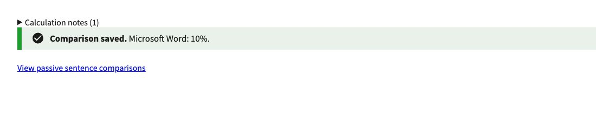
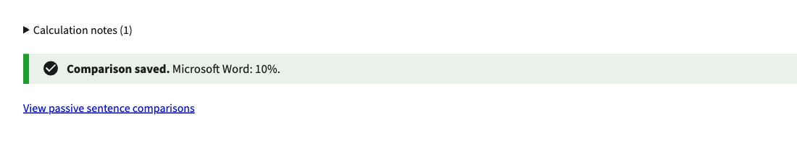

# Comparison confirmation spacing

Evidence for [PR #1253](https://github.com/HHS/simpler-grants-pdf-builder/pull/1253),
a spacing-only follow-up to #1249. The owning pattern is
[inline form feedback](../../UI_PATTERNS.md#form-save-feedback).

These matching Chrome screenshots show an isolated component preview, not the
full application. The saved feedback was rendered with the real Django template,
synthetic message data and the repository USWDS stylesheet, below a Calculation
notes disclosure. The before preview omits the new margin utility; the after
preview includes it. Both use the same 1100 × 220 CSS-pixel crop.

Measured gap between the disclosure and success alert: 0px before, 24px after.
No real documents, accounts or credentials were used.

## Before

## After

Validation: 11 existing Django comparison tests and 6 JavaScript comparison tests
passed for the implementation. This evidence-only follow-up does not change code.
Editor instructions are unchanged.
