# Two-column Contents: second prototype

November 2, 2026. Follow-up to [the comparison](README.md) and
[the review on #1264](https://github.com/HHS/simpler-grants-pdf-builder/pull/1264#issuecomment-6585960991).
Related to [#1263](https://github.com/HHS/simpler-grants-pdf-builder/issues/1263).
**The November 2–3 sections below describe prototypes only.**

## Builder integration check, November 6

Ben approved the [third prototype](https://github.com/HHS/simpler-grants-pdf-builder/pull/1268).
The implementation retains the current Contents list and applies print styles
only to generated portrait PDFs in the `get_started` import family, when
the flag is on. The editor can choose a single column per NOFO in **NOFO theme
options**. This is an explicit choice, not a prediction of how many pages will
fit. See [preview steps and rollout](../../EDITOR_TASKS.md#task-preview).

The integration check used Builder's actual PDF template, a synthetic record
in a local database, the full Builder text-only cover and the IHS theme. The
check submitted only invented text and repository assets to DocRaptor's public
test mode (pipeline 11, Prince 15.1, PDF/UA-1). Static styles and local fonts
were inlined for the test renderer, rather than using production assets or
credentials. The cover is page 1 in each PDF.

| Synthetic case | Contents pages | Verified links and printed counters |
| --- | --- | ---: |
| FY27 shape, switch off | 2–3 | 29 |
| Same FY27 shape, two columns | 2 | 29 |
| Oversized Step 3, single column | 2–5 | 62 |
| Sparse prior-year shape, switch on | 2 | 15 |

The link labels and tag order match the source list, each link reaches its
own target, and the printed counters match their destination pages. The
first two-column step headings align; the introduction spans the list and
its page number aligns with the left column. The fallback puts the existing
Contents heading in the first page footer even after a cover. Continuation
footers name the first step represented on the page and are marked as artifacts.
The original list retains a TOCI for each entry.

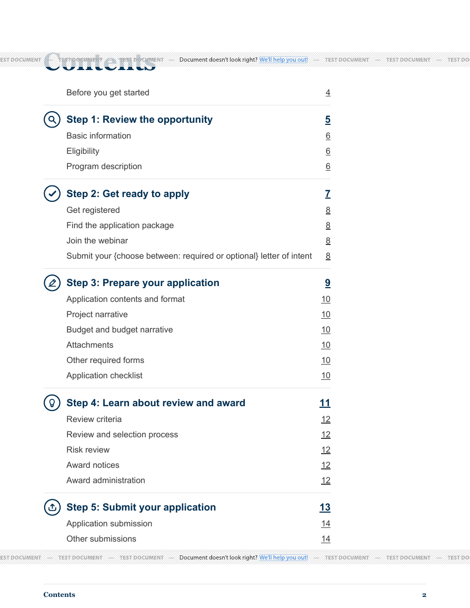

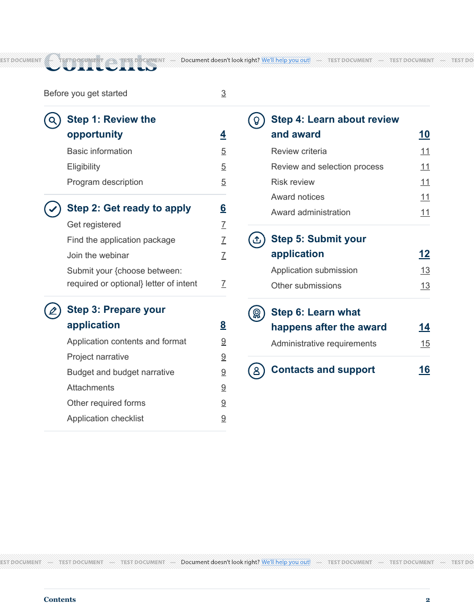

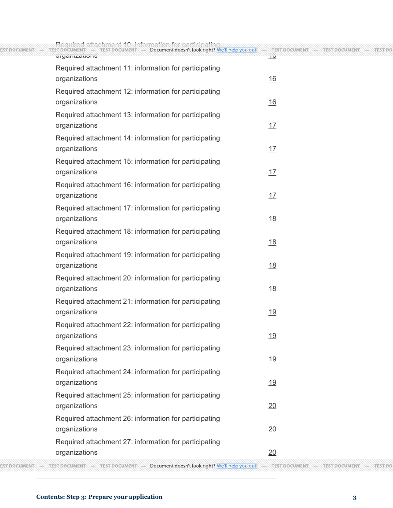

The gray bands are test-renderer watermarks. This is not a screen-reader test
or a conformance claim. Before enabling the default-off switch, validate the
actual screen-reader reading/navigation order and PDF at higher magnification,
then test approved representative FY27 and prior-year records across affected
themes. The synthetic cases do not establish a fit rate for typical notices.

**Correction, November 3:** the retained file named `followup-wrapped_intro-ihs-columns.pdf`
uses a longer invented label, but that label remained on one line in its PDF.
It did not demonstrate PDF wrapping. The earlier description was incorrect.
The next prototype uses the fixed “Before you get started” label and does not
pursue the hypothetical longer introduction.

## Third prototype: aligned entry and single-column fallback, November 3

The [new generator](fallback.py) reuses the existing fixture, template, theme
cascade, PDF renderer and link checks. It changes no application files. The
ordinary two-column version reserves the introduction row across both columns,
but limits its link to the left column's width. Its page number now aligns with
the numbers below it, and the two first step headings still align. The label is
exactly **Before you get started**.

For an oversized step, **roomy** is an explicit alternative for the entire
Contents, not automatic detection. It uses a single column and ordinary page
overflow. A running page label supplies the exact name of the step listed first
on that page, for example **Contents: Step 3: Prepare your application**. If the
page later moves into Step 4, Step 4's original heading remains in the list.
The header describes the starting context, not every entry on the page.

This is simpler than inserting labels at arbitrary column boundaries: no script,
second layout pass, count-based split, table conversion, duplicate body heading,
new link or hidden source entry is required. Each subsection supplies its parent's
exact step name to the running string. This matters when a page starts with a
new step or continues one before reaching another; a previous-page-only string
could identify the wrong starting step. Prince's documented
[named-string page policy](https://www.princexml.com/doc/15/gen-content/#the-optional-page-policy-value)
is the mechanism, not a claim of general renderer portability.

| New synthetic PDF | Contents pages | Verified result |
| --- | --- | --- |
| [Aligned two-column entry](fallback-fy27-ihs-columns.pdf) | 1 | 29 entries; introduction counter matches the left column; first headings remain level. |
| [Long-label single column](fallback-long-ihs-roomy.pdf) | 2 | 30 entries; full labels, icons, list structure and individual targets retained. |
| [Oversized-step single column](fallback-overflow-ihs-roomy.pdf) | 4 | 62 entries; Step 3 still spans pages 2–4, with its exact starting context repeated in the page margin. |

**The oversized step is not intact or made to fit one page.** This fallback
trades space for visible context: four Contents pages versus three in the earlier
two-column stress case. It does not solve optimal fit or choose the layout
automatically. The retained single-column result also leaves unused width; it
should not be described as a demonstrated full-print-width optimization.

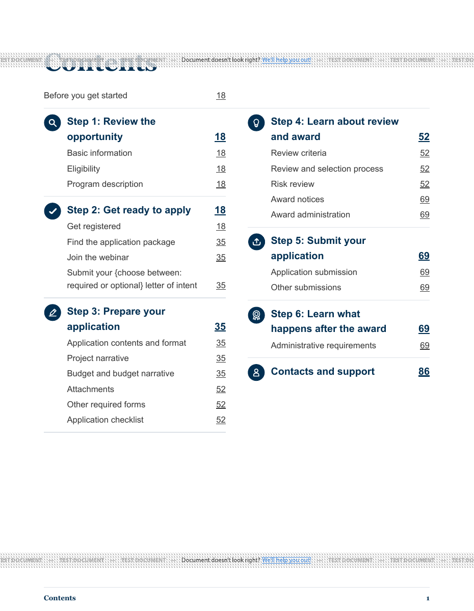

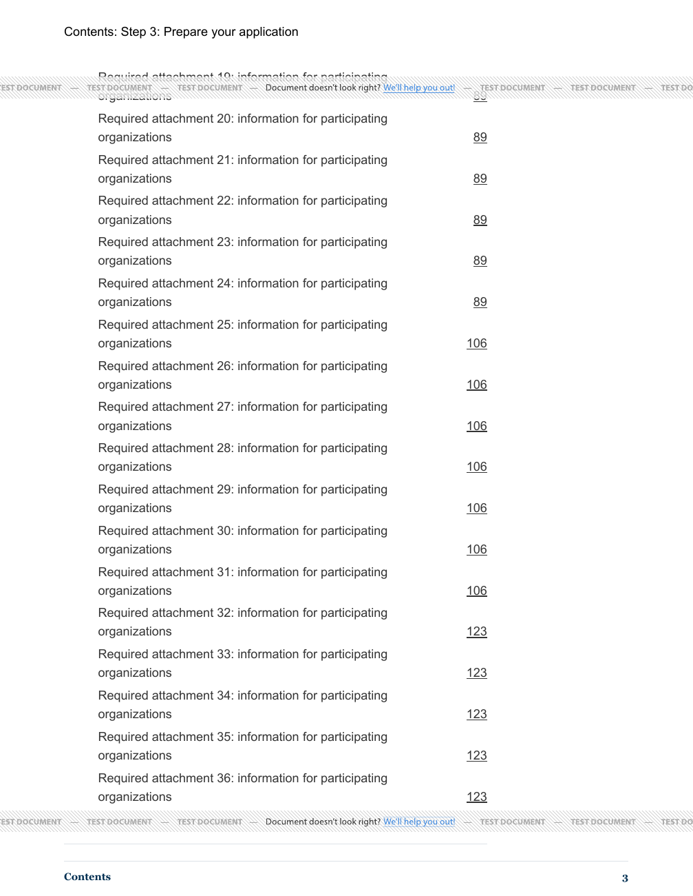

### Oversized step across four Contents pages

Screenshots from the same synthetic fallback PDF, in page order. The test service adds the gray watermark bands.

**Page 1. The first two steps are listed, with Step 3 starting on the next page.**

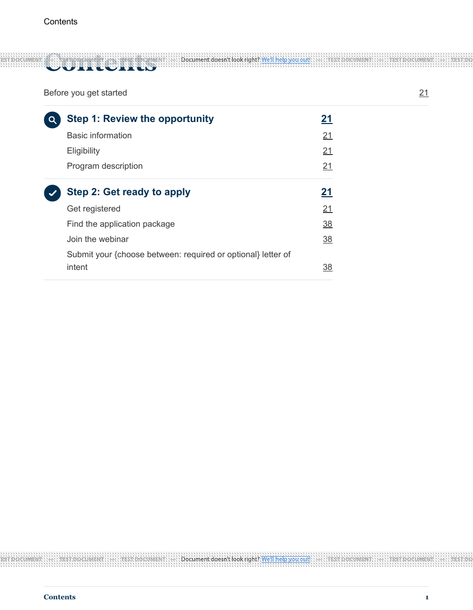

**Page 2. Step 3 starts here. Its name appears in the running label and in the regular linked step heading.**

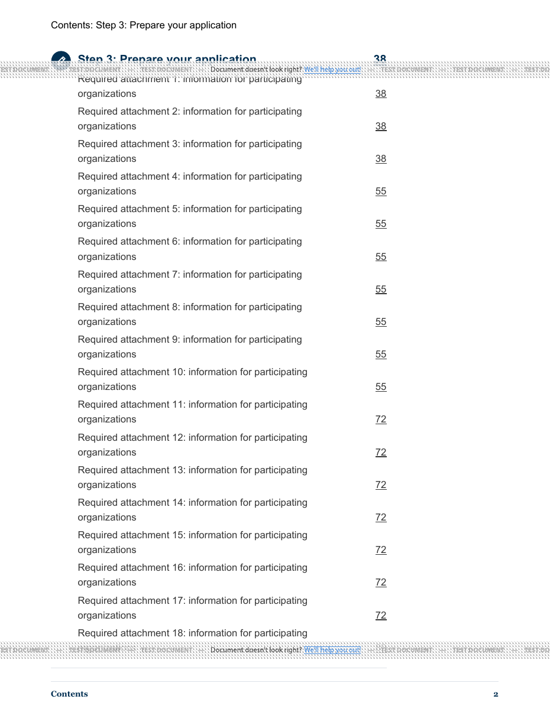

**Page 3. Step 3 continues. The running label gives context as the list resumes at attachment 19.**

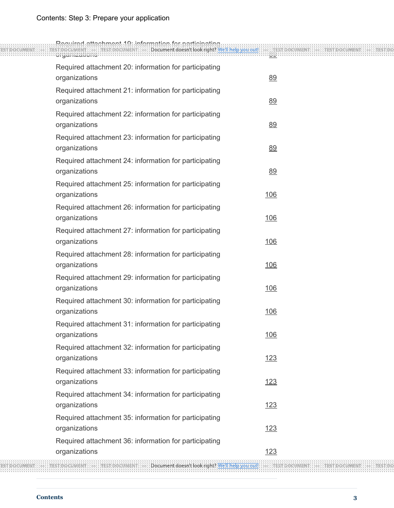

**Page 4. Step 3 finishes, then Step 4 begins. The running label still names Step 3 because its entries start the page.**

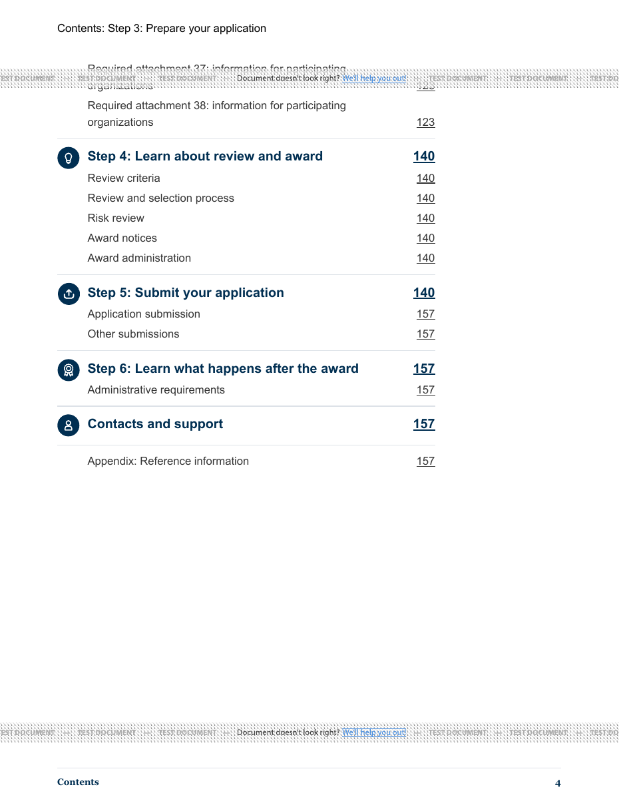

### Fallback scope and accessibility

Two columns are the proposed default for portrait PDF Contents. The single-column layout is a fallback for unusually long Contents. The prototype selects it explicitly. The selection rule for Builder remains open in #1263.

The running step label repeats context already present in the Contents list. In the generated stress PDF, the repeated label is marked as an artifact and all 62 original entries remain tagged, with link references in source order. This follows [W3C PDF14 guidance for running headers](https://www.w3.org/TR/WCAG20-TECHS/pdf#PDF14). For the complete Builder export, verify reading and tab order across the break and check whether a screen reader user who lands directly on a continuation page can identify the parent step. These checks are part of evaluating the applicable Section 508 and WCAG 2.0 AA criteria.

### Structure and validation

- All 24 new fixture/theme/mode combinations preserve the list DOM, exact labels
  and original destinations. The only body additions are parent-step data
  attributes used by the print header; they are checked against the source step.
  The original 48 and second-prototype 30 offline checks still pass.
- All 121 links in the three new PDFs pass destination, printed-counter and
  tagged-link-order checks. Each PDF retains seven `TOC` groups and exactly one
  `TOCI` per original entry, unlike the rejected caption experiment.
- PDF geometry checks verify the introduction's right edge matches Step 1's
  right edge, the introduction is above the steps, and both first headings align.
- On the single-column continuation pages, checks compare the running name with
  the actual first listed step and with every continuing step's source name.
  Inspection of the emitted marked-content stream confirms that these redundant
  margin labels are artifacts. The original step name remains visible in the
  body and its logical list relationships remain tagged. This does not establish
  actual screen-reader speech or navigation.
- 48 Chrome checks cover the four fixed-label fixture shapes, three themes,
  320px/800px widths and normal/doubled computed text. They verify viewport fit,
  source-order Tab, visible focus and Enter navigation on the new default
  two-column candidate's single-column screen view. The fallback's CSS is
  print-only; this is still not the full Builder application.

**Still not production acceptance:** actual PDF assistive-technology navigation,
magnification, exact approved-source wording, representative documents and real
application integration remain open. The first-page margin rule has only been
tested with Contents as the first physical PDF page; placement after a cover
needs separate verification. No claim is made that the redundant label's artifact
treatment has been accepted by an accessibility reviewer.

To reproduce this iteration (the earlier commands below reproduce earlier
experiments):

```sh
python documentation/review-evidence/1263/fallback.py
python documentation/review-evidence/1263/fallback.py pdf
python documentation/review-evidence/1263/fallback.py pdf --sample long --mode roomy
python documentation/review-evidence/1263/fallback.py pdf --sample overflow --mode roomy
python documentation/review-evidence/1263/fallback.py verify
CONTENTS_PROTOTYPE=fallback PYTHON=/path/to/builder/python node documentation/review-evidence/1263/browser_followup.cjs
```

Outputs are in ignored `generated/fallback/`; the three PDFs and two screenshots
above are retained for review. Only synthetic inputs and repository assets use
the public test renderer, with JavaScript off and no production credentials.
Editor Tasks was rechecked: no change is needed for this investigation-only slice.
Keep #1263 open. The remaining sections record the earlier November 2 experiment.

## What changed

The introduction now spans the full width above the columns. The first step in
each column starts at the same height in the tested PDFs. The longer-label PDF
did not actually wrap its introduction.
The prototype retains the existing step/subsection text sizes, complete fixture
labels, icons and individual link targets. The renderer chooses breaks from
content; there is no Step 4 split, height cap or removed entry. A small step stays
together when it fits; an oversized step is allowed to overflow.

These are the same invented fixture labels used in the first comparison, not a
new transcription of the authoritative HHS master. No title was shortened or
renamed to improve fit. The longer introduction is explicitly invented stress
text. Exact approved-master and real-document fidelity remain to be checked.

HTML stays single-column. The experiment also adds screen-only wrapping for the
Contents heading: at 320px with doubled text, the unbroken word otherwise exceeds
the available width. Synthetic destination headings receive the same treatment.
At narrow widths, screen-only Contents padding is 1rem rather than the existing
20mm preview padding, leaving more width for enlarged labels. These are prototype
rules to consider in implementation, not deployed fixes.

## Results

| Synthetic PDF | Contents pages | Result |
| --- | --- | --- |
| [29-entry FY27 shape](followup-fy27-ihs-columns.pdf) | 1 | Full-width introduction; aligned first steps; all links and counters retained. |
| [Longer invented introduction, historical filename](followup-wrapped_intro-ihs-columns.pdf) | 1 | Label remains on one line in this PDF; this is not evidence of PDF wrapping. |
| [Oversized step, normal columns](followup-overflow-ihs-columns.pdf) | 3 | All entries retained, but continuation lacks a repeated step label and leaves excess space before the oversized step. Not ready. |
| [Oversized step, repeated-caption experiment](followup-overflow-ihs-captions.pdf) | 3 | Exact step name with “(continued)” appears at the two continuation fragments. Tagging and visual tradeoffs prevent adoption as-is. |

Each file also has artificial destination pages. They are not complete NOFOs.
Destination pages deliberately increment their printed counter by 17, exercising
two- and three-digit labels without making a hundred-page document. These are
printed labels, not physical PDF page indices. They are not a fit-rate sample.
The public test service's watermarks cross some text; those marks are not
authored layout content. All pages were rendered and inspected, with larger
Contents views used for layout checks.

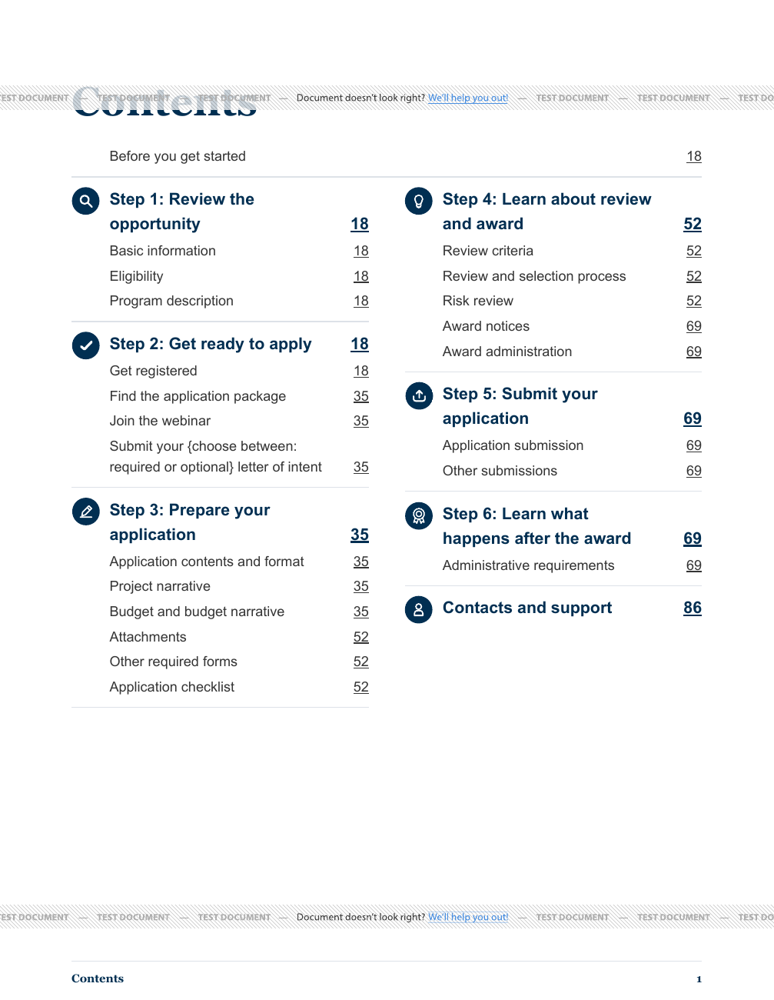

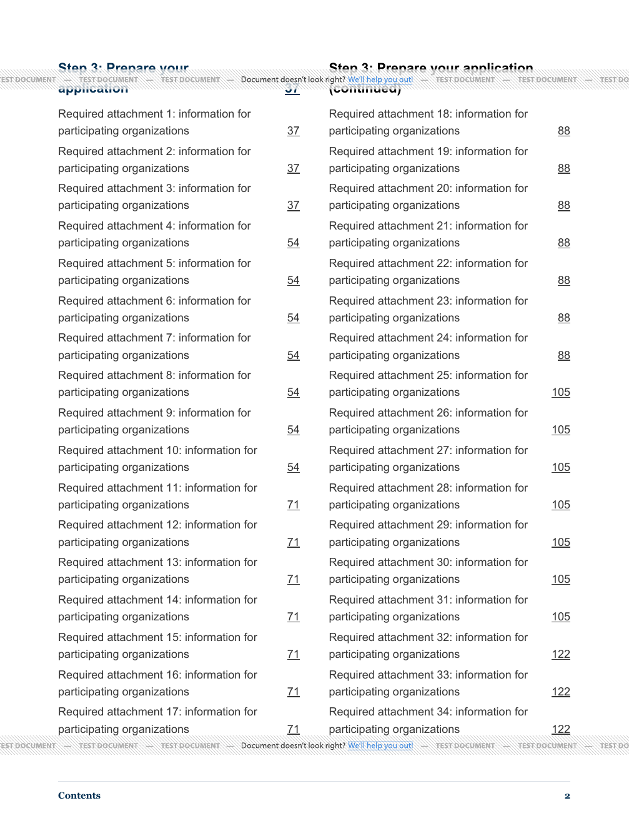

## Oversized-step feasibility finding

Prince 15.1 does repeat a table caption at a column break in this fixture. The
experiment uses `prince-caption-page: first` and `following`, with one original
linked step name and an unlinked continuation label. It does not require
JavaScript, a second layout pass, fixed subsection counts or shortened names.
See [Prince's caption guidance](https://www.princexml.com/doc/14/cookbook/) and
[its explanation of different repeated captions](https://www.princexml.com/forum/topic/2649/repeated-table-headers-with-different-content).

**Do not adopt this experiment as the production fallback.** Changing step
groups to CSS tables removes the numbered-step icons and changes the generated
structure: the normal oversized Contents has 62 `TOCI` entries and seven `TOC`
groups; the caption version has only nine `TOCI` entries and one `TOC` group.
Both retain 62 ordered link references, but that alone does not preserve the
step/subsection hierarchy. The continuation text has not been deliberately
marked as an artifact; its spoken treatment is unverified. Fixing those issues
could require renderer-specific tag customization and further testing.

This answers the narrow feasibility question, not the design acceptance
question. Keep the ordered-list version as the starting point and the caption
version as a rejected-as-is experiment. Do not hide repeated content from
assistive technology simply to make an automated count pass. Before a production
change, demonstrate a continuation treatment that retains hierarchy and verify
its actual screen-reader behavior.

## Checks and limits

- **30 offline checks:** five fixture shapes, three themes and two experiment
  modes preserve the baseline's ordered labels and unique destinations. The
  original 48 comparison checks also pass.
- **182 links across four PDFs:** every expected label is present, lands on a
  page containing that label, and has the correct printed number at the right
  edge of one of its annotation rectangles. The tag tree's ordered internal-link
  object references match source order, including the spanning introduction.
  This is more specific than content-stream extraction order, but is not a
  full tagged-content-order or screen-reader test.
- **60 isolated Chrome checks:** five fixture shapes, three themes, 320px/800px
  viewports and normal/doubled text. Computed text sizes are doubled, not merely
  the viewport or screenshot. All Contents links remain within the viewport;
  there is no horizontal document overflow. Every link is reached in source
  order using Tab with a visible outline; Enter reaches a distinct subsection.
  These fixtures do not load a logged-in profile or visit Builder.
- **HTML screen handling is probe-only:** heading wrapping and the first probe's
  focus/overflow rules are not application changes. These results do not certify
  the existing production HTML experience. They describe the candidate wrapper.
- **Still open:** approved IHS/master wording and representative prior-year/FY27
  corpus checks, actual PDF assistive-technology reading/navigation, magnification
  usability, full WCAG 2.0 AA evaluation, actual application-template integration,
  and a hierarchy-preserving oversized-step fallback. Landscape application
  behavior has not changed or been regression-tested by this slice.

No production record, import, provider credential, application PDF switch,
dependency or deployment configuration was changed. Only invented inputs and
repository assets went through the documented public DocRaptor test account,
with JavaScript off. Editor Tasks was reviewed; no instructions change because
the application workflow is unchanged.

## Reproduce

Use the locked Builder Python environment with the first probe's dependencies.
Only the explicit `pdf` subcommand sends the fixed synthetic fixture to the
public test service. There is no arbitrary-document input option.

```sh
python documentation/review-evidence/1263/columns_followup.py
python documentation/review-evidence/1263/columns_followup.py pdf
python documentation/review-evidence/1263/columns_followup.py pdf --sample wrapped_intro
python documentation/review-evidence/1263/columns_followup.py pdf --sample overflow
python documentation/review-evidence/1263/columns_followup.py pdf --sample overflow --mode captions
python documentation/review-evidence/1263/pdf_followup.py
PYTHON=/path/to/builder/python node documentation/review-evidence/1263/browser_followup.cjs
```

PDF checks require Poppler's `pdftotext`; browser checks require Playwright and
Chrome. Local generated HTML/PDFs, the machine-readable PDF check receipt and a
320px/doubled-text screenshot go under ignored `generated/followup/`.
The four linked PDFs and two Contents screenshots above are retained for review.

## Recommended next boundary

Review this prototype and the rejected caption tradeoff before a shared
application change. The next implementation should reuse the current Contents
template and theme cascade, preserve the list hierarchy and standardized source
wording, and include a demonstrated, readable overflow path. Keep #1263 open.
