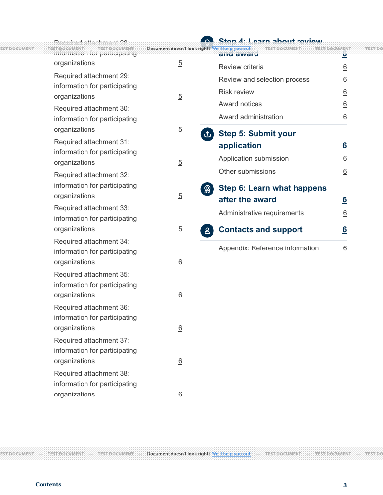

# FY27 Contents layout comparison

Issue [#1263](https://github.com/HHS/simpler-grants-pdf-builder/issues/1263).
November 2, 2026. Source baseline: `3c1e0351` on `main`.
Status: initial design investigation for review, **not an implementation or completed acceptance**.
No application templates, styles, imports, records or settings are changed.

**Next iteration:** [Second prototype and continuation feasibility findings](FOLLOWUP.md)
responds to the review with a spanning introduction, varied page counters,
HTML enlargement/keyboard checks and a repeated-caption experiment that is not
recommended for production as-is.

[November 3 follow-up](FOLLOWUP.md#third-prototype-aligned-entry-and-single-column-fallback-november-3)
corrects the earlier PDF-wrapping claim, aligns the introduction counter, and
tests a single-column fallback with running step context and intact list tags.

## Recommendation

Take **print-only two-column step groups** into the next design review. Reuse
Builder's existing landscape Contents column pattern, keep the HTML in one
column, and retain the current text sizes and individual subsection links.
This gives more space than small spacing reductions in the tested fixture.

Do not group links by computed PDF page number. That would couple layout to
pagination without a demonstrated need. Inline subsection rows can save space,
but are harder to scan and create long runs of linked text. They are a comparison,
not the recommended starting point.

The oversized-step example is not ready: a continued step loses its visible
step label and whole-group avoidance leaves excess space. Resolve that fallback
before implementing a shared change. Do not force a one-page height, hide entries,
remove source headings or reduce text size merely to fit.

## What was reproduced

The supplied IHS production record was inspected read-only in Chrome. Its
portrait IHS light theme shows `toc--small toc--items--29`. Its six numbered
steps have 3, 4, 6, 5, 2 and 1 subsection links; Contacts and Support has no
children. The generated introduction contributes one entry. **Preview PDF**
produced a 40-page test preview, with Contents on pages 2 and 3. No **Download PDF**,
record edit, reimport or status change was performed. This was a bounded Contents
inspection, not a full-document review.

The public fixtures use invented wording and destinations, matching those
counts rather than copying the private document. The letter-of-intent placeholder
is already quoted in the issue. Matching counts does not reproduce every title
length, custom style, page number or pagination dependency of the IHS source.
No private source PDF, account details, cookies or credentials are included here.

## Comparison

All candidates retain 13pt step links and 11pt subsection links in the IHS
fixture. The candidates reserve space for the per-link page number; the baseline
uses the existing styles without that addition. The compact variant reduces
step-block padding/margins and icon size, not text size. Columns add print-only
CSS columns with a 10mm gap. The inline comparison retains a separate page number
and destination for every subsection; it does not infer same-page groups.

| Synthetic 29-entry IHS fixture | Contents pages | Observation |
| --- | --- | --- |
| [Baseline PDF](fy27-ihs-baseline.pdf) | 2 | Existing small mode still overflows. |
| [Compact blocks PDF](fy27-ihs-compact.pdf) | 2 | Some space saved, but not enough. |
| [Two-column PDF](fy27-ihs-columns.pdf) | 1 | Complete step groups fit; some labels wrap more. |
| [Inline rows PDF](fy27-ihs-inline.pdf) | 1 | Compact, but longer runs are harder to scan. |

Each PDF includes an additional synthetic-destinations page, not a full NOFO.
Test-provider watermarks are expected and can cross text. All pages of these
four PDFs were rendered and visually inspected; no authored clipping or missing
label was observed. This is not a claim of final presentation quality or
accessibility conformance.

| Two-column stress/theme probe | Contents pages | Limit or finding |
| --- | --- | --- |
| Sparse, 15 entries | 1 | Fits with unused space; no one-page constraint. |
| Long labels, 30 entries | 2 | Retains wording and links; uses readable overflow. |
| Oversized step, 62 entries | 3 | Preserves entries, but continuation context and wasted space need work. |
| Same FY27 counts, HRSA light | 1 | Theme-specific fonts retained in sampled PDF font inventory. |
| Same FY27 counts, CDC light | 1 | Theme-specific fonts retained in sampled PDF font inventory. |

These are deliberately constructed probes, not a representative corpus or a
population fit rate. The approved IHS equivalent with full label/pagination
fidelity, prior-year examples and additional real FY27 cases remain necessary
before claiming that most typical NOFOs fit. Stress PDFs were checked for
navigation programmatically and their Contents pages inspected; their artificial
destination pages were not a full-document design review.

### Visual comparison

Baseline first page:


Print-only columns:


Inline rows:


Known oversized-step limitation:



## Reuse and validation

[`prototype.py`](prototype.py) renders the real Contents fragment from
`nofo_view.html` through Django with invented in-memory objects. It reuses
`add_classes_to_toc`, the real icon includes and the normal USWDS/shared/base/
orientation/OpDiv/theme CSS order. No Django project settings, database or
application secrets are loaded. The browser wrapper, focus styling and synthetic
destination pages are explicitly probe-only. This is not a complete HTML/PDF
application-template integration test.

- **48 offline combinations:** four fixture families, four variants and three
  themes. Independent expected entry counts and ordered destinations prevent a
  missing/empty Contents from passing through cross-variant equality. All pass.
- **Nine generated diagnostic PDFs:** expected link labels occur on destination
  pages for every fixture. The four main IHS variants retain 29 distinct internal
  destinations. Wrapped inline links can have multiple annotation rectangles;
  rectangles are not extra entries.
- **Chrome:** the HTML remains single-column. Tab traversal followed the source
  order through the 29-entry fixture; a visible 3px focus outline was observed.
  Enter on a subsection link reached its distinct existing target.
- **Fonts:** provider outputs embed Arial/Georgia for IHS and expected Open Sans/
  Source Sans Pro families in sampled HRSA/CDC outputs. No numeric fit claim is
  based only on a requested CSS font name.
- **Independent review:** a separate agent inspected source, ran all 48 checks,
  examined rendered prototype pages and PDF links, and identified the vacuous-test
  risk and oversized-step limitation. The checker was strengthened; the layout
  limitation remains explicitly unresolved. This is not formal design approval.

The PDF conversion uses [DocRaptor's documented public test account](https://docraptor.com/documentation/article/1067924-trying-docraptor-without-an-account-or-credit-card),
with invented inputs and repository assets only, `test=true`, no JavaScript,
pipeline 11 and the existing PDF/UA-1 profile request. Output identifies Prince
15.1. No production provider credentials or lower-environment application PDF
switches are used or changed. A profile request and tag tree do not establish
accessible reading order.

### Checks not completed

- Tagged PDF reading order and actual assistive-technology navigation. Extracted
  content-stream order places the introductory entry late; this is not sufficient
  to decide whether the tagged order is correct. It needs explicit verification.
- Multi-digit page-number spacing, varied destination-page layouts, and every
  displayed page number. Most invented targets share one page. The link checks
  do not establish broad page-number correctness.
- Verified 200% text enlargement and mobile reflow. Browser zoom/viewport control
  attempts did not change observed dimensions; no successful test is claimed.
- Full WCAG 2.0 AA evaluation, representative prior-year/FY27 output testing,
  existing landscape regression testing, and screen-reader speech.

These are outstanding acceptance work, not reasons to change security controls
or claims that #1263 is complete. Before implementation approval, review the
column design and oversized-step fallback, then complete the relevant checks.

## Reproduce

Use Builder's locked Python environment (Django, BeautifulSoup, pypdf and the
existing DocRaptor SDK). The default command is offline; only `pdf` uses the
network. There is no arbitrary-input submission option.

```sh
python documentation/review-evidence/1263/prototype.py
python documentation/review-evidence/1263/prototype.py generate
python documentation/review-evidence/1263/prototype.py pdf
python documentation/review-evidence/1263/prototype.py pdf --sample overflow --mode columns
python documentation/review-evidence/1263/prototype.py verify
```

`generate` writes four local HTML variants for the selected `--sample` and
`--theme`; choices are shown with `--help`. Serve the generated directory on
localhost to compare them. Generated files are ignored; the four checked PDFs
and selected evidence images are retained here. The two-column HTML is generated
from the same template/CSS source as its PDF rather than maintained separately.

Editor Tasks was reviewed. No update is needed for this investigation-only PR:
there is no change to import, editing, preview/export behavior, labels or controls.
No import rules, feature switches, dependencies, data migrations or deployment
changes are introduced.
