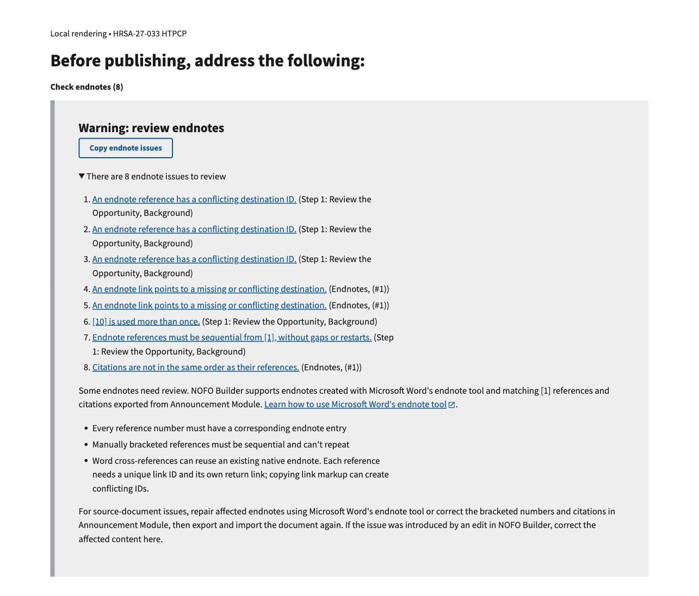
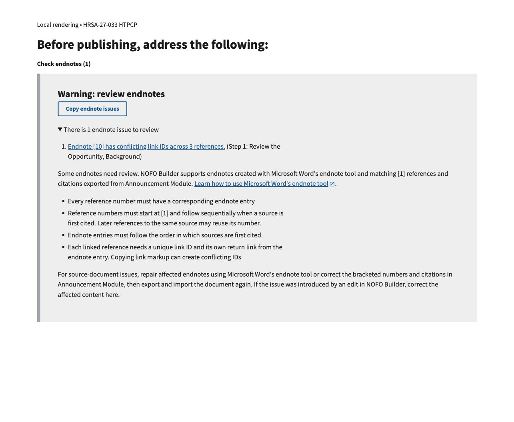

# Endnote warning consolidation — #1281

Captured November 4, 2026. Related [issue #1281](https://github.com/HHS/simpler-grants-pdf-builder/issues/1281).
See the durable [warning catalog](../../ENDNOTE_WARNINGS.md) for messages and combinations.

## Scope and method

These screenshots show local renderings of the existing Check endnotes panel
using the relevant saved HTML from HRSA-27-033 HTPCP. The before panel uses the
upstream-main validator and template; the after panel uses this branch. Both
use the bundled USWDS stylesheet, the same viewport, the same expanded disclosure,
and the same underlying reference/citation relationships. A small local wrapper
identifies the record and panel; these are not full-page production screenshots.

The record contains references 1–11, including three [10] references with the
same ID and two return links to that ID. Validation changes the issue count
from eight to one without changing that HTML or repairing the ID collision.
The source content and production record were not modified. Only warning-panel
screenshots are committed, not the source document or full record HTML.

## Before

## After

## Limits

This verifies warning output and local panel rendering, not deployment, complete
editor styling, navigation at each individual reference, Word export, or PDF
output. Automated tests cover independent warning variants; no additional variant
screenshots are included.
