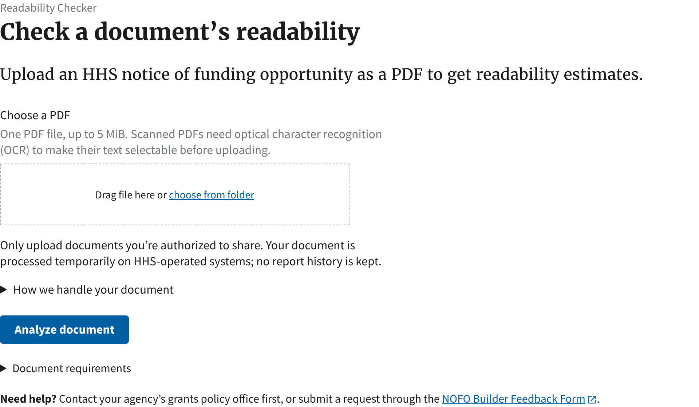
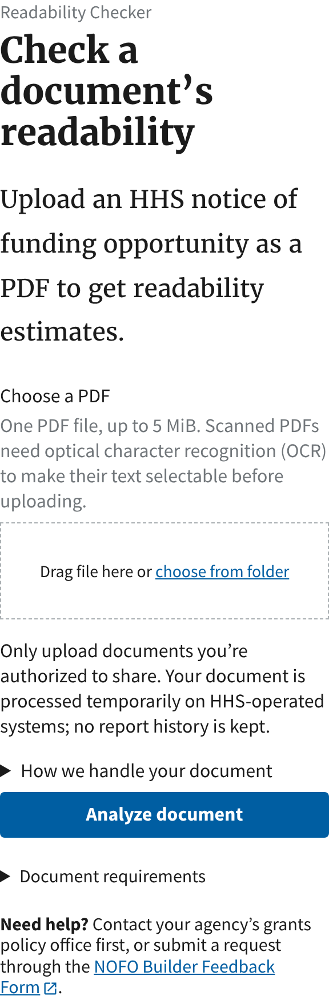
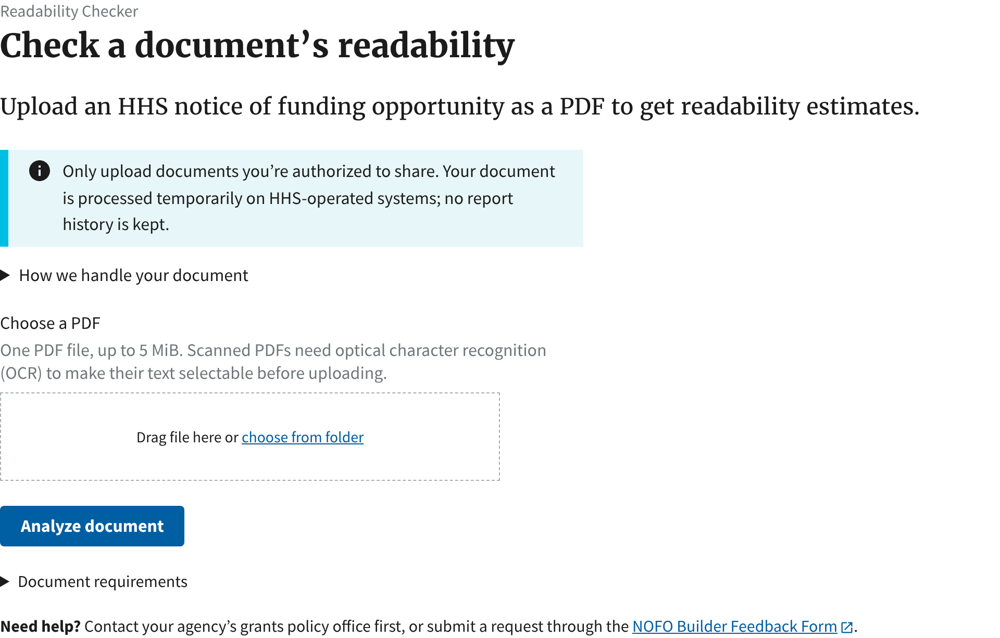
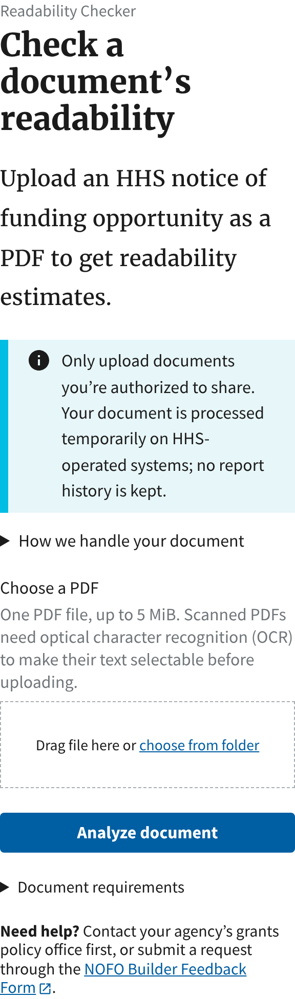
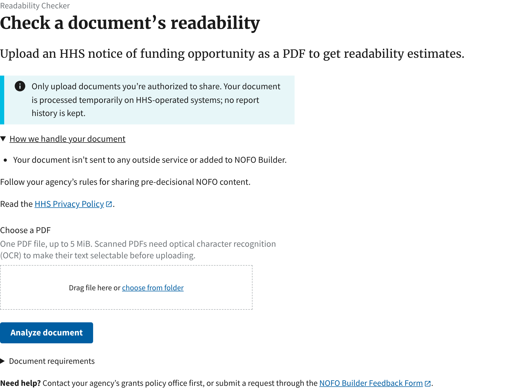
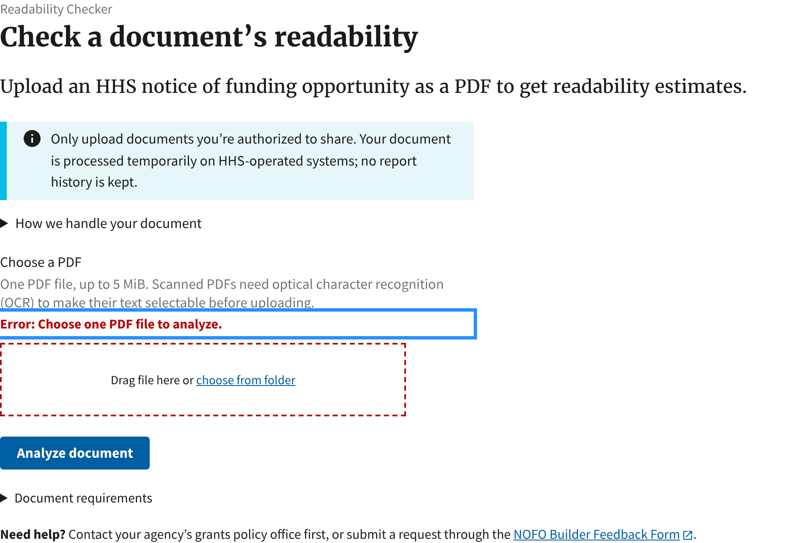

# Readability Checker upload notice: before and after

[Builder #1329](https://github.com/HHS/simpler-grants-pdf-builder/issues/1329) ·
[Current UI pattern](../../UI_PATTERNS.md#readability-checker-upload-notice) ·
[Upload privacy notice rules](../../readability/PDF_READABILITY_PILOT.md#upload-privacy-notice)

**November 11, 2026.** Local Linux, Python 3.14, SQLite, Chromium through
Playwright, with `HHS_NOFO_PDF_METRICS_PILOT_ENABLED` on and Word uploads off.
The before captures used upstream `main` at `5831b6f`, and the after captures
used the #1329 branch. No document was uploaded. Each image shows the upload
page's main column at a device scale factor of 2.

## Before

The notice was a plain paragraph after the file input. At 320px, USWDS's
`.usa-form .usa-button` rule reduced the button's top margin to 0.5rem,
overriding `margin-top-3`, so the disclosure nearly touched **Analyze document**.

| Desktop (1280px) | Mobile (320px) |
| --- | --- |
|  |  |

## After

The notice is a slim informational alert with `role="note"`. It and the **How we
handle your document** disclosure sit above the file input. The wording is
unchanged.

| Desktop (1280px) | Mobile (320px) |
| --- | --- |
|  |  |

| Disclosure expanded | Failed upload (no file chosen) |
| --- | --- |
|  |  |

The computed gap from the file input's form group to **Analyze document** was
24px (`margin-top: 1.5rem`) at both 320px and 1280px. The notice keeps
`role="note"`, so screen readers read it in document order, before the file
input, without announcing an alert on page load. This was checked in the DOM;
no screen reader was run.

```sh
cd nofos
poetry run python manage.py test bloom_nofos.tests_bloom_nofos.test_pdf_readability
```

These captures do not cover the Word-upload variant of the page, the
authenticated `/nofos/readability/` route (which uses the same template) or a
deployed environment.
