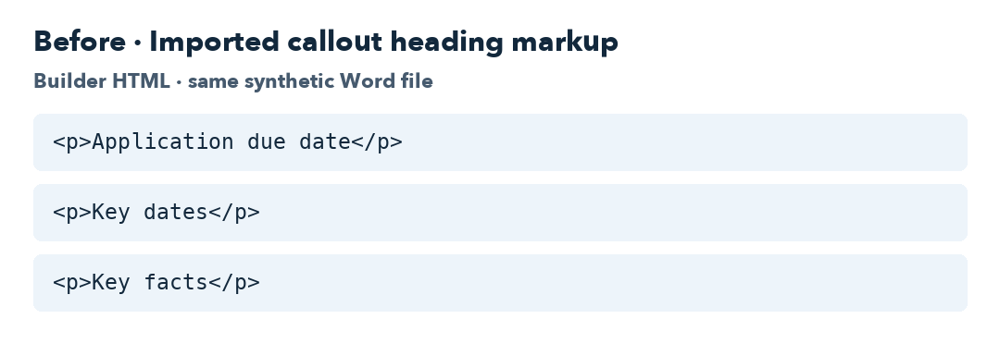
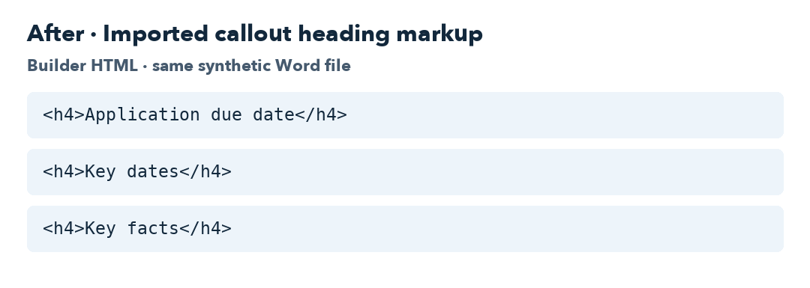

# Basic information callout headings

This import change is eligible for the evaluation in #1375. This record captures a single implementation run with a synthetic example and carries no paired score.

## Expected behavior

On Word import and re-import, the first standalone paragraph in a one-cell table under Step 1, Basic information becomes an editable callout heading when it matches Key facts, Key dates, or Application due date. Each renders as HTML heading level 4. Other content inside the cell stays in the callout body and matching paragraphs in later steps stay in the body.

## Verification

The synthetic fixture and checks are in `nofos/nofos/tests_nofos/test_deadline_callouts.py`. The baseline `b421b43ae1769dc83875b120975cb68bc449c0b5` reproduced missing named callouts on both import and re-import. The import guide was read before implementation. With the patch, the workflow test checks the saved heading, sidebar HTML, renderer input HTML, internal deadline link, and a matching title in Step 2. Inspect the PDF tag tree after generating a PDF with the configured renderer.

The images show excerpts of actual Builder HTML produced by importing the same synthetic fixture before and after the change.

