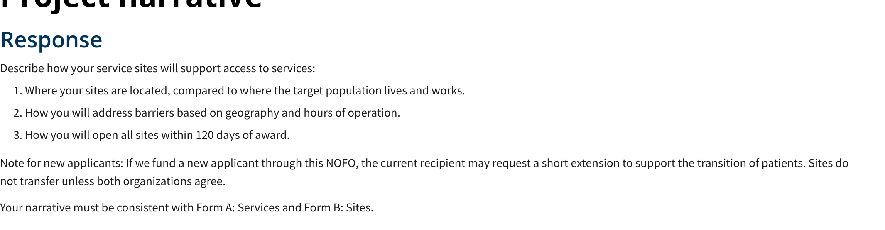
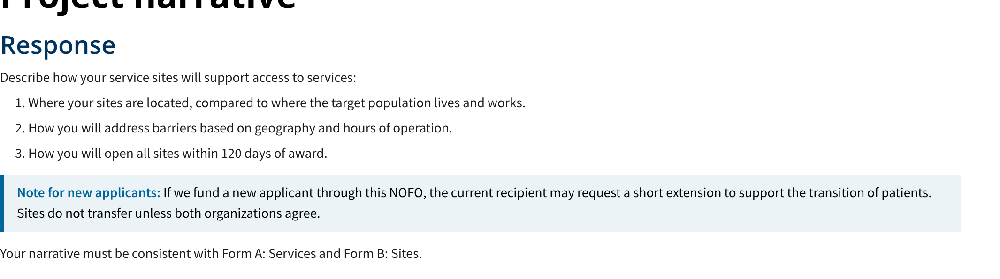
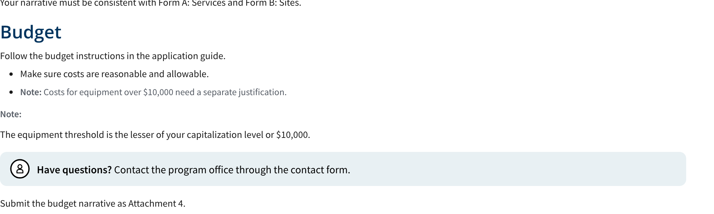
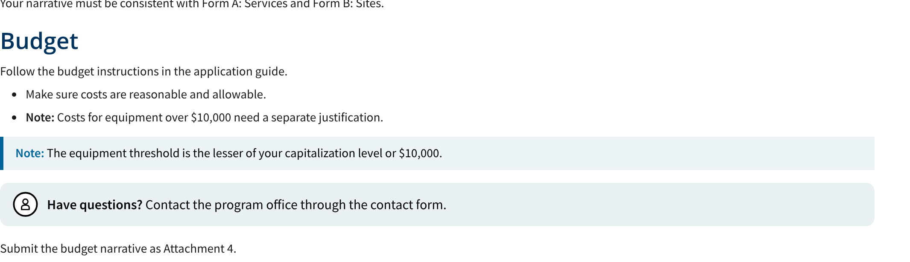
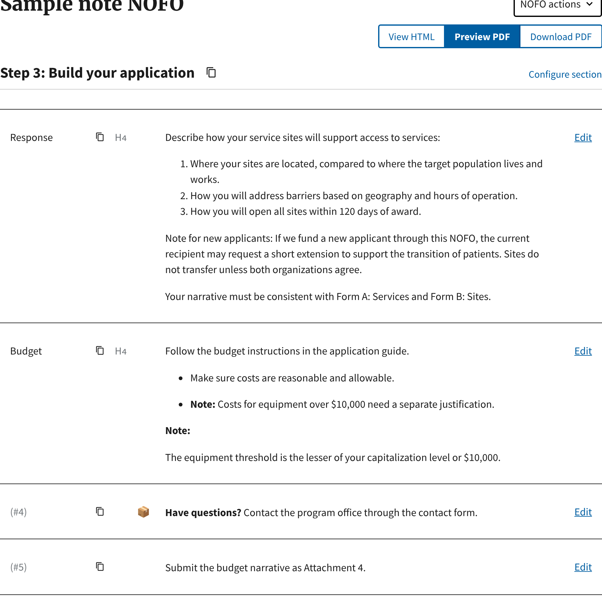
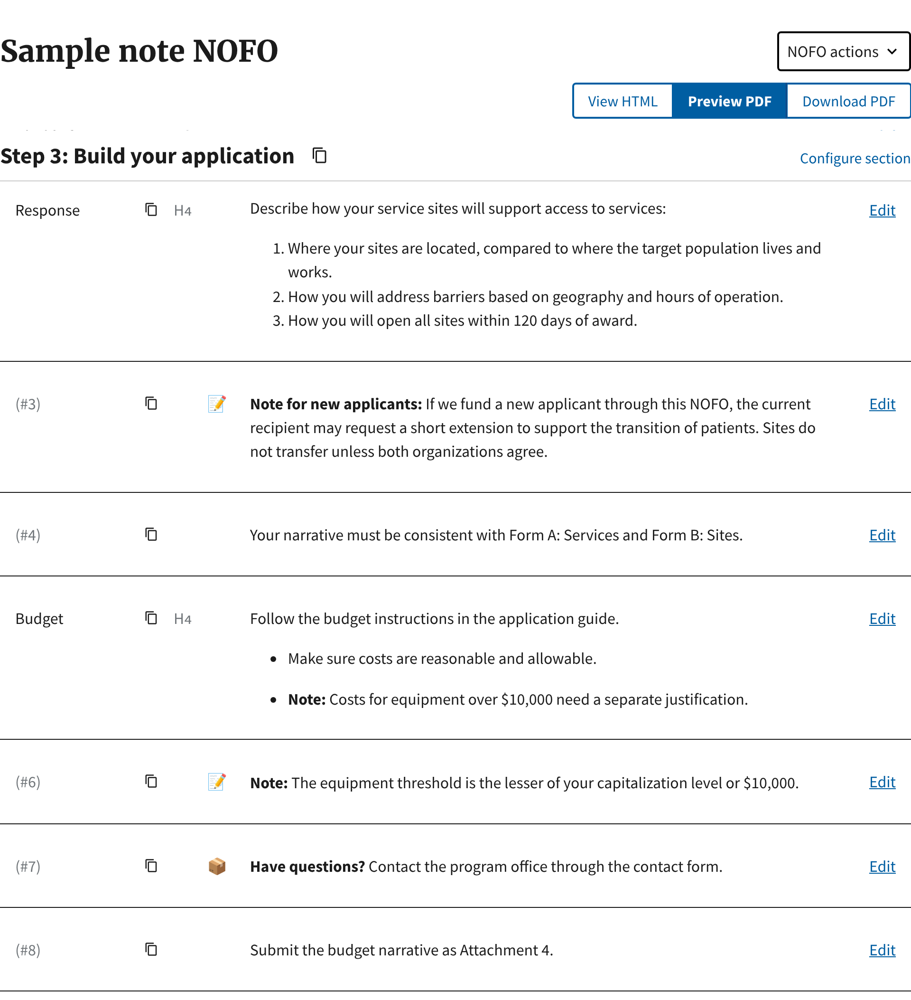
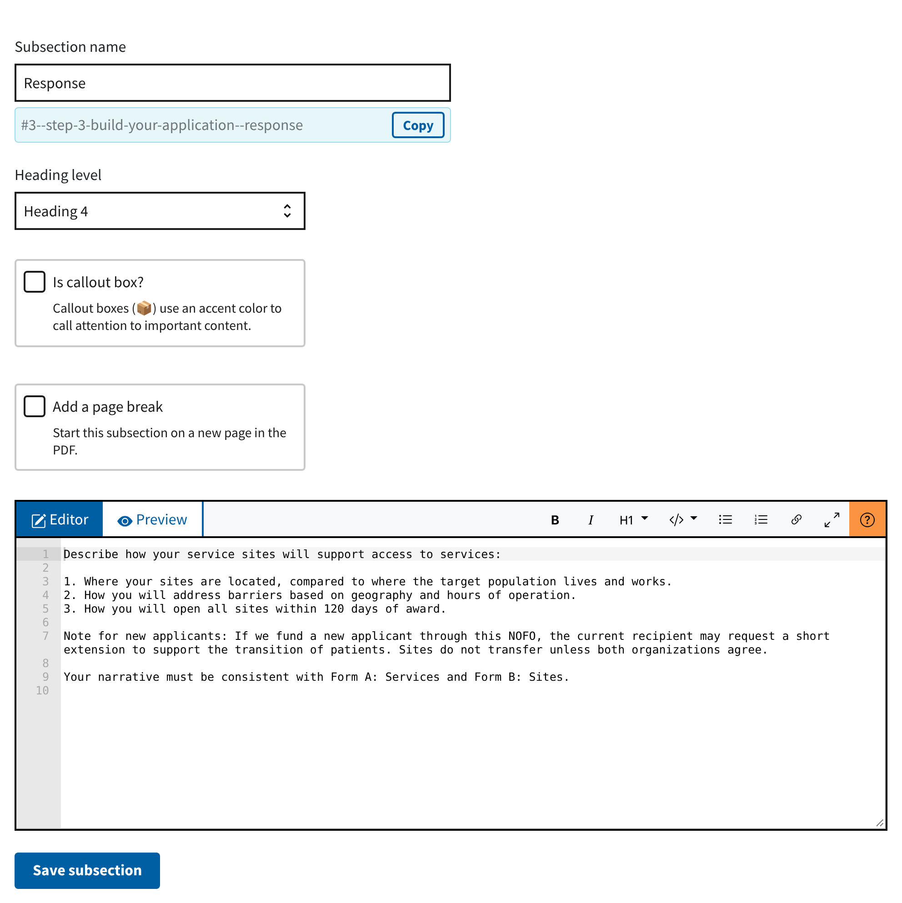
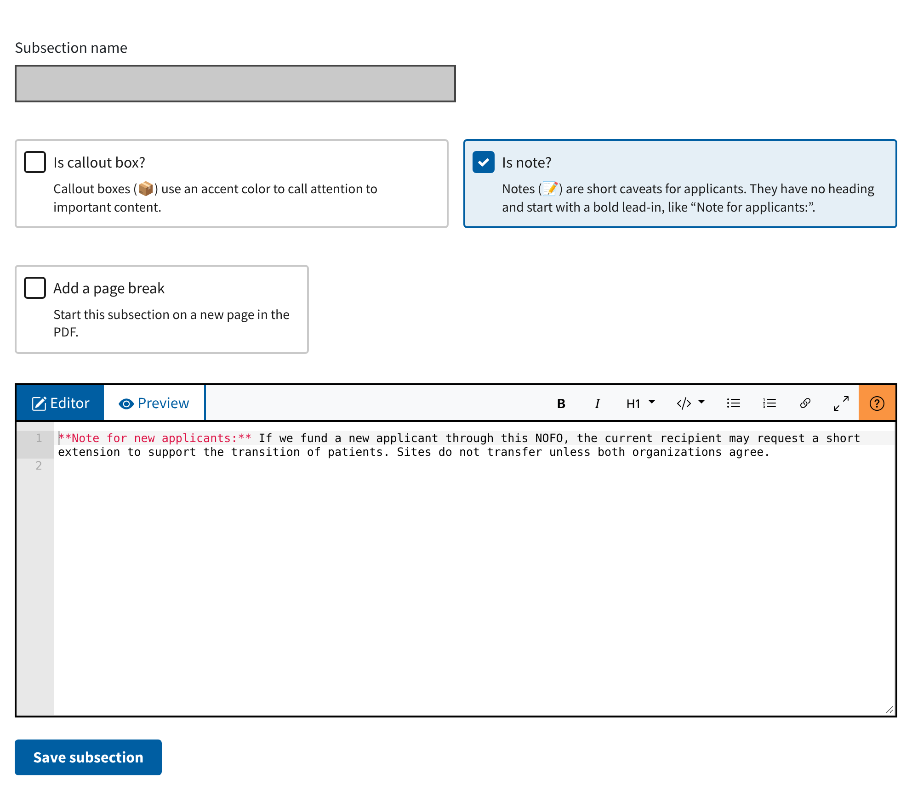
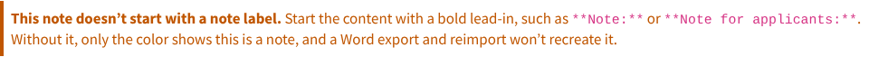
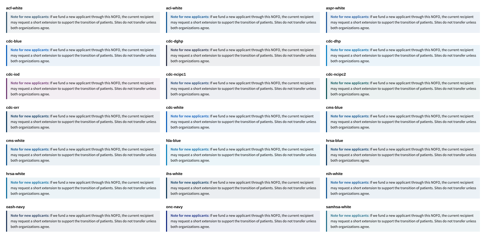

# Note callouts (#1437)

- **Issue:** [#1437](https://github.com/HHS/simpler-grants-pdf-builder/issues/1437)
- **Captured:** 2026-11-27
- **Before:** upstream `main` at `344046a`. **After:** this PR's branch.
- **Environment:** local `runserver`, SQLite, Chromium through Playwright at
  1280px wide, device scale factor 2. Document captures use print media, as
  the PDF does, in the HRSA (Light) theme. This is the browser render of the
  PDF source, not a DocRaptor/Prince PDF.
- **Content:** [`sample-note-nofo.html`](sample-note-nofo.html), an invented
  sample NOFO imported through the normal Builder upload page. No real NOFO
  content, applicant material or credentials were used.

## Document

| | Before | After |
| --- | --- | --- |
| Note after a list |  |  |
| Note in a list item, bare `Note:` line, box callout |  |  |

- **Before:** "Note for new applicants:" isn't recognized, so it renders as
  plain text. The note in a list item and the bare `Note:` line render grey and
  smaller, and the bare label is separated from its text.
- **After:** each standalone note is a note callout. The bare `Note:` line is
  joined with the paragraph after it. The list-item note is ordinary body text
  with its bold label. The "Have questions?" 1×1 table is unchanged.

## Editor

| | Before | After |
| --- | --- | --- |
| Section subsection list |  |  |
| Subsection edit page |  |  |

- **Before:** the note is a paragraph inside the "Response" subsection's text.
- **After:** each note is its own subsection, marked 📝 in the subsection list.
  Its edit page has an **Is note?** checkbox tile next to
  **Is callout box?**. Only one can be checked: checking one unchecks the
  other, and the server rejects a form that sends both.

Label warning: if a note doesn't start with a label such as `**Note:**`,
the editor shows this non-blocking warning, updated as you type:

## Every OpDiv theme

The same note in each of the 21 selectable OpDiv theme stylesheets, captured
by swapping the theme stylesheet on one page. Rule, tint and lead-in colours
and their contrast are listed in
[design standards: notes](../../DESIGN_STANDARDS.md#notes). A test checks
every selectable theme.

## Width

Measured with a long paragraph in the same column: the paragraph box and the
note both span the text column (80% of the content area, where paragraphs
wrap), with the same left and right edges. Print media at 1280px: both end at
1024px, and the paragraph's text lines wrap at up to 1006px. Screen media at
1280px and 1600px: same edges as the paragraph boxes. The note uses
`box-sizing: border-box`, so its padding and rule stay inside the text
column.

## Limits

- No DocRaptor/Prince PDF was generated, so the PDF tag tree (`Div` > `P`) and
  page breaks were not checked in a real PDF. Run a test-mode PDF and check the
  tag tree before release.
- No screen reader or applicant testing was done.
- Custom document CSS was not included.
