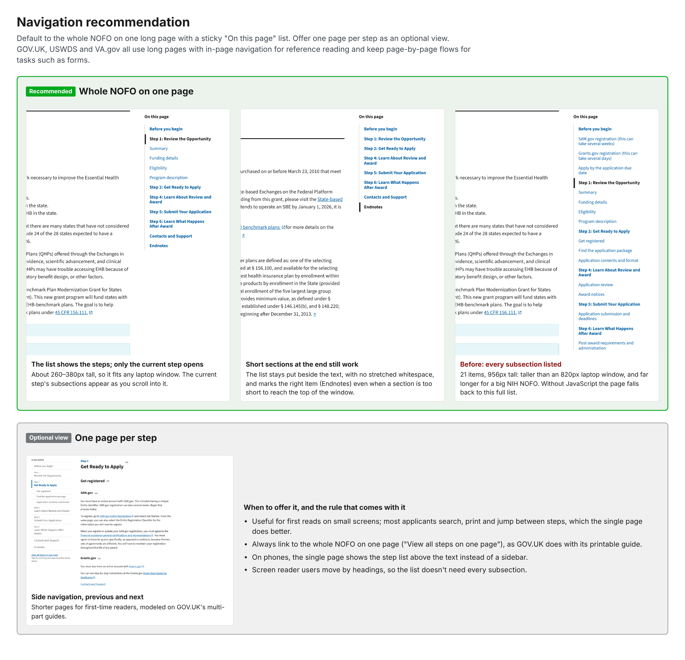
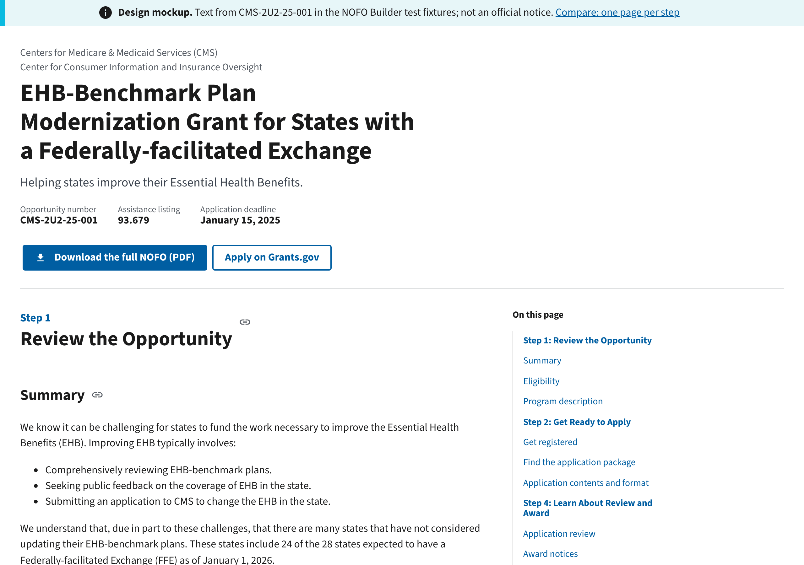
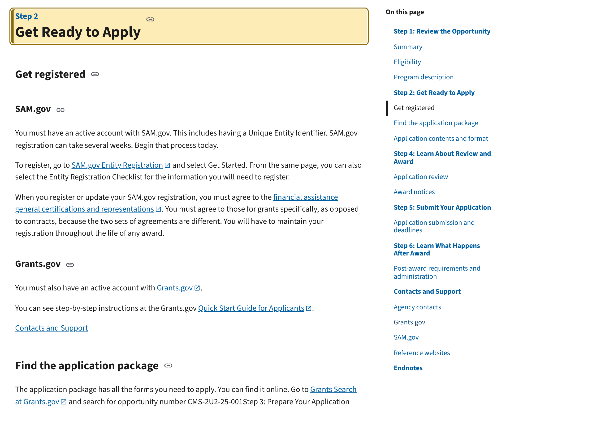
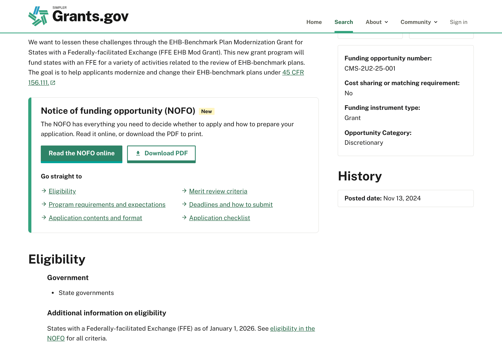
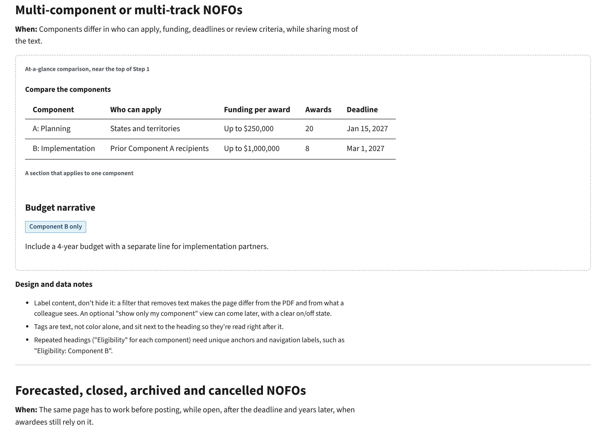
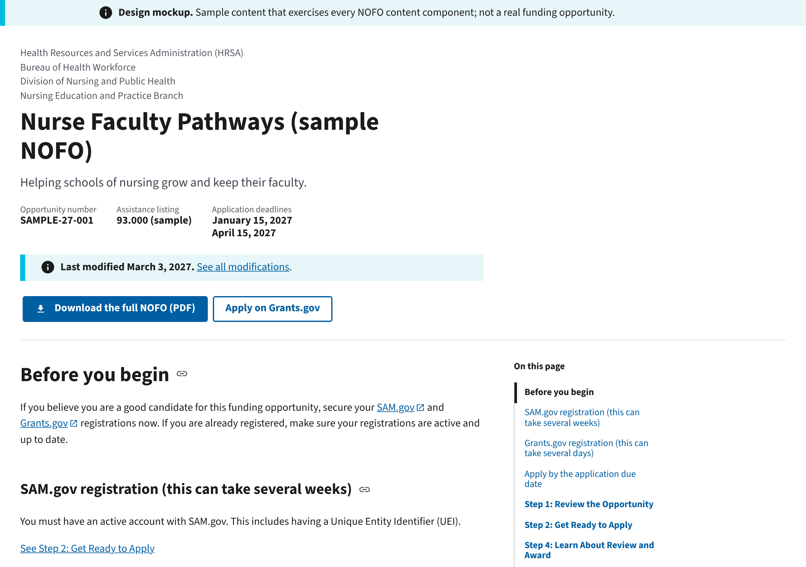

# NOFO web pages: research, prototypes and edge cases — #851

- **Issue:** [#851](https://github.com/HHS/simpler-grants-pdf-builder/issues/851) — Generate a Grants.gov-publishable HTML announcement from NOFO Builder, and redesign the HTML template
- **Type:** spike, separate from the Builder's existing NOFO HTML. Nothing here changes or reuses Builder application code; see [Relationship to the Builder's existing HTML](#relationship-to-the-builders-existing-html).
- **Investigation date:** 2026-11-28
- **Inspected baseline:** upstream `main` at `1f7c527`; HHS/simpler-grants-gov and HHS/simpler-grants-protocol default branches on the same date
- **Environment:** cloud development container. Agency websites, commongrants.org and simpler.grants.gov pages were blocked by its network policy; GitHub source and the Simpler.Grants.gov API (through a CommonGrants client) were reachable.
- **Status:** findings and prototypes for discussion. No decision recorded yet.

## Summary

1. **Publish one long, accessible NOFO page as the default web version**, with a sticky "On this page" navigation that lists the steps and opens only the current step, and offer one-page-per-step as an optional view ([Navigation recommendation](#navigation-recommendation)). GOV.UK, USWDS and VA.gov all reserve page-by-page flows for tasks such as forms. They use long pages with in-page navigation for reference reading, which a NOFO is. A single page is also the one self-contained file #851 proposes attaching to an opportunity.
2. **The Builder's content model already fits a web page.** Sections, subsections, heading tags, callouts and stable `html_id`s render cleanly in USWDS. Two adjustments were needed: re-level headings after the hidden metadata block, and treat "Label: value" callouts as description lists.
3. **Link the NOFO and the opportunity listing in both directions,** with deep links into NOFO sections from the listing. This needs stable section anchors, which the Builder has, and a way to tell Simpler.Grants.gov about them. CommonGrants has no NOFO-content fields today, so we propose two custom fields (see [CommonGrants](#commongrants)).
4. **Design for edge cases from the start.** A sweep of live Simpler.Grants.gov listings found real instances of every case below, plus placeholder dates and amounts. Several of them don't fit the Builder's data model today. Examples: one NOFO posted under several opportunity numbers, many assistance listings, and multi-component NOFOs. See the [edge-case catalog](#edge-cases).

## Navigation recommendation



**Default: the whole NOFO on one page.** GOV.UK, USWDS and VA.gov all use long pages with in-page navigation for reference reading, and keep page-by-page flows for tasks such as forms. Applicants search, print and jump between steps, which a single page supports. It is also the one self-contained file #851 proposes attaching to an opportunity.

**Long navigation lists and short sections:**

- **The list shows the steps and opens only the current step's subsections.** For this NOFO that keeps it 260–380px tall, instead of 956px with every subsection listed. The full list is taller than an 820px laptop window, and much longer for a large NIH NOFO.
- **Short final sections still work.** The list is sticky and capped at the window height, so it never stretches the page. The current item comes from scroll position, so Endnotes is marked even though it is too short to reach the top of the window.
- **Without JavaScript, every item stays visible.** Screen reader users move by headings, so the list doesn't need every subsection to be accessible.
- **On phones, the step list sits above the text** instead of in a sidebar.

**Optional: one page per step.** Shorter pages for first-time readers, modeled on GOV.UK's multi-part guides, with side navigation and previous/next links. It must always link to the whole NOFO on one page ("View all steps on one page"), as GOV.UK does with its printable guide.

The image is composed from prototype screenshots taken on 2026-11-28 at 1280×820. The "before" panel is the single page with the collapsing behavior turned off.

## Relationship to the Builder's existing HTML

The Builder already renders every NOFO record as HTML. `NofosDetailView` serves `nofos/templates/nofos/nofo_view.html`, and `nofo_pdf.html`, the same page without the Builder header, is what the PDF service prints. That HTML is the PDF's source, so it is built for print:

- named pages, running headers and page counters;
- PDF bookmarks;
- full-bleed covers and step title pages.

It is also only served to signed-in members of the NOFO's group.

**This spike is separate discovery work.** It doesn't change, extend or replace that view. The prototypes come from one-off scripts in `scripts/` that read an exported NOFO record (the fixture JSON) outside the application.

**The scripts copy Builder rules rather than invent them.** Where the prototypes imitate Builder behavior, the rules come from the Builder:

| Behavior | Builder source |
| --- | --- |
| Section and subsection order, heading tags, stable `html_id`s | NOFO model fields |
| Callout boxes and "Label: value" callouts | `includes/callout_box.html`, `callout_box_contents` |
| Checklist glyphs to checkbox icons | `content_processing.py`, `replace_unicode_with_icon.py` |
| "Maximum points" detection | `add_classes_to_paragraphs.py` |
| "Table:" captions | `add_classes_to_tables` |
| Before you begin text | `includes/byb_page.html` |
| Several deadlines split on `\|` | the cover template |

A production version should call those Builder functions instead of porting the scripts.

**Suggested path to production:** keep one content pipeline, the same models and template filters, and add a web template set and stylesheet beside the print templates. Restyling `nofo_view.html` isn't recommended, because its structure exists for pagination. Whether the web version is a new view, an export or a variant of `nofo_view` is open for the team. It is #851's "standalone, publishable artifact" question.

## What's in this folder

| Path | Purpose |
| --- | --- |
| [`prototypes/index.html`](prototypes/index.html) | Start here locally: links to every prototype. Each page is one self-contained HTML file. |
| `prototypes/uswds/` | Plain USWDS 3.8.1, no site header or footer: [whole NOFO on one page](prototypes/uswds/one-page.html), [one page per step](prototypes/uswds/before-you-begin.html), [content components](prototypes/uswds/components.html), [edge-case patterns](prototypes/uswds/edge-cases.html) |
| `prototypes/simpler-grants/` | Simpler.Grants.gov theme compiled from that site's source: [opportunity listing with a NOFO section](prototypes/simpler-grants/opportunity.html), [NOFO inside the site](prototypes/simpler-grants/nofo.html), [NOFO on its own](prototypes/simpler-grants/nofo-standalone.html) (the attachable file), [content components](prototypes/simpler-grants/components.html), [edge-case patterns](prototypes/simpler-grants/edge-cases.html) |
| `screenshots/` | Captures of the prototypes, referenced below |
| `scripts/` | One-off tooling that regenerates the prototypes; see [Reproduce](#reproduce) |

GitHub shows HTML files as source. To view the prototypes, download the folder or check out the branch and open `prototypes/index.html` in a browser.

All prototype content comes from the CMS-2U2-25-001 NOFO in the Builder's test fixtures (`nofos/nofos/fixtures/json/cms-u2u-25-001.json`). The Simpler.Grants.gov opportunity data is the live listing for that NOFO, saved in `scripts/data/`. Edge-case examples are illustrative unless marked as real.

## Method

- **Source inspection:** the Builder's models and fixtures; the Simpler.Grants.gov frontend (USWDS theme settings, header, footer and opportunity page components); and the CommonGrants protocol's TypeSpec models, docs and custom-field catalog.
- **Live data:** the Simpler.Grants.gov opportunity records for CMS-2U2-25-001 (`ffeeff3a-…`) and PAR-24-295 (`ab679839-…`), fetched through a CommonGrants API client.
- **Prototypes:** generated from the fixture by the scripts in `scripts/`. The Simpler.Grants.gov theme is compiled from that repo's `_uswds-theme.scss` and custom styles, not approximated.
- **Local tests:** Chromium through Playwright, axe-core 4.10.2 (WCAG 2.0, 2.1 and 2.2 A/AA plus best-practice rules), keyboard paths, and reflow at 320px.
- **Not done:** screen-reader testing, zoom at 200%/400%, usability testing with applicants, or a deployed Simpler.Grants.gov staging demo (#851 Goal 1).

## Findings

### Federal NOFOs on the web today

Found by web search; the pages themselves could not be opened from this environment.

| Agency | Pattern | Examples |
| --- | --- | --- |
| NIH (Guide, retired for new NOFOs in FY2026) | Full NOFO as HTML; FOAM now attaches a "Full Announcement" HTML file on Grants.gov | PA-27-035, RFA-RM-27-003 |
| NSF | Full solicitation as HTML with an active/archived status banner and stable URLs | NSF 26-519 |
| SAMHSA, HRSA, NEH, IMLS | Agency web page summarizing the NOFO, with a PDF download | SM-26-023, HRSA-26-009 |
| DOT | Program microsite with NOFO, "How to Compete" guide and apply pages | FY 2026 BUILD |

Only NIH and NSF publish the whole NOFO as structured HTML. Everyone else treats the PDF as the official document.

### Paged or one long page

| System | Long content you read | Paged, next and previous |
| --- | --- | --- |
| GOV.UK | Long publications are single HTML pages with a contents list, offered alongside the PDF | Multi-part guides use numbered parts, previous/next links and a printable whole-guide link; "one thing per page" is a forms pattern |
| USWDS | In-page navigation for long pages with many sections; side navigation between related pages | Step indicator for multi-step processes, usually forms |
| VA.gov | "On this page" jump links on content pages | One-thing-per-page forms with a step indicator |

This summary is from the design systems' published guidance as we know it; the sites could not be re-checked from this environment. The recommendation is a long page by default, with paging as an option that always links to the full version. A task flow suits the parts of a NOFO that are tasks, such as an eligibility pre-check or the application checklist.

### Prototype design



- **Title block:** OpDiv, agency, title, tagline, opportunity number, assistance listing and deadline. The PDF download is the main action, because applicant research says most people print the NOFO.
- **Navigation:** a sticky "On this page" list on the single page. It shows the steps and opens only the current step's subsections, so it stays 260–380px tall instead of about 750px for this NOFO, and much less than the full list would be for a long NIH NOFO ([screenshot](screenshots/uswds-nav-current-step.png)). The current item follows scroll position, so short final sections such as Endnotes are marked when you reach them. Without script, every h2 and h3 item stays visible. Headings remain the main way screen reader users move around, so the navigation doesn't need to list every one. On the step pages, a sticky side navigation whose current step expands, plus previous/next links and "View all steps on one page" ([screenshot](screenshots/uswds-step-pages-desktop.png)). On phones the navigation sits above the text ([screenshot](screenshots/uswds-phone.png)).
- **Content mapping:** callouts become USWDS summary boxes. "Label: value" callouts (key facts, key dates, funding) become description lists. Cross-references between steps are rewritten to point to the right page. The "Basic information" metadata block is not shown; its values fill the title block and the page's meta description.

### Accessibility



- **Target highlight:** the heading a link takes you to gets a gold border and tint, distinct from blue keyboard focus. It is kept in Windows high contrast mode, and its fade-in respects reduced-motion settings.
- **Focus follows the link:** after any in-page jump, keyboard and screen reader focus moves to that heading.
- **Section links on every heading:** 32px targets (WCAG 2.2 requires at least 24px), named "Link to this section: …", placed outside the heading so its accessible name stays clean. Clicking one updates the URL, copies the link and announces the result. Links use the Builder's `html_id`s, so they stay stable.
- **Structure:** one h1 and a main landmark per page, labelled navigation, a skip link, `aria-current` on the current step and section, and no skipped heading levels. When a heading is hidden (the metadata block) or the source skips a level, each heading is placed one level below its nearest real ancestor, so source siblings stay siblings: Summary, Key facts, Key dates and Funding details are all h3.
- **Tables:** scrollable containers that take keyboard focus, each with a unique accessible name.
- **Sticky site header:** in-page jumps, including the edge-case gallery's contents links, land below Simpler.Grants.gov's sticky header, so targets are not obscured (WCAG 2.2, 2.4.11).
- **Mobile menu:** the Simpler.Grants.gov menu is modal on phones. While it's open the rest of the page is inert and Tab and Shift+Tab wrap inside it; Escape or Close restores the page and returns focus to Menu.
- **No smooth scrolling:** on a document this long, smooth scrolling took more than a second to reach a section.
- **Results (local, 2026-11-28):** axe-core reported 0 violations on all 17 prototype pages. None scroll sideways at 320px. Keyboard paths were tested for the skip link, in-page navigation, section links and cross-page links. The `prototypes/index.html` launcher is not part of the design and was not audited.

**USWDS finding:** the USWDS 3.8 in-page navigation script ignores headings' existing IDs. It generates new ones from heading text (for example `#step-2-get-ready-to-apply-2`) and scrolls with `history.pushState`, which never triggers `:target` or moves focus. The prototypes render the in-page navigation as static USWDS markup instead, with a few lines of script to mark the current section.

### Simpler.Grants.gov integration



- **Opportunity listing:** the real listing data for CMS-2U2-25-001 in the site's layout. It adds a "Read the NOFO" header button and a NOFO section under the summary, with read-online and PDF buttons and "Go straight to" links into Eligibility, Merit review criteria, the Application checklist and other sections. The Documents table lists the NOFO web page and PDF.
- **NOFO inside the site** ([screenshot](screenshots/sgg-nofo-page.png)): header, footer, breadcrumbs (Search › Opportunity listing › Notice of funding opportunity) and links back to the listing. A deep link from the listing lands on the section with the target highlight ([screenshot](screenshots/sgg-deep-link-target.png)).
- **NOFO on its own:** the same page without site chrome. This is the self-contained file #851 proposes attaching through the Simpler.Grants.gov API.

**Data findings on Simpler.Grants.gov** (live API, 2026-11-28):

- The CMS-2U2-25-001 listing (archived) has **no documents attached**, and its summary is a garbled copy of the NOFO text: a bullet became a paragraph and a paragraph became a bullet. Award totals and the letter-of-intent date are not in the API. The prototype listing shows the summary as the Builder renders it and takes those values from the NOFO.
- The PAR-24-295 listing's "Full Announcement" HTML attachment is only 422 bytes, apparently a stub that points back to NIH.
- A 2020 State Department listing is still marked Forecasted, with no close date and the whole NOFO pasted into its description field.
- The site's footer markup (a `grid-gap-lg` row in a container with 1rem padding) caused 8px of sideways scroll at 320px in the prototype. It was patched locally; the live site should be checked.

### CommonGrants

Read from the protocol source (v0.5.0); commongrants.org could not be opened from this environment.

| Builder field | CommonGrants field |
| --- | --- |
| `title` | `title` |
| `number` | `identifiers["opp:us:fon"]`, or the `federalOpportunityNumber` custom field |
| `assistance_listing_number` | `identifiers["opp:us:aln"]` plus the `assistanceListings` custom field (a list) |
| `opdiv`, `agency`, `subagency` | `funders.primary` and `funders.otherOrgs` |
| `application_deadline` | `keyDates.closeDate`; the time zone has to go in `description` because event times have none |
| Other key dates | `keyDates.otherDates` |
| Funding details | `funding` (amounts and award counts) |
| Cost sharing, contacts | `costSharing` and `contactInfo` custom fields |
| PDF | an `attachments` entry |
| "How to apply" | `CompetitionBase.instructions` (experimental) |

**Gap:** nothing in the protocol describes NOFO content: no sections, eligibility or review criteria, or application requirements. The only places a NOFO can go are a generic `attachments` list or one `additionalInfo` URL. Implementations may not add top-level fields, so any extension goes through `customFields`.

**Proposal for the custom-field catalog:**

```json
{
  "nofoDocument": {
    "name": "nofoDocument",
    "fieldType": "object",
    "value": {
      "htmlUrl": "https://example.gov/nofo/cms-2u2-25-001",
      "pdfUrl": "https://example.gov/nofo/cms-2u2-25-001.pdf",
      "version": "2024-11-13",
      "modifiedAt": null,
      "language": "en"
    }
  },
  "nofoSections": {
    "name": "nofoSections",
    "fieldType": "array",
    "value": [
      {
        "id": "8--step-1-review-the-opportunity--eligible-applicants",
        "title": "Eligible applicants",
        "role": "eligibility",
        "url": "https://example.gov/nofo/cms-2u2-25-001#8--step-1-review-the-opportunity--eligible-applicants"
      }
    ]
  }
}
```

A shared list of section roles (`eligibility`, `review-criteria`, `application-contents`, `deadlines`, `contacts` and so on) would let Simpler.Grants.gov build "Go straight to" links from data rather than from heading text.

### Edge cases

Patterns for each case are on the edge-case pages ([plain USWDS](prototypes/uswds/edge-cases.html), [Simpler.Grants.gov](prototypes/simpler-grants/edge-cases.html)).

| Edge case | Example | Builder today | Design response |
| --- | --- | --- | --- |
| One NOFO, several opportunity numbers | One document posted per track, applicant type or clinical-trial option | One `number` text field | List every number with what it is for; every listing links to the same NOFO, and the NOFO links to every listing |
| Multi-component or multi-track | Components with different eligibility, funding or deadlines | Content only | Comparison table near the top; "Component B only" tags beside headings; label content rather than hiding it |
| Status lifecycle | Forecasted, open, closed, archived, cancelled | `status` covers drafting only | One status banner above the title; never delete closed NOFOs; link newer versions |
| Several deadlines or two phases | LOI, pre-application then invited application, rounds, rolling | One `application_deadline` text field | Timeline with "Passed" and "Next deadline" labels; time zone stated once |
| Modified or amended | Deadline moved, eligibility changed after posting | `modifications` date adds a PDF notice and section | Banner with a "see what changed" link; "Updated" tags on changed sections; stable anchors; same version on web and PDF |
| Reissues and year-over-year | FY 2027 version of a FY 2025 program; "reissue of PAR-…" | `successor` links versions | "What's new" callout, which the Compare tool could draft; links in both directions |
| Limited competition | Current recipients or named organizations only | Content only | Warning at the top of Step 1 and on the listing |
| Many assistance listings or co-funders | PAR-24-295 has 15 listings (real data) | One assistance listing text field; two subagency fields | First few shown, the rest in a native disclosure |
| Applications outside Grants.gov | eRA ASSIST, GrantSolutions, agency portals | Content only | "Where to apply" box; apply buttons name the real system |
| Long or complex content | 190-page NOFOs, merged-cell tables, maps, templates | Supported in PDF | Navigation limited to h2/h3; scrollable tables; alt text; file type and size on attachments |
| Translations | Spanish versions | Not modeled | Separate page with `lang` set, linked both ways |
| Placeholder dates and amounts | Close date 2099-01-01 for a rolling program; $0 or $1 minimum awards | Not applicable | Show what the value means ("Rolling", "Not specified"), taking dates and funding from the NOFO |



#### Real examples on Simpler.Grants.gov

A sweep of live listings through the CommonGrants API on 2026-11-28. Search results don't include attachments, so attachment details come only from records fetched in full. Rows marked ✓ were re-fetched and confirmed by hand.

| Edge case | Listing | What the data shows |
| --- | --- | --- |
| Companion numbers | PA-24-190 / PA-24-191 (NIH parent K25) ✓ | Same text except "Clinical Trial Required" or "Not Allowed". PA-24-191 says to apply to "the companion FOA ()" with the link missing. The same pairing holds for K01, K08, K23, K24 and K99. |
| Omnibus solicitation | NNH25ZDA001N-SBR and others (NASA ROSES 2025) | Each program element is its own listing with a generic description and no attachments; the solicitation lives on NSPIRES |
| Multi-component | RFA-OH-27-049 (NIOSH, forecasted) | Describes itself as a multi-component NOFO: overall component, cores, and small, large and pilot projects |
| Tracks merged | RFA-CA-26-010 (NCI, forecasted) | Consolidates a former U01 and U24 into one NOFO with two tracks |
| Stale status | AFPRA-20-04 (State) | Posted 2020, still Open, no close date |
| Archived on creation | HHS-2027-ACL-AOA-CGNS-0039 (ACL) | Created, modified and archived on 2026-10-19, no close date |
| Deadlines missing from data | FA955026S0003 (AFOSR) | White papers due in October through a separate portal; only the December proposal deadline is in the close date |
| Placeholder close date | OFOP0002825 (State, Austria) ✓ | Close date 2099-01-01 for a rolling program; applications go through the MyGrants portal |
| Amendments as attachments | FA955026S0003 (AFOSR) | Original announcement plus Amendment_0001 and Amendment_0002 as separate PDFs |
| Amendment only in text | NNH25ZDA001N-SBR (NASA) | "Amended November 24, 2026" in the description; created and modified dates are equal |
| Reissue | RFA-FD-25-020, PAR-25-352 | "Reissue of RFA-FD-23-001" in the title; "reissue of PAR-20-118" in the description |
| Year-over-year | F25AS00283 → F26AS00104 (Fish and Wildlife) | Near-identical text in consecutive years |
| Single source | PAR-27-009 (NIH, forecasted) | Title begins "Single Source:" |
| Many assistance listings | PA-24-182, PA-24-191 ✓, PA-24-194 | 27, 23 and 28 listings; some codes are alphanumeric (93.HL6 on RFA-AI-28-002) |
| Outside Grants.gov | F24AS00022 (Fish and Wildlife) | GrantSolutions only; Grants.gov submissions won't be evaluated |
| Stub NOFO attachments | PAR-24-295 ✓, PA-24-191 ✓ | "Full Announcement" HTML files of 422 and 420 bytes; RFA-AI-28-002's is 172,679 bytes |
| Placeholder amounts | HRSA-27-072, USGS CESU G27AS00076–84, OVC-2018-14081 | $0 and $1 minimum awards; a $0 total with a $400,000 maximum |
| Not a funding opportunity | 72052024RFI00001 (USAID) | An RFI listed as an opportunity, with separate English and Spanish response forms |

**What this means for linking NOFO pages and listings:**

- Companion, component and reissue relationships exist only as free text, so a NOFO page can't find its siblings from listing data. The Builder should store related opportunity numbers, with the relationship, as structured data.
- A listing's single close date can be a final-stage deadline, an administrative horizon (2027-11-13 on every NIH parent K award) or a placeholder (2099-01-01). The NOFO page should own the key dates, and the listing should defer to it.
- Listing timestamps don't reliably show amendments: one bulk update touched many records on 2026-03-26, and an amended record kept equal created and modified dates. Modifications should be recorded in the NOFO itself, as the Builder's `modifications` field starts to do.

### Builder components not yet designed for the web

Compared against the Builder's design system docs (`DESIGN_STANDARDS.md`, `SCALABLE_NOFO_DESIGN_SYSTEM.md`, `STYLE_GUIDE.md`, `TABLES.md`, the introduction guides), the PDF templates in `nofos/nofos/templates/nofos/` and `nofos/bloom_nofos/templates/includes/`, and the theme CSS, on 2026-11-28.

Many PDF components exist because a PDF is printed, paginated and self-branded. A web page gets branding and navigation from the site that hosts it, so the test is whether a component carries content or meaning.

**Needed: they carry content or meaning.** All seven are prototyped in both themes. The fixture NOFO pages now open with the generated "Before you begin" content. The other six don't occur in the fixture, so a synthetic sample NOFO (`scripts/data/component-sampler.json`) exercises them on the content components pages ([plain USWDS](prototypes/uswds/components.html), [Simpler.Grants.gov](prototypes/simpler-grants/components.html)).

| Component | In the PDF | Web treatment in the prototypes |
| --- | --- | --- |
| Before you begin / Before you get started | Generated variants (full, HRSA, eRA, sole source) or an imported introduction | A section before Step 1, built from the Builder's `byb_page.html` text for the NOFO's variant. Its subheads are real h3s rather than styled paragraphs, so they appear in the navigation. The Adobe keyboard callout is dropped. An imported introduction section is used as is. |
| Several deadlines | Deadline list on the cover when the field contains `\|` | "Application deadlines" with each date on its own line in the title block, and a list under "Apply by the application due date" |
| Table captions, merged cells, criterion tables | `<caption>`, raw HTML tables with `colspan`/`rowspan` | A "Table: …" paragraph becomes the `<caption>`, which also names the scroll region; merged header and body cells keep their `scope` and alignment |
| Lettered and roman lists | `type="a"`, `list-lower-roman` and similar | List types kept, including nesting such as (c)(ii); matched case-sensitively so `a` and `A` stay distinct |
| "Maximum points" pseudo-headings | `role="heading" aria-level="7"` | A "Maximum points: 20" label under its heading, not a heading |
| Appendix and Modifications | Fixed back-matter sections | Labelled sections in the navigation; the "Last modified" banner under the title links to Modifications |
| Subagency and second subagency | Under the agency | Listed under the agency in the title block |



Screenshots of the other components: [lettered and roman lists](screenshots/components-uswds-lists.png), [caption, points label and merged-cell table](screenshots/components-uswds-tables-points.png), [Simpler.Grants.gov title block](screenshots/components-sgg-title-intro.png), [appendix and modifications](screenshots/components-sgg-appendix-modifications.png).

**Not needed: PDF branding or print navigation.**

- Cover variants, hero image and title-size steps: the title block replaces the cover; a cover image is optional decoration.
- Step title pages, step breadcrumbs and "In this step" lists: they exist because a printout can't scroll. The sticky navigation does this job.
- Step icons and the three icon styles: decorative, optional for brand continuity.
- The floating key facts sidebar: a layout choice the at-a-glance row covers.
- Note callouts: the PDF draws them as a tinted box, but on the web the text stands on its own. The bold lead-in ("Note for current recipients:") already marks it as a note, so it renders as an ordinary paragraph.
- Callout icons: decorative. Drop the Adobe "Alt+Left Arrow" callout entirely.
- The 14 OpDiv themes: inside Simpler.Grants.gov the site's theme applies. A standalone file might carry the OpDiv logo, but not the full theme system.
- Running headers and footers, page numbers, PDF bookmarks (the heading outline does this job), page and column break markers (hide them), the Contents page's page numbers and layouts, landscape orientation and table width classes.

**Fixed in the prototypes:** the application checklist showed Word's "¨" character instead of checkboxes, because the fixture predates the import step that converts it. The generator now applies the same two steps as the Builder, so the checklist shows USWDS checkbox icons.

## Relation to #851 acceptance criteria

| Criterion | Status in this spike |
| --- | --- |
| Document how FOAM sources, generates and hosts its HTML | Not done; only the public output was observed (PAR-24-295 attachment) |
| Recommendation for the Builder generating and attaching its own HTML/PDF | Partly: a self-contained single-page file is prototyped, and a CommonGrants extension is proposed. Attaching through the API depends on #844 |
| Redesigned template reviewed against WCAG 2.1 AA | Prototype passes automated WCAG 2.2 AA checks; manual and screen-reader review still needed |
| Findings documented | This record |
| Supported HTML-and-assets format documented | Partly: the prototypes show that one self-contained file works (inline CSS, icons and images; about 140–280 KB). Simpler.Grants.gov's accepted types, size limits and script policy still need confirming with that team |
| Works without Builder internal pages or authenticated assets | Yes for the prototypes; the production export path isn't built |
| Staging demonstration | Not done |

## Limitations

- Agency sites, commongrants.org and live simpler.grants.gov pages were not reachable, so some descriptions come from search results, source code or prior knowledge, as marked.
- The prototypes are generated outside the Builder from an exported record, not from the Builder's own HTML view; see [Relationship to the Builder's existing HTML](#relationship-to-the-builders-existing-html).
- Automated checks find only part of accessibility problems. Screen-reader, zoom and applicant testing remain.
- The fixture NOFO has no Step 3, so the navigation goes from Step 2 to Step 4. Its text also has two internal links to Word bookmarks that don't exist (`#_Optional_letter_of`, `#_Completeness__and`), which stay broken in the prototypes. A few source tables are layout tables, and some nested lists come through flat; the export should fix both.
- The Simpler.Grants.gov mockups use that site's real logo, header, footer and .gov banner, and each page carries a "Design mockup, not the live site" notice. They are for internal review, not for publishing.

## Reproduce

```bash
git clone --depth 1 https://github.com/HHS/simpler-grants-gov /tmp/simpler-grants-gov
cd documentation/review-evidence/851/scripts
SGG_REPO=/tmp/simpler-grants-gov PYTHON="$(poetry env info --executable)" ./build.sh
```

`build.sh` installs USWDS 3.8.1, Sass and PurgeCSS into `scripts/node_modules` (ignored by git), generates every prototype from the fixture, and replaces `prototypes/`. Python needs `markdown` and `beautifulsoup4`, both already in the Builder's Poetry environment. The committed prototypes are this script's output from 2026-11-28; an earlier rebuild matched them except for trailing whitespace, which the script now strips.

## Suggested follow-ups

1. Decide the default format (one long page, with optional paging) and record it in an ADR.
2. Agree with the Simpler.Grants.gov team on accepted attachment formats and on linking the NOFO from the listing; consider proposing `nofoDocument` and `nofoSections` for the CommonGrants catalog.
3. Model the edge cases the Builder can't hold today: several opportunity numbers and how they relate (companion, component, reissue), several assistance listings, components, and multiple key dates.
4. Prototype a Builder HTML export that reuses the PDF rendering, then run the #851 staging demonstration once #844 can attach files.
5. Run screen-reader and zoom testing, then test with applicants.
