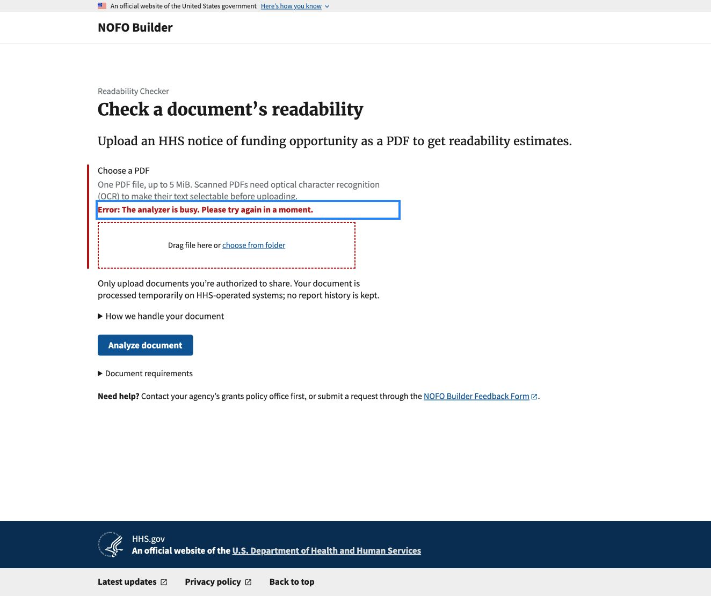
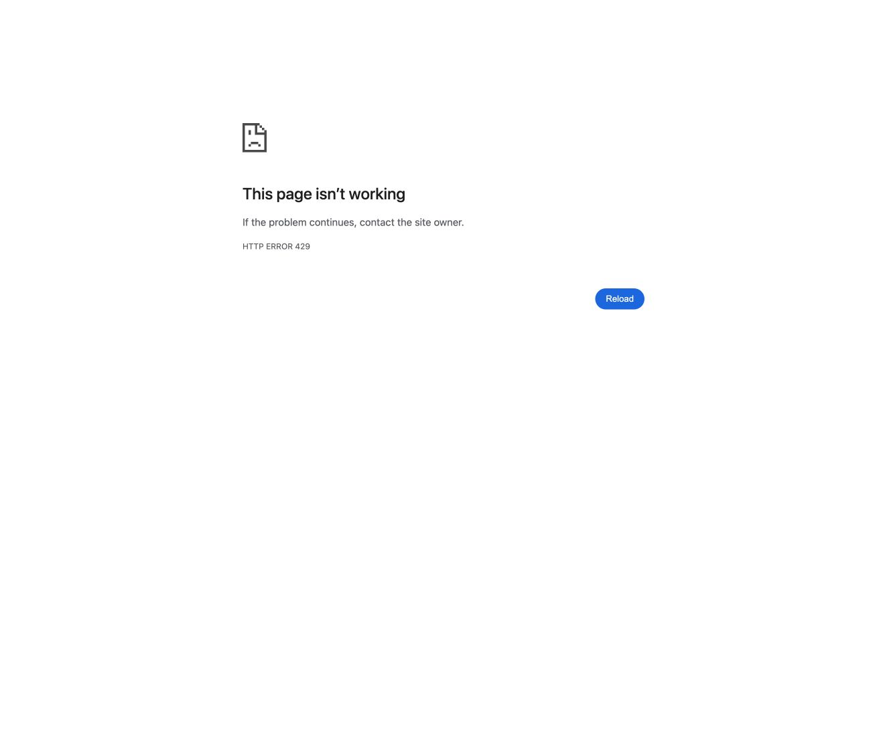

# Readability Checker deployment verification evidence

Captured in Chrome on November 9, 2026 for [deployment verification issue #971](https://github.com/HHS/simpler-grants-pdf-builder/issues/971). See the [readiness guide](../../readability/READABILITY_CALCULATOR_READINESS.md#what-users-see-and-where-to-look) for current behavior and monitoring.

## Builder analyzer busy

Builder rendered its actual public upload template locally with a synthetic PDF and a simulated busy analyzer response.

## WAF upload rate limit

A local server returned HTTP 429 with an empty response body, matching the current WAF rate block configuration. This screenshot shows Chrome's generic error page. Other browsers may display a different error page or a blank response.

The screenshots show a local reproduction. They do not establish live browser behavior or deployment settings.

## November 10 dev temporary storage and cleanup

- **Environment and method.** On November 10, 2026, the
  [runtime verification workflow](https://github.com/HHS/simpler-grants-gov/actions/runs/42829391563)
  ran from 8:58 to 9:00 a.m. Eastern, dispatched by `benbrasso`. It used
  synthetic PDFs in a disposable infra-dev task with the service's deployed
  task definition. The workflow ran from SGG
  `30fe0cd70dc1bb21bfc7c00c759e0b58b76ec415`, which includes
  [SGG #13221](https://github.com/HHS/simpler-grants-gov/pull/13221).
  The latest [successful dev rollout before the probe](https://github.com/HHS/simpler-grants-gov/actions/runs/42716263766)
  deployed Builder `8e660d2580072376b242b1ef1d7bc0fabf8fc68a`, which includes
  the [request workspace and interruption cleanup fix](https://github.com/HHS/simpler-grants-pdf-builder/pull/1316).
  The probe reported `hhs-nofo-metrics` 0.7.0 and `pypdf` 6.21.4.
- **Storage.** The disk-backed upload and analyzer working directory both
  reported `memory_backed` from the filesystem check inside the request workspace.
- **Cleanup and runtime.** The synthetic supported PDF, invalid and encrypted
  rejections, and controlled timeout all passed their cleanup checks. The
  probe observed the files and analyzer directory gone before fallback cleanup
  and verified workspace removal. Linux analyzer limits, the minimal child
  environment, and PostgreSQL admission and release checks passed. The task
  exited successfully, and the public upload switch was off before and after.

This run establishes storage and cleanup in the disposable dev task for the
cases tested. Live-service worker interruption, service task replacement,
production storage, and deployed log handling and retention remain separate
checks. See the [readiness plan](../../readability/READABILITY_CALCULATOR_READINESS.md#3-runtime-checks-without-opening-public-uploads)
for the remaining verification and review.

## November 10 signed-out dev logging check

At 3:20 p.m. Eastern, one approved synthetic PDF was submitted through the
signed-out Readability Checker on infra-dev after the
[dev deployment](https://github.com/HHS/simpler-grants-gov/actions/runs/42852799008)
of Builder `c5aee10ec63b4cde554046f03331517787a7977d`. The request returned
HTTP 200 with a report. The public switch was off before the test, enabled
briefly for the upload, then restored to off. The dev and production public
pages both displayed the unavailable page afterward.

An aggregate New Relic query for 3:19–3:23 p.m. Eastern found one application
POST by time and route and one load balancer POST with the distinct synthetic
request marker. Searches of the message, request, URL, and applicable exception
fields returned zero matches for the test filename and the phrase embedded in
the PDF in both sources. This verifies the fields searched for one successful
dev upload. Failure paths and production uploads remain outside this result.

### Logging coverage reviewed November 10

- New Relic showed Builder application and load balancer access logs for both
  infra-dev and production. A 24-hour query returned no WAF log category under
  the two Builder entity names and no matching span or transaction-error
  events under those entity, service, or application names. Coverage under
  other identifiers or in other systems remains unverified.
- The [production inspection](https://github.com/HHS/simpler-grants-gov/actions/runs/42861864575)
  reported 1,827 days of retention for the application CloudWatch log group and
  one forwarding subscription. The [WAF configuration source](https://github.com/HHS/simpler-grants-gov/blob/main/infra/modules/service/waf.tf)
  declares a separate CloudWatch log destination. The production inspector
  reads the web ACL and application log settings. Verifying the deployed WAF
  logging destination, retained fields, and access requires a separate
  restricted check.
- The New Relic account's retention view required additional access. Have
  authorized observability and infrastructure owners verify effective
  retention and reader access, plus any trace, error-reporting or crash-data
  destinations, under [safeguards #970](https://github.com/HHS/simpler-grants-pdf-builder/issues/970).
