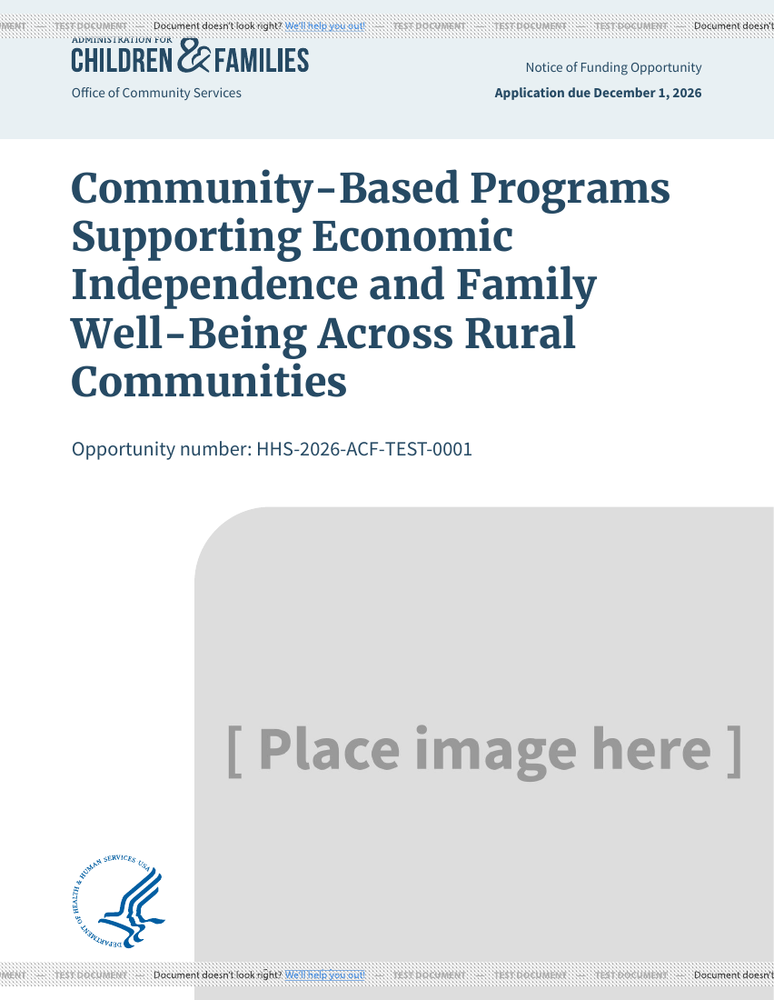

# ACF standard-image cover title sizing

Rendered synthetic covers through DocRaptor's free test mode using the actual
cover template, repository fonts, and styles, with Prince 15.1 / pipeline 11 and
print media. The sample uses the bundled placeholder cover image; the production
record requires authentication and was not accessed.

## Before and after

This 104-character title reproduces the overflow:

> Community-Based Programs Supporting Economic Independence and Family Well-Being Across Rural Communities

Before the change, the title and opportunity number occupy one page and the
image moves to the next. After the change, the header, title, opportunity number,
image, and HHS logo share one page.

| Before | After |
| --- | --- |
|  |  |

## Validation

- Six synthetic titles of 18, 104, 127, 167, 230, and 255 characters exercise all
  four existing title-length classes. The original render has seven pages; the
  updated render has six. Each updated page contains its header, title,
  opportunity number, and image. All six updated pages were visually inspected.
- ACF standard-image title sizes change from 36/28/24/23pt to 32/26/22/21pt.
  Length thresholds remain 110, 165, and 225 characters.
- The rules live in the ACF stylesheet and require the standard-image cover
  class. Text-only and full-coverage covers, body headings, and other OpDivs do
  not match these rules.
- Existing ACF standard-image covers receive the styling when rendered again;
  no migration or record update is required.
