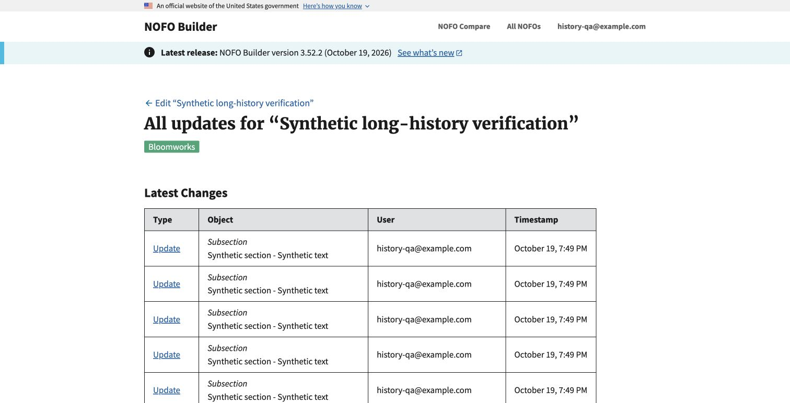
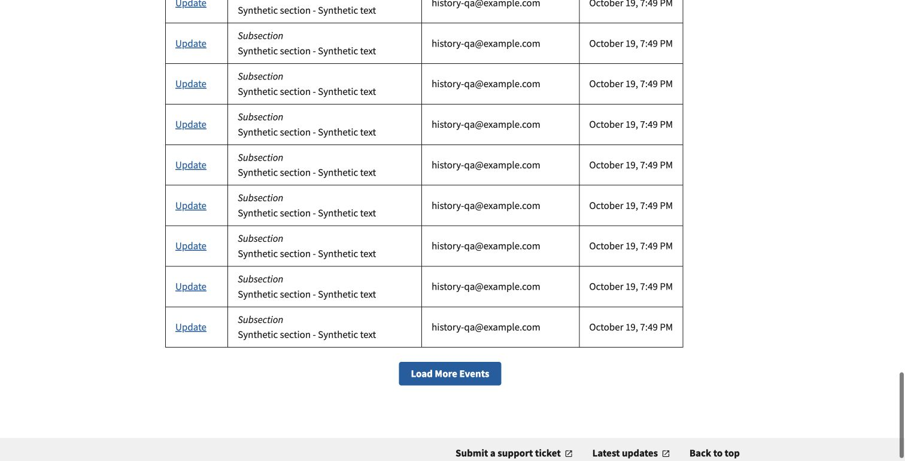

# History performance verification

Local synthetic verification for #1142. No production NOFO, account or audit
payload was used. The UI keeps its existing styles and controls.

## Dataset and measurements

Isolated SQLite database: 1,000 synthetic body-edit events for the viewed NOFO,
3,000 for an unrelated NOFO, plus ordinary create events. Each synthetic snapshot
has a 14,400-character body; changed fields contain old/new copies.

Original retrieval at base `f20039cd` loaded 1,003 events in 0.4378 seconds, before
row formatting/comparisons. New full Django test-client HTTP requests returned
200 in 0.0726 seconds on the first page, 0.0240 seconds at offset 25 and 0.0097
seconds at offset 975. Query counts were 14, 13 and 13, including request
authentication/middleware; the first request initialized caches. These are
different scopes, not an apples-to-apples end-to-end speedup claim. Tests separately
assert equal warmed request counts for one versus 25 rows and no JSON `LIKE`.

Runtime backfill resolved 4,006 events with zero unresolved ownership in 2.6716
seconds. This is local synthetic evidence, not a production migration estimate
or a reproduction of the production timeout on the example NOFO.

## Browser checks

Chrome opened the actual local history route after ordinary sign-in with a
synthetic local-only account. The initial table had 25 rows and next offset 25.
Selecting **Load More Events** appended another 25: 50 distinct comparison URLs
and next offset 50.

The edit page's **See all updates** link was exercised, and an Update comparison
opened successfully with its Before/After columns. The initial page and Load More
do not compute these comparisons.

The screenshots show the unchanged real history interface, not a mockup or a
production response. This is a performance repair, not a visual redesign.
Deployment and production timing remain separate checks in
[DOCUMENT_HISTORY.md](../../DOCUMENT_HISTORY.md).
