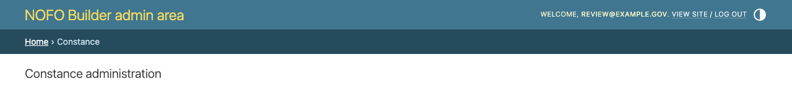
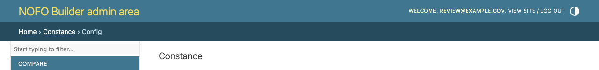
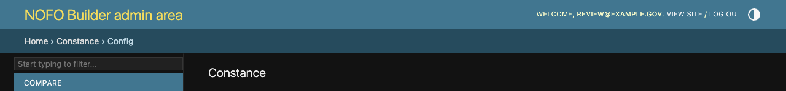
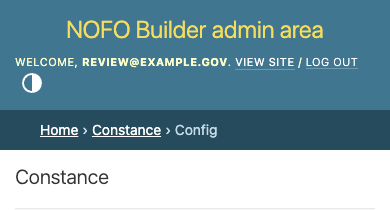

# Constance breadcrumb validation

Verified locally with the locked Django 6.1.2 and Constance 4.3.5 packages,
using an authenticated superuser and an isolated SQLite database.

- `python manage.py test bloom_nofos.tests_bloom_nofos.test_admin_assets --noinput`:
  all 3 tests pass. Removing the template override makes the new regression
  test fail specifically for `/admin/constance/config/`.
- Both `/admin/constance/` and `/admin/constance/config/` render a breadcrumb
  navigation landmark containing an ordered list and one current-page marker.
  The Home and Constance links resolve correctly; the configuration form and
  Save control remain present.
- Browser checks pass for both pages at 1280px in light and dark modes and at
  390px in light mode. Breadcrumbs retain the same background, padding and
  40px height; their width fits the viewport. Screenshots focus on the header
  and breadcrumbs, which are the scope of this fix.
- Black, isort and `git diff --check` pass for the changed files.
- The remote development admin pages were not authenticated or modified.
  These screenshots show local rendering, not a deployed change.

## Screenshots

