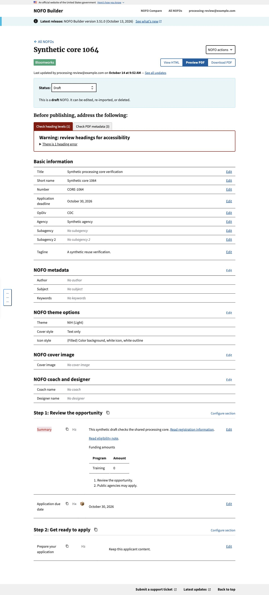
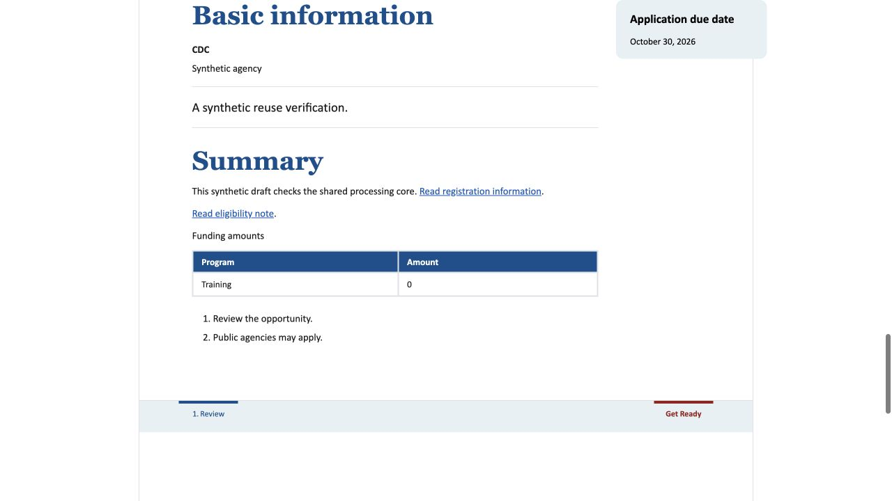

# Framework-independent processing core: verification

Issue #1064, based on merged #1063 / main `1e92725b`.

## Reuse benefit and limits

`nofos.content_processing.process_document_content` runs on HTML text without
initializing Django, loading models/storage/web modules, or constructing an
upload, user or document record. Builder, Composer and Compare reuse this same
core through a thin application adapter. Existing parser objects and NOFO rules
remain; this is not yet an independently installable package or a universal
editor interchange format. See [boundary documentation](../../DOCUMENT_PROCESSING.md).

## Automated verification

- Fresh merged-main baseline: 80 processing/characterization/Tagline/Metadata/
  introductory-page tests passed before editing.
- Full local suite after extraction: 2,555 tests, three existing skips, successful.
- All 56 JavaScript tests passed; no migration changes detected.
- Independent review found no actionable findings and separately passed 27
  core/adapter/characterization tests and 655 existing NOFO tests.
- The reviewer compared moved function bodies against main: unchanged except
  the explicit debug callback and CSSParser's non-fetching external-import hook.
- A committed fresh-process test blocks application, database/storage, web and
  Word-adapter imports plus network and file writes. It exercises wrapped
  headings, Metadata, Tagline, introductory links, captions, tables, callouts,
  lists, bookmark/alt markers, endnotes, local CSS and structured failures.
- Adapter tests retain existing error codes/detail fields, callback exception
  identity and the DEBUG snapshot capture point before instruction removal.

Suite counts overlap and must not be added. Local tests use repository-pinned
metrics 0.5.4 in an isolated environment, not the older shared editable package.

## Browser smoke check

Actual existing import form in the local in-app browser, using synthetic HTML,
isolated SQLite and DEBUG off. No production record, private master or provider
credential was used. Source: [synthetic HTML](synthetic.html).

The import advanced to naming and saved a draft. The editor and normal HTML
output show both steps, summary prose, the Funding amounts caption and zero
table value, ordered list, Application due date callout and captured Tagline.
Trailing Metadata supplied the title, number, OpDiv, agency and deadline without
becoming an applicant-facing section. The source introductory section was
consumed and its real destination remapped to the maintained new-family page.
Clicking the list link reached `#note-1`; clicking the registration link reached
`#section--before-you-begin`. The generated introductory page is present.

The intentionally minimal fixture displays a heading-review warning and blank
PDF metadata warnings. Those are expected fixture limitations, not a clearance
or accessibility claim. No PDF/Word export or full final-template review was
performed. No production deployment, feature flag or saved record was changed.
