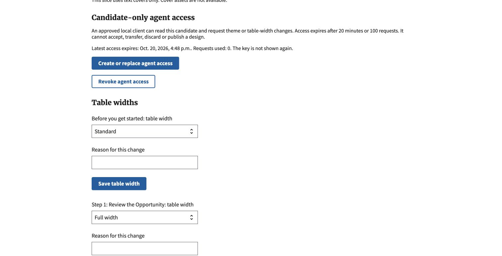
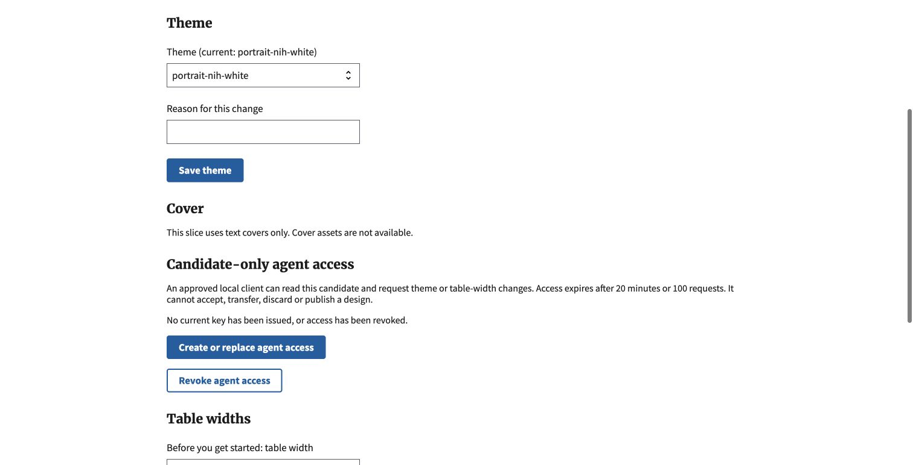
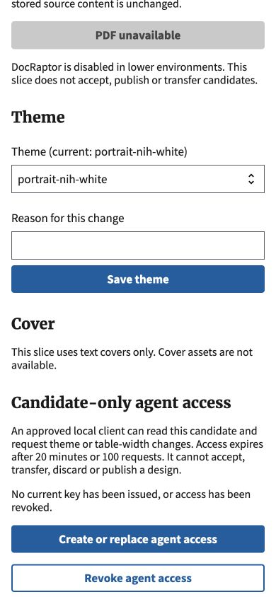
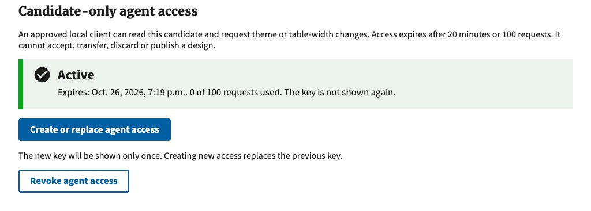
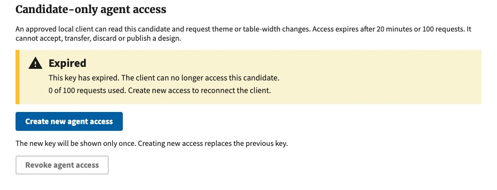
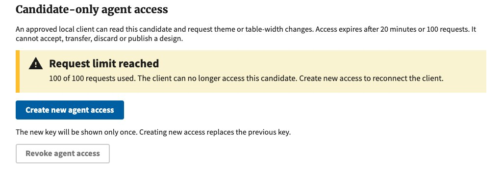
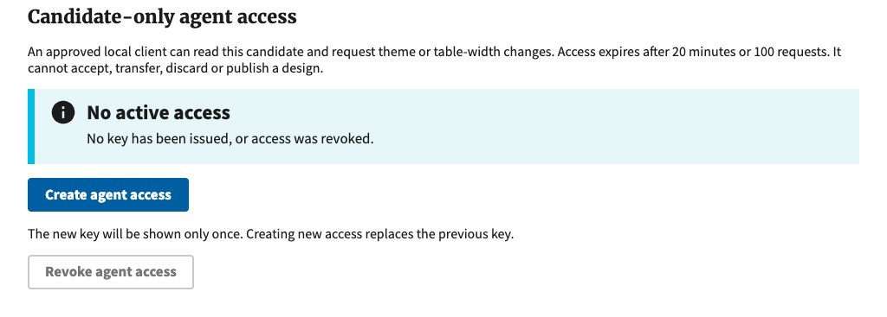
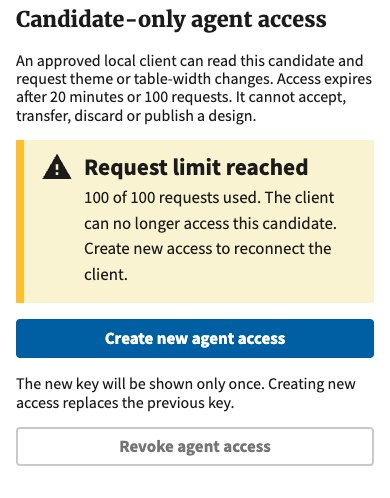

# Candidate-only interface verification

October 20, 2026. Synthetic local data only; stacked on the connected-host slice.

## Verified

- Full local Django suite: 2,734 tests, three existing skips, OK. Run from `nofos/`.
- JavaScript suite: 57 passed.
- Independent review: no blocking findings; reviewer independently passed all 41
  transport, SQLite concurrency, connected-host and pure-kernel tests.
- Final focused rerun: all 41 tests passed. Coverage includes cookie-only and
  cross-candidate denial, current ownership, expiry, replacement, revocation,
  quotas, malformed JSON, stale revisions, forbidden operations and rollback.
- Actual concurrent requests use separate SQLite connections. Competing writes
  cannot both succeed against an old revision; requests cannot exceed quota.
  SQLite contention may fail closed and require a sequential retry.
- Fresh migration 0155 applied to the isolated scratch database.
- Chrome: reviewed credential-free access controls and revoked a synthetic grant.
  No plaintext key was displayed, captured or shared. Issuance and authenticated
  operations were tested through Django clients, not a live model or browser key page.
- At the default width and 390-pixel narrow viewport, access controls wrap and
  remain visible. At 390 pixels the document width is also 390 pixels. Computed
  new heading styles match the existing Theme and Cover headings: Merriweather Web,
  21.44 pixels, weight 700. Temporary viewport override was reset.

## Screenshots

These contain invented candidate data and no credentials.

Credential-free access controls before revocation:

After revocation:

Narrow-screen controls after revocation:

## Not established

This is an HTTP authorization boundary, not an OS sandbox or a wired agent
runtime. No real documents, provider calls, DocRaptor, PDF review, acceptance,
transfer, publication or discard were exercised. No shared or production use is
approved by this evidence. Other database engines and reverse proxies were not
tested. The one-time key page is covered by response/security tests, not screenshots.

## October 26 access-status review follow-up

The human review approved explicit access statuses in the existing review-page
section. It now shows **Active**, **Expired**, **Request limit reached**, or
**No active access**; inactive keys offer a new-access action and disable the
revoke button. These statuses are recalculated when the page loads. Existing
server-side expiry, request limits and authorization checks remain unchanged.
Editor Task instructions explain the labels and refresh behavior.

- Full Django suite on the updated branch: 2,882 tests, three existing skips, OK.
- Focused transport/host/kernel suite: 50 tests, OK. The lifecycle test checks
  displayed status, button availability and actual credential admission through
  expiry (including its exact boundary), exhaustion, revocation and reissuance.
- JavaScript suite: 61 tests passed. Changed Python files pass Black/isort;
  diff and commit checks pass.
- Chrome captures below use actual Django-rendered responses for invented test
  data, served locally with the application's static assets. CSRF input values
  were removed from the preview files; bearer keys and authentication cookies
  were never included. This is rendered-page verification, not a live-agent run
  or a browser exercise of the one-time key page.
- At 1440 and 390 pixels there is no horizontal overflow. Section headings match
  Theme/Cover/Table widths at 21.44 pixels, weight 700, and Chrome confirms the
  rendered Merriweather font. Alert headings render Source Sans Pro Bold at
  23.36 pixels with the existing USWDS alert spacing.
- The branch update preserves the outside-edit recovery fix from `main` and
  joins tool-access and history migrations with migration 0157. A scratch
  database upgrade from main's schema succeeded with no migration drift.

