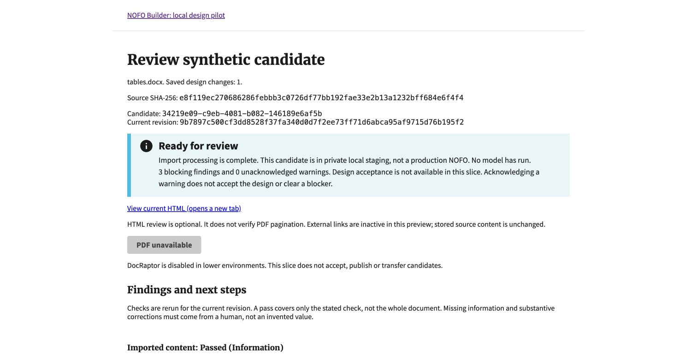
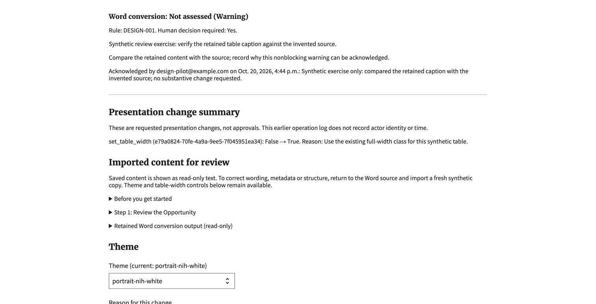
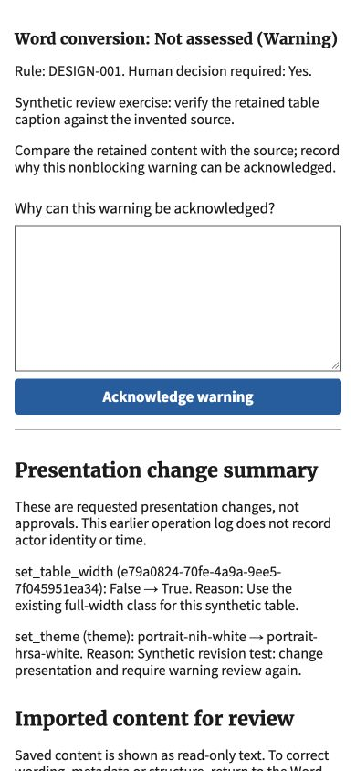

# Synthetic candidate review evidence

October 20, 2026. Invented local documents only, stacked on the candidate-only
interface. This is a partial #1148 slice, not an acceptance or operating approval.

## Checks

- Independent code review found no blocking issues and independently passed all
  52 combined review, transport/concurrency, host and kernel tests.
- Parent focused rerun passed all 52 tests. These cover attribution, immutable
  retries, stale design/render/finding evidence, blockers that cannot be
  acknowledged, diagnostic failures, ownership/group/CSRF, escaped text and
  disabled capabilities. No PDF/network call is required.
- Independent guide/task review found no blocker. Two minor instruction fixes
  were applied: counts belong to the summary alert; copy unsaved reasons before
  submitting rather than after the recovery page has replaced the form.
- Migration 0156 applied to the isolated SQLite database. Full-suite results and
  final migration/format checks are recorded in the PR.

## Chrome walkthrough

1. Loaded an existing synthetic table-heavy candidate. The report identified
   an existing heading diagnostic and retained the source/import and asset/link
   verification blockers. Optional HTML was available; PDF remained disabled.
2. Followed **Review affected section**. Chrome expanded the relevant read-only
   section and showed all ten table rows and the ordered submission list.
3. Added a clearly labeled invented warning for this exercise in the scratch
   database. Submitted a human acknowledgment through the actual browser form.
   The page showed the local synthetic user's identity, timestamp and reason;
   the warning count became zero while all three blockers remained.
4. Changed the theme using the ordinary pilot form. The revision and design
   change count changed, and the warning required acknowledgment again. The old
   acknowledgment was not applied to the new revision.
5. At 390 pixels, the warning form and button remained usable and the document
   width was 390 pixels, without horizontal overflow. Reset the viewport after
   capture. New section headings match existing Theme/Cover headings:
   Merriweather Web, 21.44 pixels, weight 700. The alert heading uses Source Sans
   Pro Web at 23.36 pixels, weight 700, following the shared alert pattern.

Screenshots contain invented content and no credentials. The warning was seeded
for the exercise; it is not evidence that the source generated that warning.

## Limits

No acceptance/rejection/deletion, production transfer, substantive content edits,
real documents, model runtime, provider calls or DocRaptor/PDF were exercised.
Source-to-import and complete asset/link fidelity remain explicitly not assessed.
Passing diagnostics do not prove accessibility or design completion. Historical
render archives and attribution for earlier presentation edits are not implemented.
The full #1148 walkthrough and acceptance criteria remain open.
