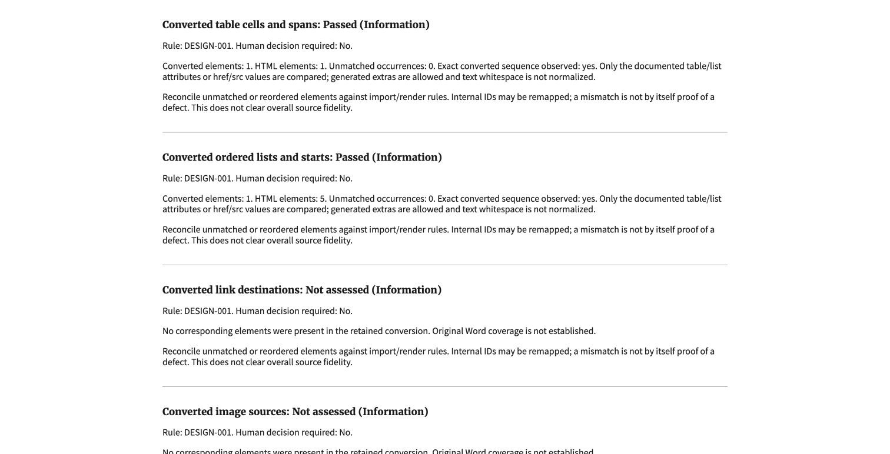
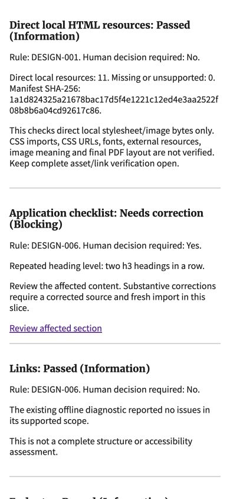
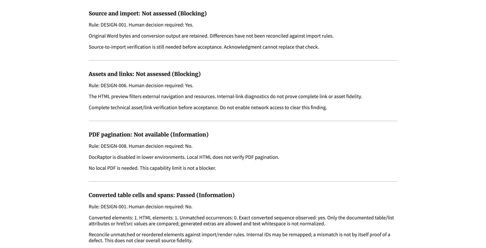

# Bounded fidelity evidence verification

October 20, 2026. Invented local content only; this is partial #1146 evidence,
not complete source fidelity, design acceptance or operating approval.

## Review loop and automated checks

- Independent review identified three gaps: unsupported inputs initially lacked
  exact-byte evidence binding; table header-cell IDs were omitted; inline CSS
  marker changes could be mistaken for unchanged lists. All three were fixed
  and independently rechecked, with regression tests.
- A final resource-bound check added bounded reads, a 5 MiB/file limit and a
  shared 16 MiB direct-resource budget. The independent reviewer verified it.
- Final exact-code independent run: all 68 fidelity/review/transport/concurrency/
  host/kernel tests passed. Parent focused rerun also passed 68.
- Tests seed changed amounts, removed cells, changed spans/header IDs, list
  starts/values/order/reversal, duplicate-link loss, remapped destinations and
  removed images. They also cover unsupported/oversized equal-summary inputs,
  missing/linked/traversal paths, changed static bytes and resource budgets.
- Source/complete-asset blockers remain in the report. Passes do not enable
  acceptance or clear those blockers. A changed evidence identity stales the
  human warning form. No new import rule or normal render behavior changed.
- Full-suite, migration-drift, formatting and CI results are recorded in the PR
  handoff rather than inferred from these focused checks.

## Chrome walkthrough

Used the existing synthetic table-heavy candidate and actual filtered native
HTML, with no new model/provider call or PDF generation:

- One converted table matched one HTML table, including all ten body rows;
  one converted ordered list was observed in the HTML's five total ordered
  lists (generated navigation is allowed as extra output).
- No converted links/images were present. Their inventory was not assessed,
  not passed or represented as absence from the original Word.
- All 11 direct local resources resolved and their bytes were hashed. CSS
  imports/URLs, fonts, external resources and image meaning remain outside scope.
- Source/import and complete asset/link blockers remained visible, as did
  the expected informational PDF limitation and existing heading diagnostic.
- At 390 pixels, the resource digest wraps without horizontal overflow:
  viewport and document width both 390 pixels. Temporary viewport was reset.
  Finding headings reuse Merriweather Web, 16.64 pixels, weight 700.

All screenshots contain invented content and no credentials.

## Limits

These are exact sequence observations of selected converted HTML facts, not
an independent source-to-import reconciliation. Repeated matching generated
content could satisfy an observation; semantic source-to-output mapping remains
unimplemented. Missing exact matches can reflect intended transformations and
must not automatically be called importer defects. The maintained rule/field/ID
mapping ledger and complete Word extraction/prose/asset verification remain work
to do. No acceptance, deletion, live transfer or real-data operation was tested.
