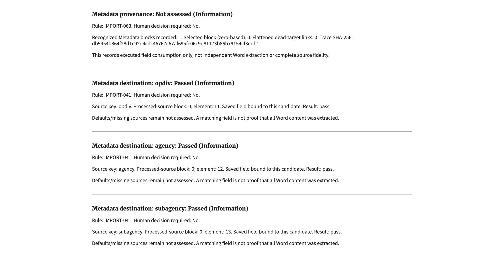
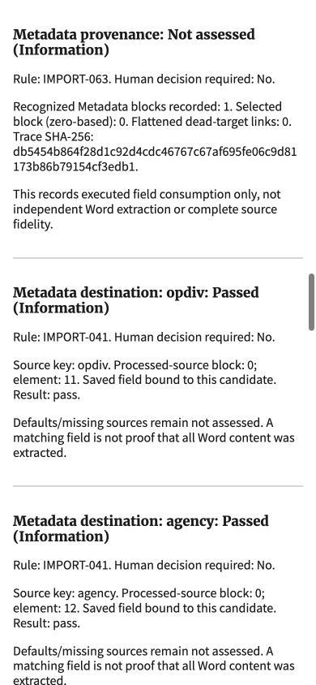

# Metadata consumption evidence

October 20, 2026. Invented local content only. This is a bounded #1146 mapping
slice, not complete source fidelity or acceptance readiness.

## Review and tests

Independent review found that malformed inner trace structures could be described
as recorded evidence. Added compact validation for blocks, field/blank events,
selection, flattened links, destination coverage and origin bindings, plus
mutation regressions. The reviewer rechecked the fix and independently passed
all 73 provenance, Metadata import, core/adapter, host and review tests, with no
remaining blocking findings. No importer replay is used as independent evidence.

Tests compare traced and untraced output and sections, preserve the original soup,
cover duplicate/blank precedence and non-Metadata boundaries, run synthetic Word
through conversion and saved fields, retain defaults and OpDiv rejection, and
reject malformed/changed evidence and stale forms. Full-suite and CI results
are recorded in the PR handoff.

## Chrome walkthrough

- Uploaded a new synthetic DOCX generated by the existing `metadata_docx` test
  helper through the actual local upload form. It uses an invented number and
  the author placeholder `{Same as OpDiv.}`.
- The report recorded one recognized block, ten mapped destinations and no
  flattened dead-target links. All ten destination comparisons passed. The
  existing placeholder rule made the author blank; the separate missing-author
  diagnostic correctly remained blocking. Matching an import rule is not proof
  of a complete document.
- Source/import and complete asset/link blockers remained visible. An unmatched
  converted list also stayed unresolved, rather than being waived by Metadata
  evidence. This fixture's native endnotes can transform list structure; the
  observation alone does not establish an importer defect.
- Re-uploading the existing routine fixture returned its original candidate
  and correctly reported no reconstructed Metadata trace.
- Desktop and 390-pixel layouts were inspected. The trace hash wraps; viewport
  and document widths were both 390 pixels. Temporary viewport was reset.
- No model, provider, PDF, acceptance, transfer, deletion or real-data operation.
  Screenshots contain only invented content and no credentials.

