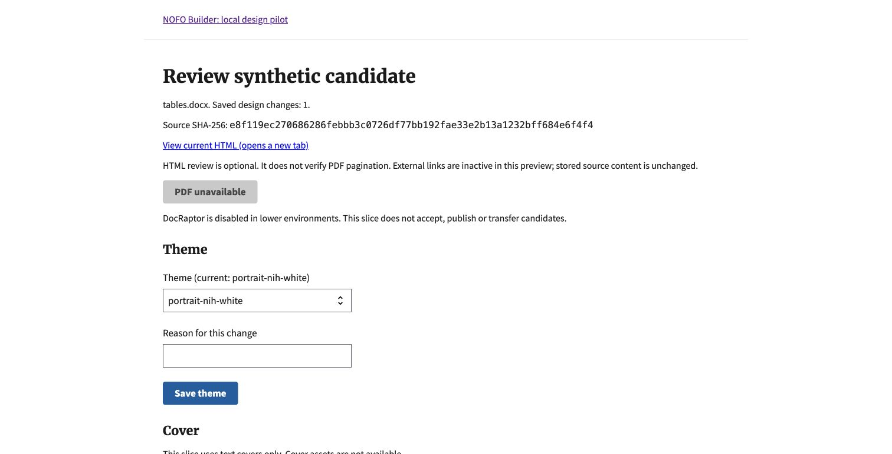
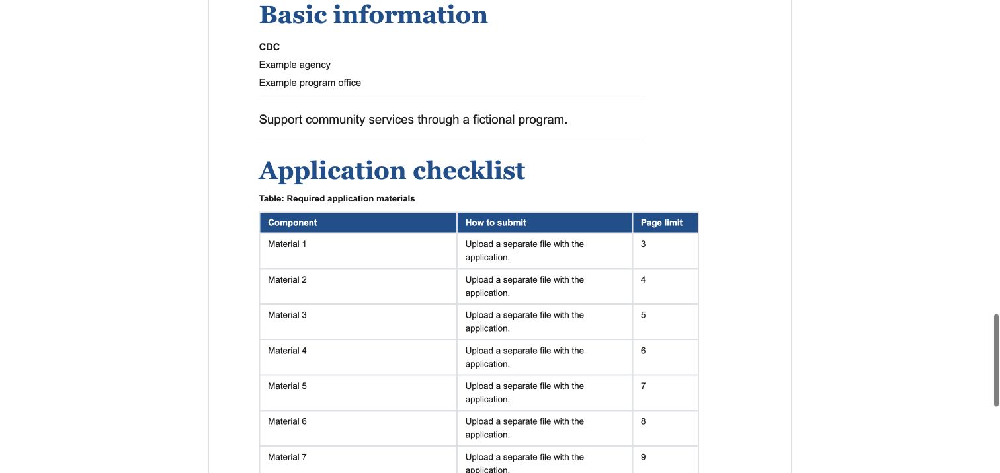
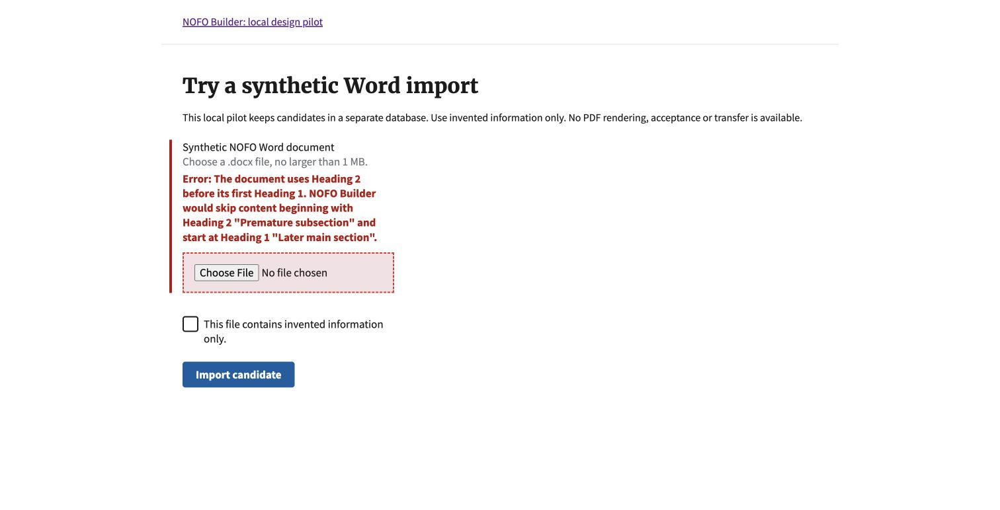

# Connected local host evidence

October 20, 2026. Invented documents only, private scratch SQLite database,
ordinary synthetic user, localhost Chrome, DEBUG off and no export credentials.

## Verified locally

- 73 tests: connected host/profile, pure candidate rules, Word readability and
  editable-introduction regressions. Includes source-byte integrity, current-group
  revocation, same-group cross-owner denial, cross-candidate requests, stale
  rendering inputs, failed compare-and-swap, transaction rollback, duplicate
  imports, CSRF rejection, unsupported operations, unsafe profile configuration
  and assertions that PDF/S3 cover functions are never called.
- Fresh isolated migration succeeds; `makemigrations --check --dry-run` reports
  no changes. This does not replace full-repository CI.
- Chrome: routine Word import; existing HRSA theme saved with a reason; old HTML
  link rejected after that change; current native HTML opens successfully.
- Chrome: table-heavy import; full-width option persists; rendered section has
  `section--tables-full-width`, all 10 body rows and three numbered steps remain.
- Chrome: invalid H2-before-H1 source produces the existing actionable import
  error. Judgment source retains its contradictory dates and quoted adversarial
  instruction as content. No authority/readiness claim follows from that import.
- Restarted the isolated process with the same scratch directory; synthetic
  account, candidates and saved design settings persisted.
- Independent connected-host review at `6d3fb3c7` found no blockers for this
  declared synthetic human-operated scope and independently passed all 73
  focused tests. A separate docs-only recheck confirmed the new Editor Tasks
  labels, prerequisites, recovery steps and links. All 57 JavaScript tests pass.

## Screenshots

These are HTML/control screenshots, not PDF output or PDF pagination evidence.
No real documents, production state, external model or agent credential was used.
The Python socket guard is not OS containment. Independent review does not
establish runtime authority or validate actual simultaneous requests; the tests
exercise failed compare-and-swap deterministically. Candidate-only agent
transport, human acceptance, transfer, complete
asset/link fidelity and cancellable bounded processing remain follow-up work.
