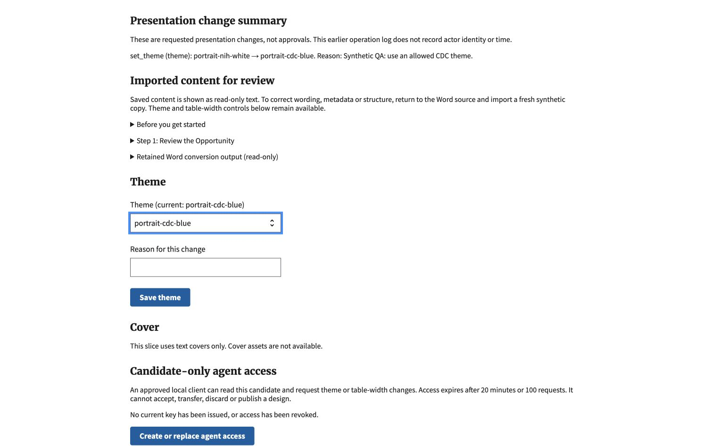
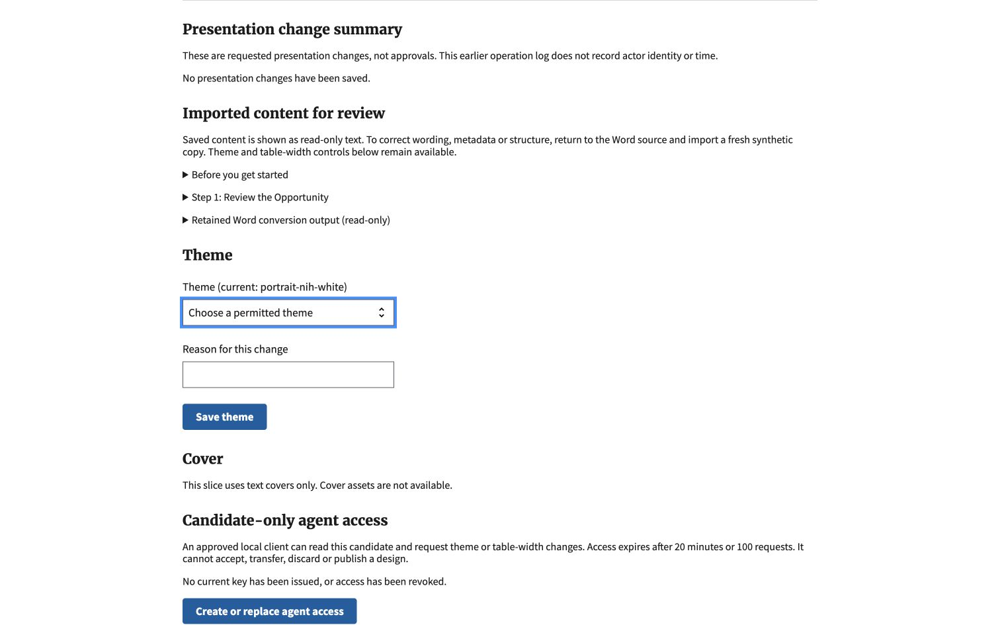

# Design stack refresh and permission checks

October 21, 2026. Refreshed #1160–#1165 against main `5b7b5137`, retaining
the temporary document-history rollback and current dependency/security fixes.
Shared branch history is preserved; no force push or PR merge was performed.

## Permission repair

The trusted host reuses `NofoThemeOptionsForm` for the initiating owner's current
group and document/resulting-theme cover restrictions. Reads, human writes and
candidate-only tool writes share the same filtered choices. Imported OpDiv text,
a broader session cookie, or submitted group fields cannot expand them. Retired
themes can be retained only when current and permitted; after changing away they
cannot be selected again. Cover mutations remain unavailable.

If the import's initial theme is not permitted, the control shows a required
empty placeholder. It does not implicitly select the first available replacement.
No source content or other presentation setting is changed merely by reading the
choices.

## Verified locally

- Fresh Python 3.14 environment installed from the refreshed lockfile.
- 94 focused catalog, host, tool, review, theme-policy and fixture tests pass.
- `makemigrations --check --dry-run` reports no changes.
- Existing 57 JavaScript tests pass.
- Changed Python files pass Black/isort and pre-commit checks.
- Final full-suite and per-PR CI outcomes are recorded in the PR refresh comments,
  not inferred from this focused evidence.

## Actual Chrome check

Ran the explicit isolated profile at loopback port 8921, with a private mode-0700
scratch directory, SQLite, DEBUG disabled, no provider/AWS credentials, and no
outbound Python connections. Used only repository-generated `routine.docx` and
`tables.docx`, not user documents. The synthetic owner belonged to CDC while the
imported source initially selected the NIH theme.

The theme control offered only active CDC themes. Explicitly selecting and saving
`portrait-cdc-blue` changed the saved design count from zero to one and displayed
the before/after theme and supplied reason. A second, unchanged import showed the
empty required placeholder, with no automatic replacement selected. Inspected the
rendered options and `required` state through the browser DOM.

Negative forged-value, membership-revocation, cross-owner, retired-theme and
resulting-cover policy checks are automated tests, not browser demonstrations.
The no-reload server was restarted after the template change before checking the
placeholder. These screenshots are integration evidence at the refreshed stack
tip, not independent evidence for every earlier branch in isolation.

No agent credential was issued in this browser run. No model, PDF renderer, cloud
service, real-document workflow, acceptance, transfer, discard, publication or
deployment was exercised. The host remains synthetic and local only. This is not
a complete source-fidelity, accessibility, PDF-layout or security assessment.
