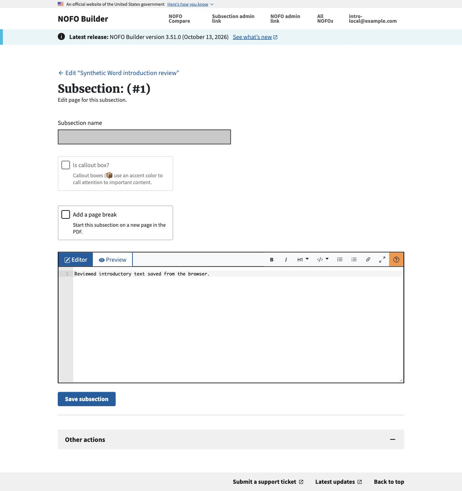
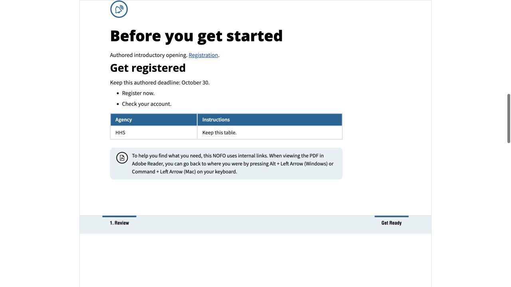
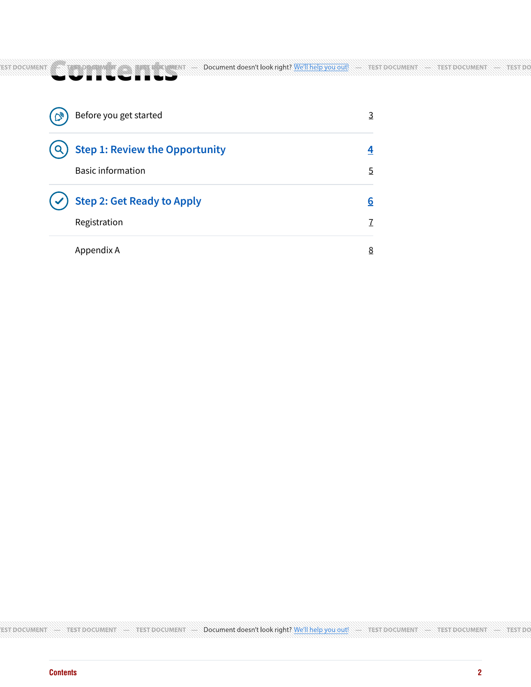
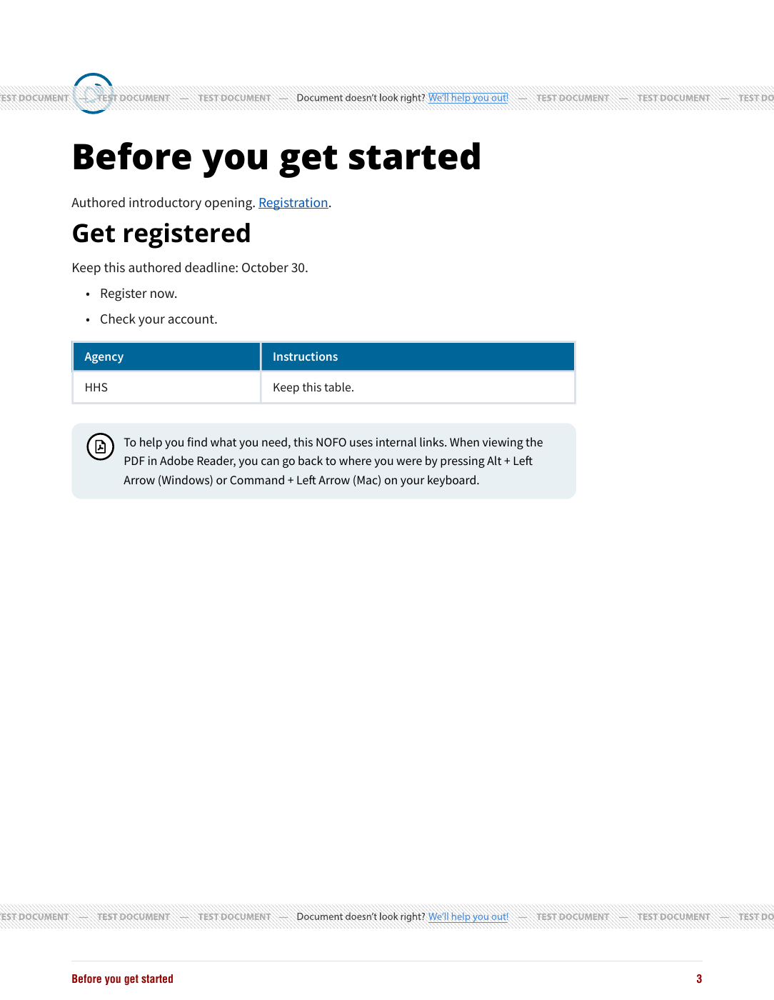
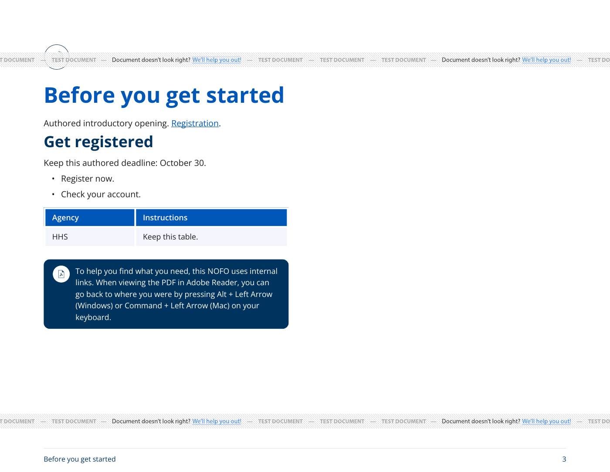
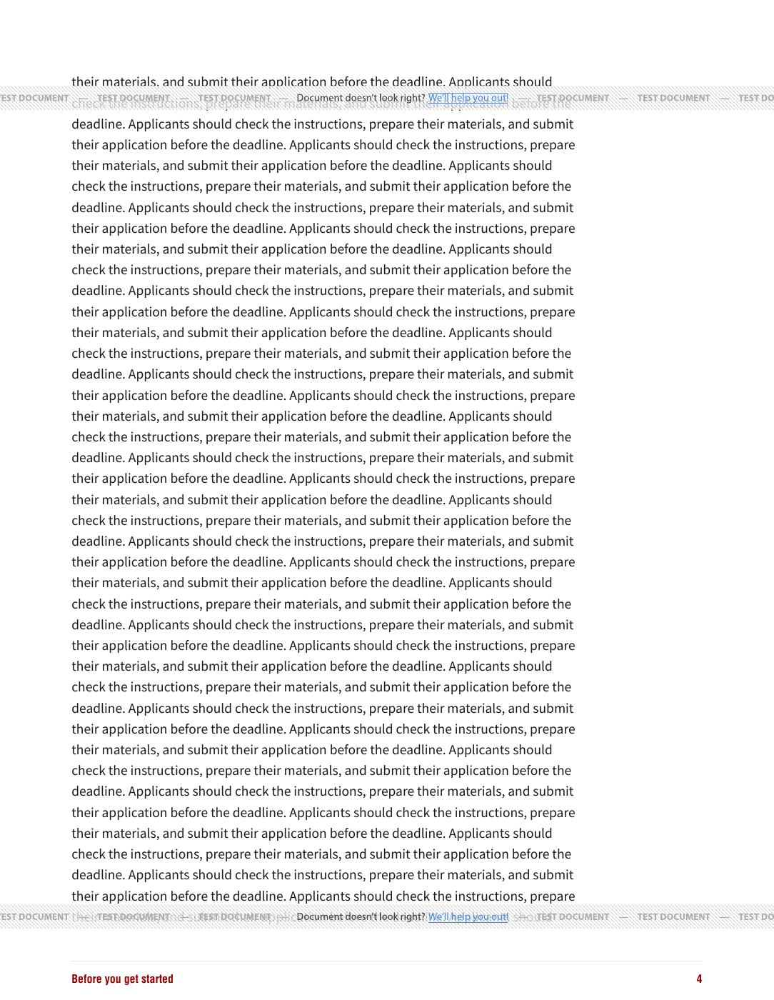
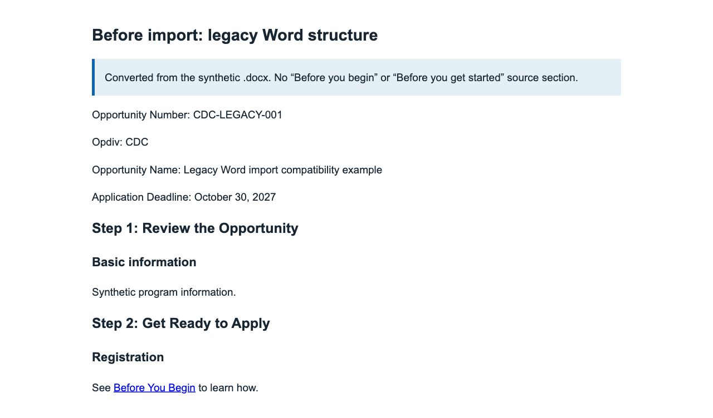
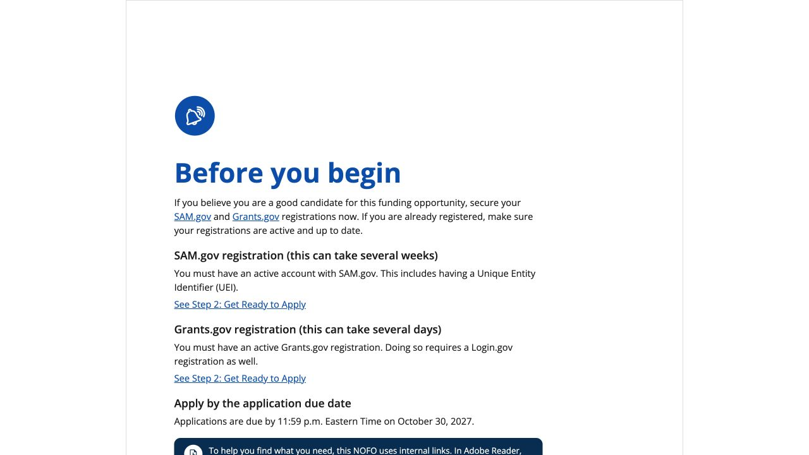
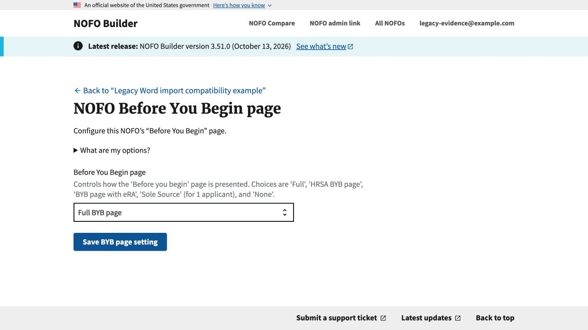

# Editable introduction verification

Issue #1115. October 15, 2026. This branch is stacked on the PDF snapshot fix
#1113/#1116 so migrations form a single 0152 -> 0153 chain. No merge, deployment
or production-record changes are part of this evidence.

## Design and compatibility

See [the durable behavior guide](../../EDITABLE_INTRODUCTION.md) for ownership,
classification, editor constraints, re-import outcomes and output policy.
Wording family and ownership are separate. A new explicit introduction role at
order zero leaves existing main-section orders unchanged. Existing records
retain their generated workflow and saved family/variant, including None and
blank/default numbers. Composer and Compare do not opt in.

The actual October 13 cleared Word master was converted and processed locally,
without sending its contents to any provider. It selected imported ownership,
retained four introductory subsections, and kept Step 1 at order one. That check
is local source recognition, not a claim about deployed import or final layout.
No private source or output is committed here.

## Automated scenarios

`test_editable_introduction.py` covers:

- T01/T03/T04/T20: compound recognition at both H1/H2, unsupported HTML/new
  documents, missing/repeated/empty intro, unsafe prelude rejection, source
  private-attribute spoofing and required-mode cross-family mapping.
- T02/T07/T08/T23: all three prior families and all five variants remain
  generated; settings stay accessible; blank/default numbers never select mode.
- T05/T06/T18/T24/T25: Metadata boundaries, ordinary source lists/tables,
  authored child bookmarks, canonical Step 2 links, note forward/return targets,
  unique rendered IDs, and no false broken-link warnings.
- T09/T10/T11: mode, family and role survive re-import, duplication and archival;
  missing introductory content stops before any overwrite/archive.
- T12/T13/T21/T27: settings GET/POST denied only in imported mode; lead body
  title is blank/disabled and has no heading control; direct heading/callout
  manipulation rejected; genuine named children remain editable; metadata
  changes do not rewrite source text; fixed role/name/order and unique parent.
- T14/T16/T18: parent-only compact TOC/icon, no numbered divider, Step 1 metadata
  and sidebar, preserved main numbering, and Endnotes insertion without moving
  the introduction. Historical noncontiguous-order rendering remains unchanged.
- T17/T19: guidance with/without authored equivalent text, content included once
  in full/export/readability HTML, and generated legacy body excluded.

Existing family/import, Metadata, forms, shared content-processing,
Endnotes/Appendix, Composer/Compare, and policy-export suites provide regressions.
Final suite counts, browser captures and independent review results are recorded
in the PR after verification completes. Do not read this list as proof that all
T01-T27 environments or actual provider outputs have been tested.

Independent final review at `71ba00a6` ran 146 focused tests with two existing
skips and found no remaining actionable code issues. The review caught source
prefix misclassification/loss and Endnotes reordering of the fixed parent; both
were fixed and independently rechecked. Actual Mammoth Word fixtures with a
preface paragraph or heading return 422 before creating any record. Final full
integration and CI results are linked in the PR.

## Local browser loop

The browser imported the synthetic DOCX through the real upload form, opened
the introductory body editor, saved revised prose and confirmed it in the NOFO
editor. Its title is blank/disabled, heading-level selector absent, and template
selection absent from the NOFO editor. Direct GET/POST settings and title/level
tampering are checked separately by endpoint/form tests. Screenshots contain
only synthetic content and a local test account.

Computed editor H1 uses Merriweather Web at weight 700; CDP platform-font
inspection confirmed the actual custom font was `Merriweather-Bold` rather
than merely a requested CSS family. This matches the established subsection
editor pattern. Source Sans Pro remains the surrounding body face.

## Actual synthetic PDF checks

Three outputs were generated through the actual DocRaptor test API using its
[documented public test key](https://docraptor.com/documentation/article/1067924-trying-docraptor-without-an-account-or-credit-card),
test mode, pipeline 11 and PDF/UA-1 profile request. Only synthetic content was
sent; current local CSS was inlined and public dev URLs resolved static fonts.
Production credentials were not used. Requesting a PDF/UA profile does not prove
accessibility conformance.

- Portrait HRSA/solid icon: eight pages, imported body on page 3.
- Landscape CDC/thin icon: eight pages, imported body on page 3.
- Long portrait source: eleven pages, intro spanning pages 3-6 without forced
  shrinking. Step 1 follows on page 7. Introductory footer remains consistent.

PDF pages and navigation annotations are inspected separately from HTML. The
vendor's test watermarks are expected. Short main sections intentionally leave
substantial whitespace on section-divider pages.

Parsed actual PDF annotations confirm both Step 2 links land on introductory
page 3 in short portrait/landscape outputs; in the long output the parent lands
on page 3 and the authored child heading on page 6. Every introductory page's
extracted footer retains “Before you get started.” Reviewed changed-region
rasters include compact TOC, both short introductory pages and the multi-page
continuation; this is not full-document visual clearance or an accessibility
audit.

## Remaining verification limits (AC16/T26)

- Actual GrabzIt DOCX bytes, bookmarks, TOC and footer have not been generated
  in this local environment. Its allowlist remains intact and production
  credentials are not used. Local Word-export HTML is not provider DOCX proof.
- No deployed cleared-master import/export has been performed for this branch.
- Synthetic representative layouts are not a review of every theme, source
  document, long table, browser or assistive technology.

These are explicit verification limits for maintainers, not a request to invent
another approval owner or broaden access to complete a local development task.

## Legacy Word source with no introductory section (before/after)

Verified locally using the PR branch plus review fixes. A synthetic legacy DOCX
contains first-page metadata, Step 1 / Basic information and Step 2, with neither
Before You Begin nor Before You Get Started as a source heading. It was uploaded
through Django's real import endpoint using its test client and an isolated
in-memory database. No ownership or BYB selection was manually assigned.

The import selected `generated` ownership and `full` automatically, created no
imported-introduction section, and rendered exactly one legacy **Before you begin**
page with SAM.gov / Grants.gov registration and the application deadline. The
settings endpoint remained accessible with **Full BYB page** selected. This is the
fallback default; NIH-group and legacy HRSA-theme imports retain their existing
separate defaults. `test_legacy_word_without_intro_defaults_to_full_generated_byb`
locks down this scenario.

**Before:** Browser screenshot of the DOCX's Mammoth-converted source, not a
Microsoft Word screenshot. The explanatory heading/banner identifies this view.

**After:** Browser screenshot of the actual HTML response from the imported
record, served locally with the repository's styles/assets. No generated body
text was inserted by the evidence script.

**Default/settings:** Actual template-settings response for the same record.

These screenshots verify local Word conversion/import, HTML rendering and
settings compatibility; they do not claim a new vendor PDF/DOCX or deployed test.
Only synthetic content is shown.
