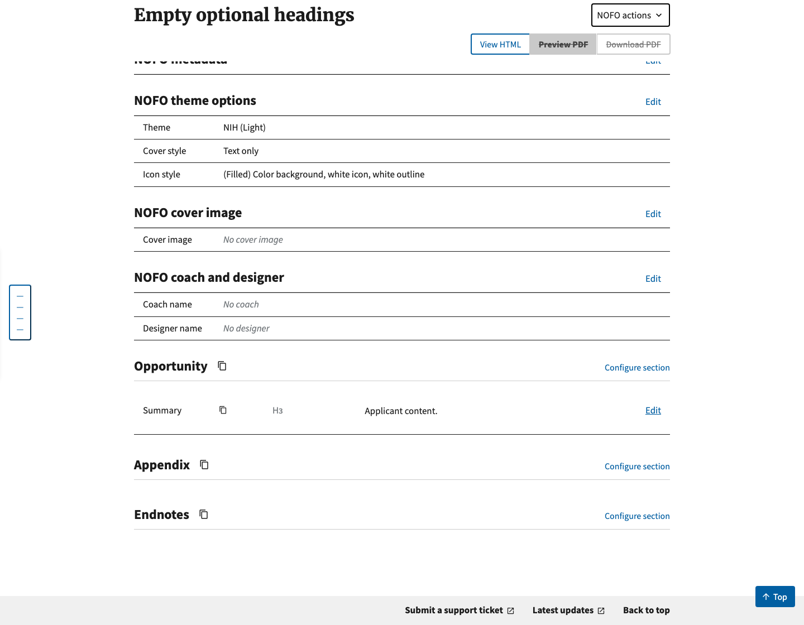
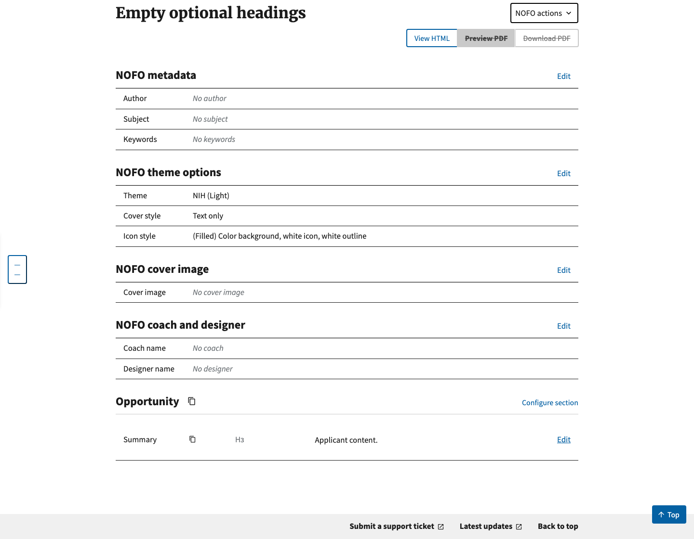
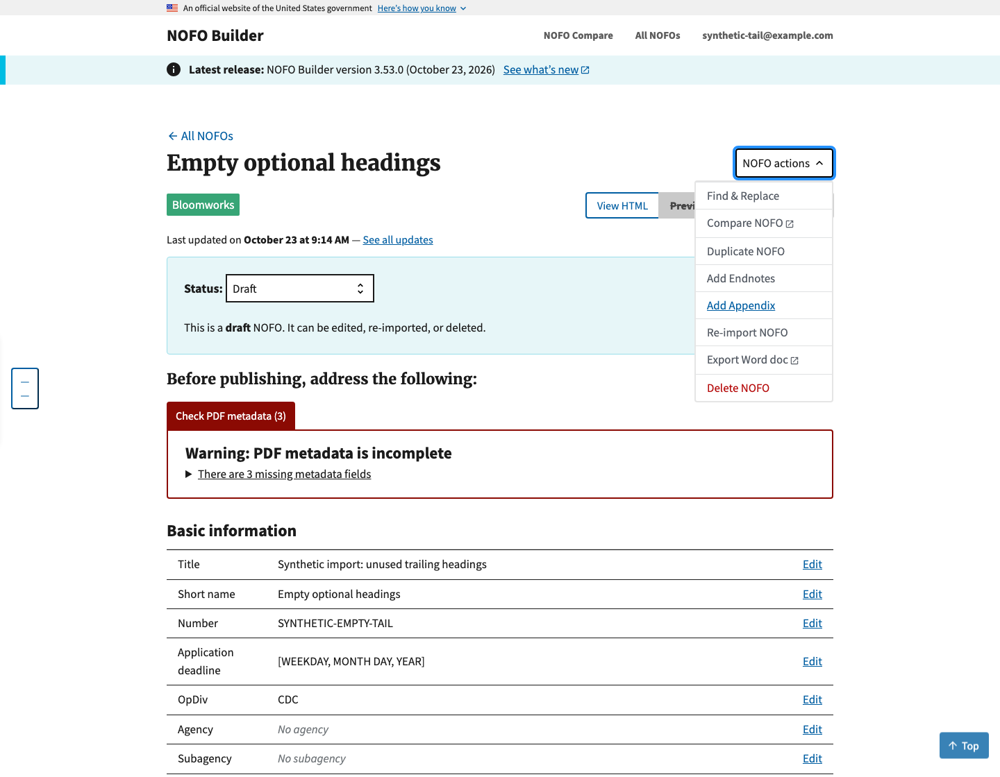

# Empty optional tail headings — import review evidence

## Origin and evidence limits

HRSA submitted a NOFO Builder feedback-form bug reporting an empty, unnecessary
Endnotes heading. The maintainer investigated that report and identified the
imported-heading/section-deletion gap. The maintainer clarified this origin on
October 23, 2026; see [issue #1207](https://github.com/HHS/simpler-grants-pdf-builder/issues/1207).
The original feedback submission and HRSA document are not included here.

GrantSolutions Announcement Module retaining a heading, or making the relevant
setting unclear, is an **unconfirmed hypothesis**. This change handles the
observed downstream symptom without claiming to reproduce its upstream cause.

## Synthetic Word reproduction

[empty-tail.docx](empty-tail.docx) contains only synthetic metadata, H1
Opportunity, H2 Summary, the paragraph “Applicant content.”, and empty H1 Appendix
and Endnotes headings. The package is generated by `placeholder_docx()` in
`nofos/nofos/tests_nofos/test_empty_trailing_headings.py`.

The baseline is upstream `main` at `72dc5aaf1da9ffb3a7c1db46c7fb944f4f6989e6`.
Captured locally on October 23, 2026 using Python 3.14, upstream's locked
dependencies, an isolated SQLite database and headless Chromium at 1440 × 1120.
Both records were created through the real Builder Word-upload endpoint using
a local synthetic account. For the before record, only the newly added cleanup
function was disabled; all other import code and dependencies were identical.
For the after record, the cleanup ran normally. Both records were given the same
synthetic display title and short name after import for comparison.
Screenshots show the actual running Builder UI, not mockups.

1. Import `empty-tail.docx` on the baseline (or with the new pass disabled).
2. Open the NOFO edit page and scroll to the document sections: Opportunity,
   Appendix and Endnotes appear, with no content in the last two.
3. Import the same file with IMPORT-071 active: only Opportunity is created;
   Summary and its paragraph remain intact.
4. Open **NOFO actions**: **Add Endnotes** and **Add Appendix** remain available.

### Before — unused sections remain

### After — main content remains; unused sections are omitted

### After — editors can still add the optional sections

## Validation

- Word uploads persist the expected sections through Builder, Composer and Compare.
- HTML reimport replaces previously saved empty sections with the cleaned input.
- Regression cases cover H1/H2, case/colon/spacing, blank paragraphs, consecutive
  placeholders, ordinary div wrappers and cleanup before hierarchy validation.
- Preservation cases cover populated sections, non-tail headings, child headings,
  images, tables, lists, rules, semantic containers, native note lists, similar
  titles and referenced bookmark targets. The pass is idempotent, and an upload
  containing only placeholders still fails the existing no-sections check.
- Full Django suite: 2,792 tests, OK with 3 skipped (256 seconds).
- Focused import/processing checks: 38 tests pass. JavaScript checks: 57 pass.
- Changed Python files pass Black and isort checks; `git diff --check` passes.
- Repository-wide formatting checks have pre-existing failures in
  `nofos/nofos/policy_language.py`, `nofos/nofos/tests_nofos/test_metrics.py`, and
  `nofos/nofos/tests_nofos/test_policy_language.py`. The same
  failures were confirmed against the corresponding unmodified upstream files.

No production service, private NOFO, external Word/PDF export, or generated PDF
was used. These screenshots establish import/editor behavior only.
