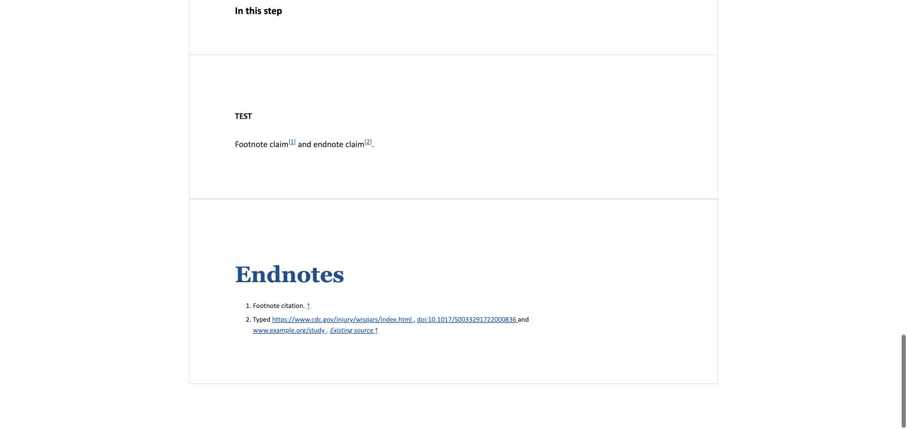

# Endnote citation links (#1114)

## Scope

Recognized native and successfully paired manual citation text gains explicit
HTTP/HTTPS, www and DOI links during import. Existing links and citation wording
remain intact. No saved records are rewritten on view/export. The implementation
reuses the existing note range wrapper and the shared import pipeline; it does
not enable a global Markdown extension or introduce a link-checking service.

## Source distinction

The synthetic DOCX fixture in `test_endnote_citation_links.py` contains native
Word footnote/endnote relationships, three typed addresses and one actual
external hyperlink relationship. Intermediate Mammoth HTML contains exactly
one external anchor. After import/storage, the same citation contains four
external anchors. This confirms typed addresses and real Word hyperlinks are
different in this representative source. It does not establish what the
original, unsupplied source document contained.

## Validation

- Citation regressions cover the issue's URL/DOI examples, trailing punctuation,
  access-date parentheses, balanced DOI parentheses, query strings, fragments,
  escaped ampersands, formatting split across inline runs, comments, excluded
  code/script/style, hard breaks, mixed direct/block text and idempotence.
- Shared Builder/Composer/Compare persistence and rendered HTML retain reciprocal
  note navigation and inline formatting. Explicit re-import creates links and
  existing re-import rollback/history checks remain in place.
- A stored plain-text citation remains plain on view/export, with no body write.
- The PDF service contract test examines the actual `nofo_pdf.html` payload and
  verifies citation destinations without calling DocRaptor.
- Chrome local UI: imported the real synthetic DOCX, named/opened the resulting
  NOFO, verified all four citation destinations and followed both endnote and
  return links. Re-imported the same DOCX through the authorized UI and confirmed
  the same record retained exactly four external citation links, without nesting
  or duplication. Screenshots contain synthetic content only.
- The local Chromium PDF contained all four expected citation URI annotations:
  the CDC HTTPS address, the normalized `doi:10.1017/S0033291722000836` resolver,
  normalized `www.example.org/study`, and the existing DOI anchor. The rendered
  endnote page was inspected with Poppler; it retained linked citation wording,
  italic source text, numbering and return arrows. Chromium print pagination is
  not the supported DocRaptor layout, so this verifies destinations, not parity.

## Deliberate exclusions

Existing malformed destinations such as a duplicated DOI resolver are preserved
as a separate source-quality problem, not silently repaired. Article titles do
not imply destinations. Unrecognized/ambiguous notes are not guessed at.

Local Chromium-generated PDF annotation checks, where recorded, are not proof of
DocRaptor's output or PDF/UA compliance. No production files, credentials,
deployments or flags were used or changed.

## Screenshots

