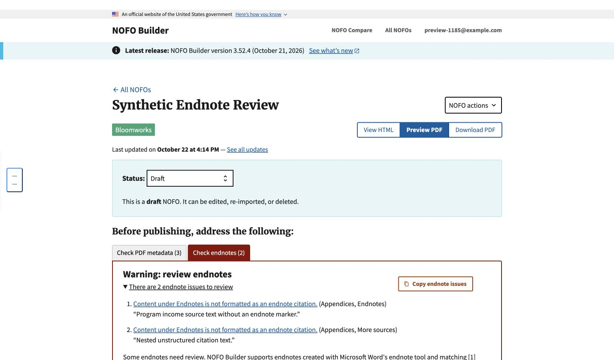

# Endnote content warnings — issue #1185

Local synthetic evidence, October 22, 2026, on `origin/main` at `8d43eee1`
plus this branch. No production records or source documents were modified.

The coordinating agent checked the running local page in Chrome: **Check
endnotes (2)** displayed one warning for **Endnotes** and one for its nested
**More sources** subsection, with subsection links and bounded first-block
excerpts. Ordinary prose after the next peer heading was not included.
The coordinating agent also selected **Save subsection** with the malformed
Endnotes content unchanged: the save succeeded and both warnings remained.
This reuses the existing warning panel; no heading typography or alert styles
were changed. PDF generation and production behavior were not verified here.

Automated coverage includes a top-level Endnotes/Footnotes section, a nested
Endnotes subsection and deeper headings, plain text, bullet lists, pasted divs,
malformed native lists, escaped/bounded excerpts, manual continuation content,
legacy Google Docs links, native Word imports, existing relationship warnings,
group access denial, and a real subsection save that remains nonblocking.

Full-suite and formatter results are recorded in the pull request. Repository-wide
formatter checks have unrelated baseline failures in `policy_language.py`,
`test_metrics.py`, and `test_policy_language.py`; changed Python files pass.
