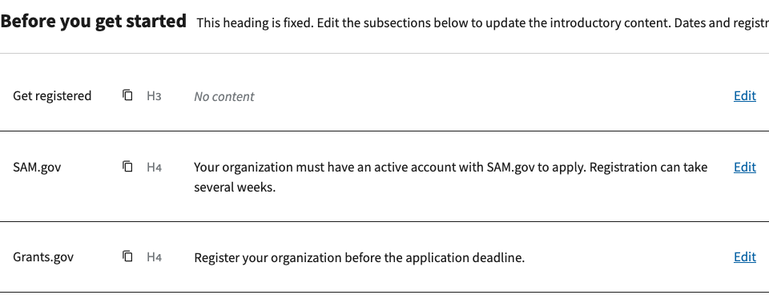
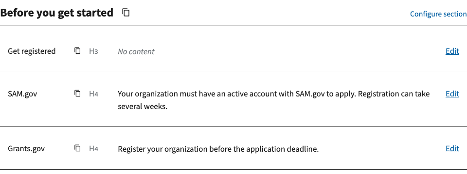

# Introductory editor paragraph removal

Issue [#1134](https://github.com/HHS/simpler-grants-pdf-builder/issues/1134).
Captured locally October 19, 2026, against upstream base `50253150`.

Remove the explanatory paragraph below **Before you get started** on the NOFO
edit page. The heading, Copy link and Configure section controls, and subsection
table remain. The note is not relocated or replaced. No content, heading
constraints, import, HTML/PDF output or deadline-replacement behavior changes.

The behavior guide now distinguishes automatic synchronization from the existing
Application Deadline edit workflow: that form offers replacement of matching
text in selected subsection bodies, including the imported introduction.

## Before / after

| Before | After |
| --- | --- |
|  |  |

## Capture and checks

Use a synthetic imported-introduction record in an isolated local SQLite database.
Sign in a synthetic user using Django's test client and GET the real NOFO edit
view. Capture the returned HTML before and after removing the paragraph, served
locally with collected application static assets. Chrome screenshots show the
introductory table at a 1440 x 1000 viewport, after fonts load. No user document,
production account or credentials are included. These are actual local view
responses, not mockups or a deployed-production check.

Both captures retain Configure section and the subsection Edit links. The heading
uses the existing Source Sans Pro Web styling at 24px and weight 700 in both.
The focused `test_editable_introduction` suite passes (27 tests), covering the introduction's
fixed heading, body editing, rendering and saved-content behavior. The change
only removes a template paragraph, so no new test or deadline logic is introduced.
