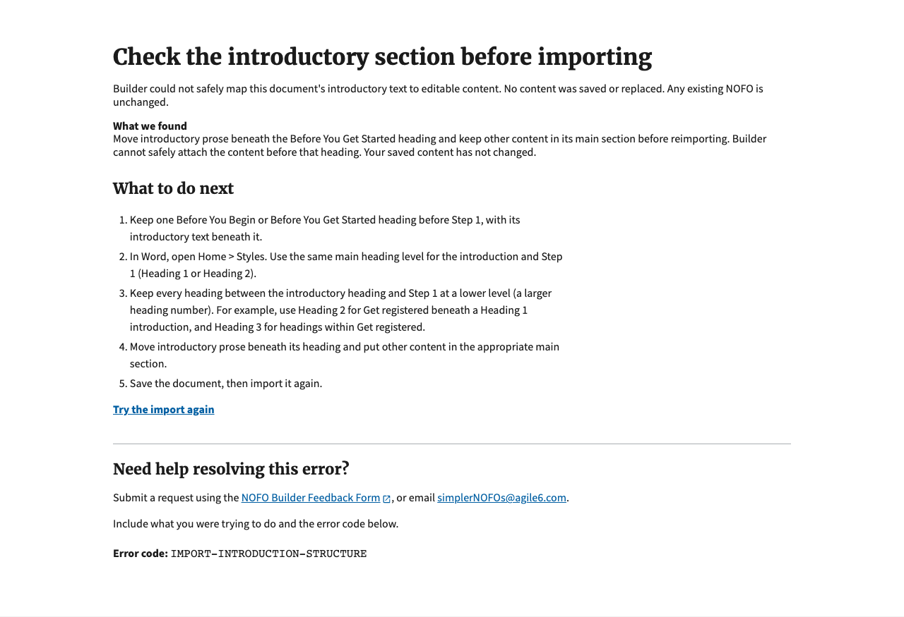
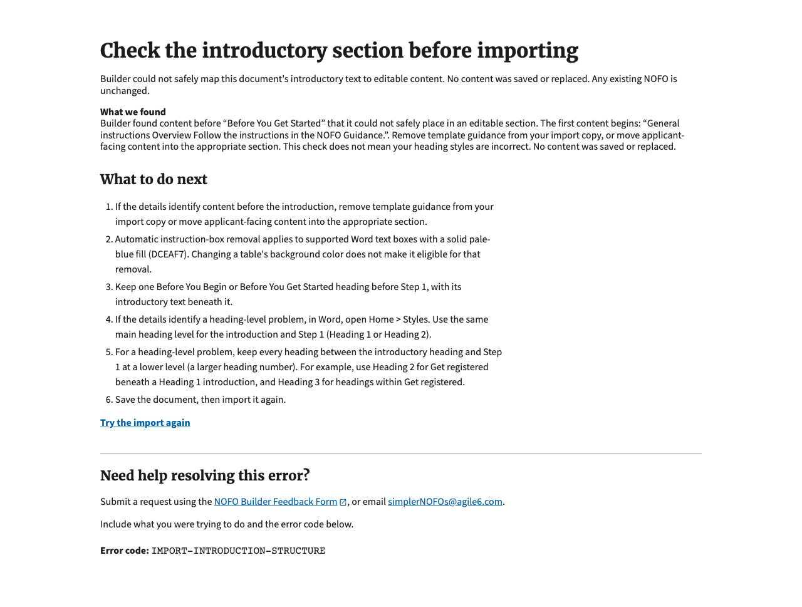
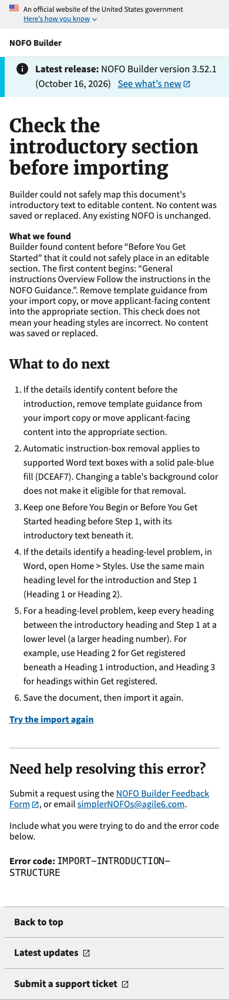

# Introductory import error accuracy

Issue [#1128](https://github.com/HHS/simpler-grants-pdf-builder/issues/1128).
Captured locally October 19, 2026. The base is `50253150` on upstream `main`.

## Scenario and scope

A synthetic FY27 Word document has valid introductory and Step 1 headings,
Basic information and trailing Metadata. A one-cell table precedes the
introduction with DCEAF7 shading and these synthetic paragraphs:

- General instructions
- Overview
- Follow the instructions in the NOFO Guidance.

Both versions reject the document with HTTP 422 and
`IMPORT-INTRODUCTION-STRUCTURE`. Before, the detail does not identify the table
and the recovery leads with heading advice. After, it identifies the content,
explains the template-guidance remedy and says that this check does not mean
heading styles are incorrect. The shared recovery makes heading-level changes
conditional and explains that pale-blue table shading does not qualify a table
for Word text-box removal.

No automatic-removal rules, processing order or saved-content behavior change.
No user document, production account, cookies or credentials are included.

## Capture method

1. Use `fy27_docx()` from `test_editable_introduction.py` and insert the synthetic
   one-cell table as the first Word body element. The regression test
   `test_general_instruction_table_names_content_and_preserves_saved_nofo`
   constructs the same scenario for white and DCEAF7 shading.
2. In an isolated local SQLite database, sign in a synthetic user with Django's
   test client and POST the actual DOCX to `/nofos/import`. Save the returned
   server-rendered HTML, confirming HTTP 422. For the before capture, load the
   base revision's introduction module and error-catalog entry in that capture
   process; for after, use the branch implementation. Use the locked dependencies
   for both captures.
3. Serve the unchanged responses and collected application static assets locally.
   Capture them in headless Chrome with Playwright. Desktop screenshots show the
   actual `main` element at a 1280 x 1000 viewport; the mobile screenshot is the
   full page at 390 x 844. Wait for fonts before capturing.
4. Inspect all three images. Desktop and mobile have no horizontal overflow.
   Before and after use the existing Merriweather Web H1 at 31.2px on desktop;
   the page template, styles and navigation controls are unchanged.

These are screenshots of actual local import responses, not mockups. They do
not establish deployed behavior. Browser upload interaction is covered by the
actual POST and endpoint tests rather than a manual file-picker session.

## Screenshots

### Before

### After

### After on mobile

## Validation

The regression coverage checks new import and reimport, white and pale-blue
instruction tables, unchanged saved section IDs and introductory body text,
no new/archive NOFOs, bounded excerpts, document-order selection after recognized
Metadata, an image-only fallback and HTML escaping. Existing coverage continues
to exercise genuine heading-level errors and successful imports without a prelude.

Final automated check results are recorded in the pull request. Repository-wide
format checks also flag untouched base-branch files: Black flags
`policy_language.py`, `test_metrics.py`, and `test_policy_language.py`; isort flags
`test_policy_language.py`. The same failures reproduce on copies read directly
from upstream `main`; the three changed Python files pass both checks.
