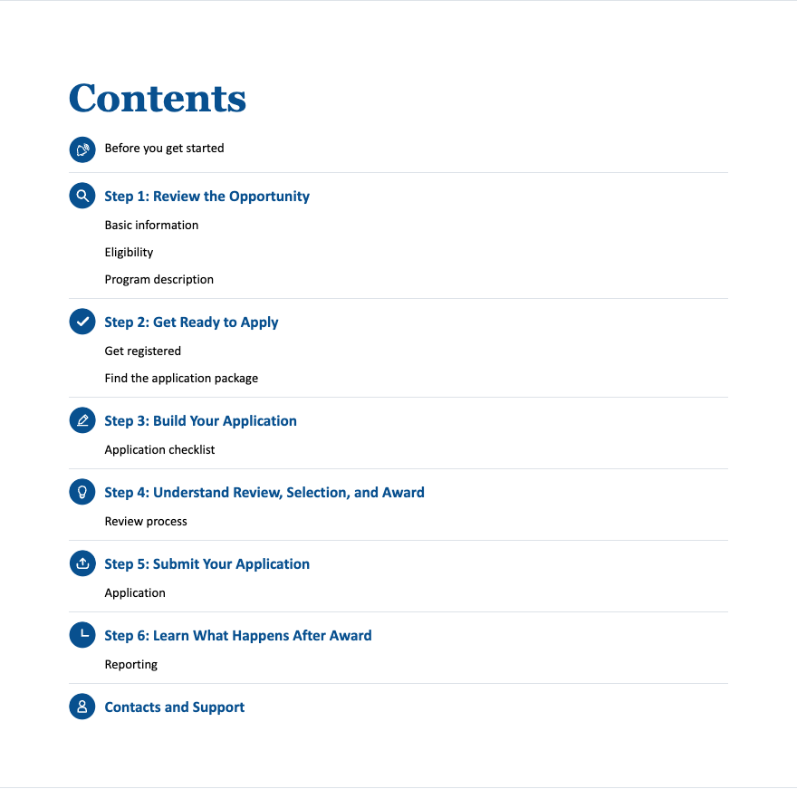
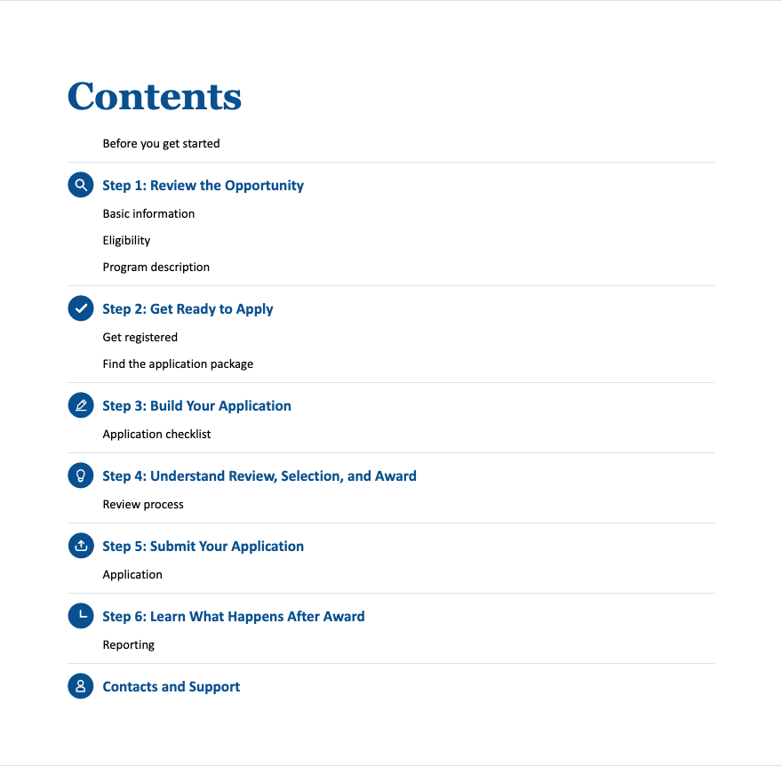
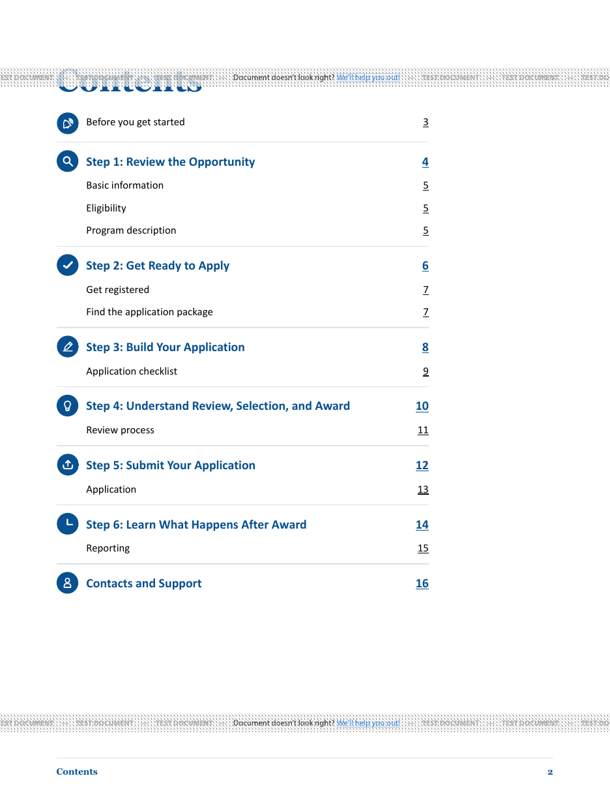
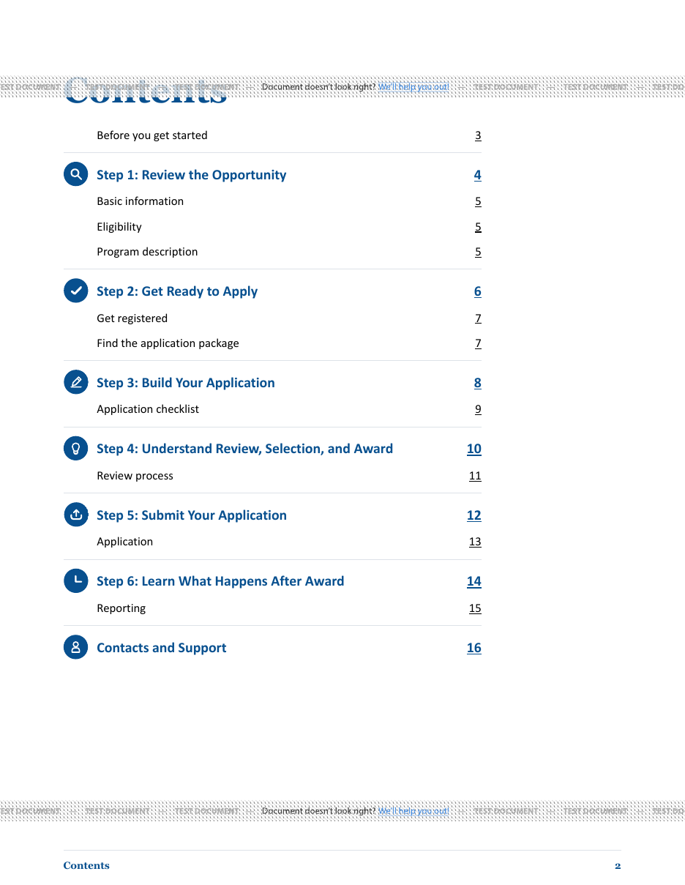
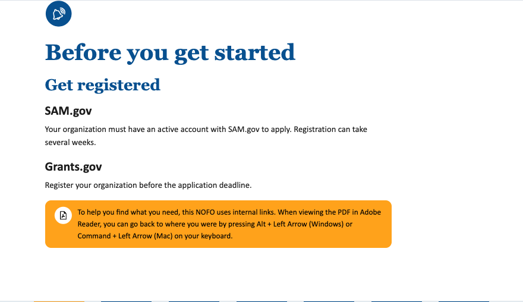
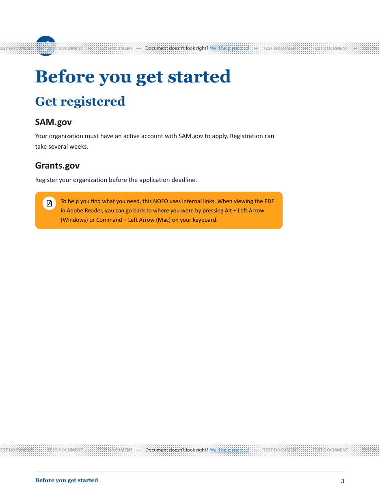

# Introductory Contents icon correction

Issue [#1130](https://github.com/HHS/simpler-grants-pdf-builder/issues/1130).
Captured locally October 19, 2026, against upstream base `50253150`.
This change is independent of introductory import-error PR #1129.

## Behavior

Imported introductions now use the existing `toc--no-icon` layout: the
Before you get started Contents link has no bell and aligns with subsection
text. Its destination remains `#section--before-you-begin`. The introductory
page retains its theme-aware bell. Numbered-step icons, child-TOC suppression,
section order and the generated-introduction workflow are unchanged.

## Screenshot method

A synthetic opportunity with an imported introduction and six numbered steps
was created in an isolated SQLite database. Before and after use the same
record, portrait ACL theme and filled icon style, and the real shared templates.
No user document or production credentials are included.

- **HTML:** render `nofos/nofo_view.html`, serve it locally with collected
  application assets, and capture the Contents and introductory sections in
  Chrome at a 1280 x 1000 viewport after fonts load. Before has one introductory
  Contents SVG and one introductory-page SVG; after has zero and one respectively.
  After, the introduction link and first subsection link both start at x=315.578px.
- **PDF:** call the real `generate_nofo_pdf` service with synthetic content,
  `is_test_pdf=True`, pipeline 11 and its existing PDF/UA-1 profile request, using
  [DocRaptor's documented public test key](https://docraptor.com/documentation/article/1067924-trying-docraptor-without-an-account-or-credit-card).
  Local repository stylesheets are inlined into the rendered submission; public
  dev assets resolve fonts and images. No production account credentials are
  used. The provider's TEST DOCUMENT watermarks are expected. Requesting the
  profile is not an accessibility-conformance claim.
- Rasterize actual PDF pages 2 (Contents) and 3 (introduction) at 110 dpi with
  Poppler, and inspect the images. Both PDFs have 17 pages, matching Contents
  labels/page numbers, unchanged text on other pages and the same number of
  Contents links. The introductory Contents destination is
  still page 3. These are local test-provider results, not deployed validation.

## Before and after

### HTML Contents

| Before | After |
| --- | --- |
|  |  |

### Actual PDF Contents page

| Before | After |
| --- | --- |
|  |  |

### Introductory-page bell retained

## Automated checks

The focused editable-introduction, introductory-family and PDF-print suites
pass (64 tests). The rendering regression checks both HTML and PDF templates
with all three icon styles across portrait ACL, portrait HRSA and landscape
CDC themes: no icon in the introductory Contents entry, the same destination,
a bell on the introductory page and retained numbered-step icons. Existing
single-body, child-heading suppression and broken-link checks remain covered.
The changed Python test passes Black and isort; final full-suite results are
recorded in the PR description.
