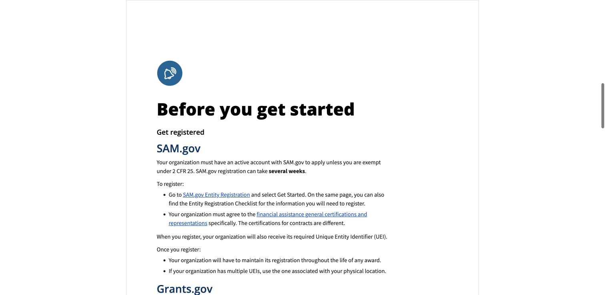
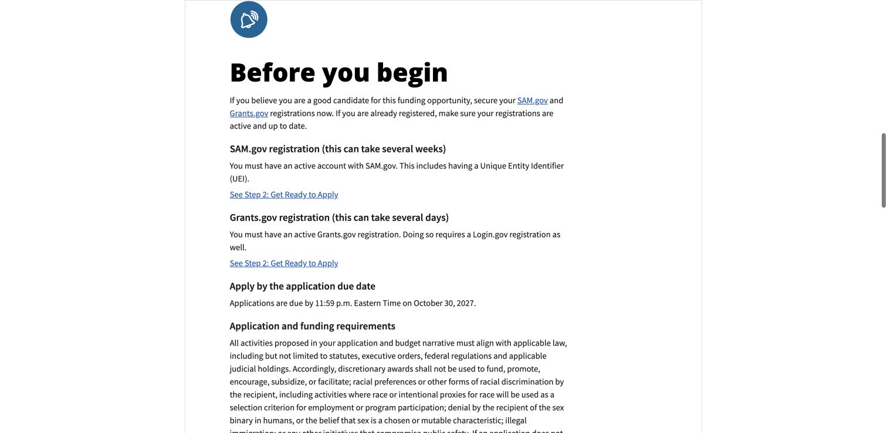
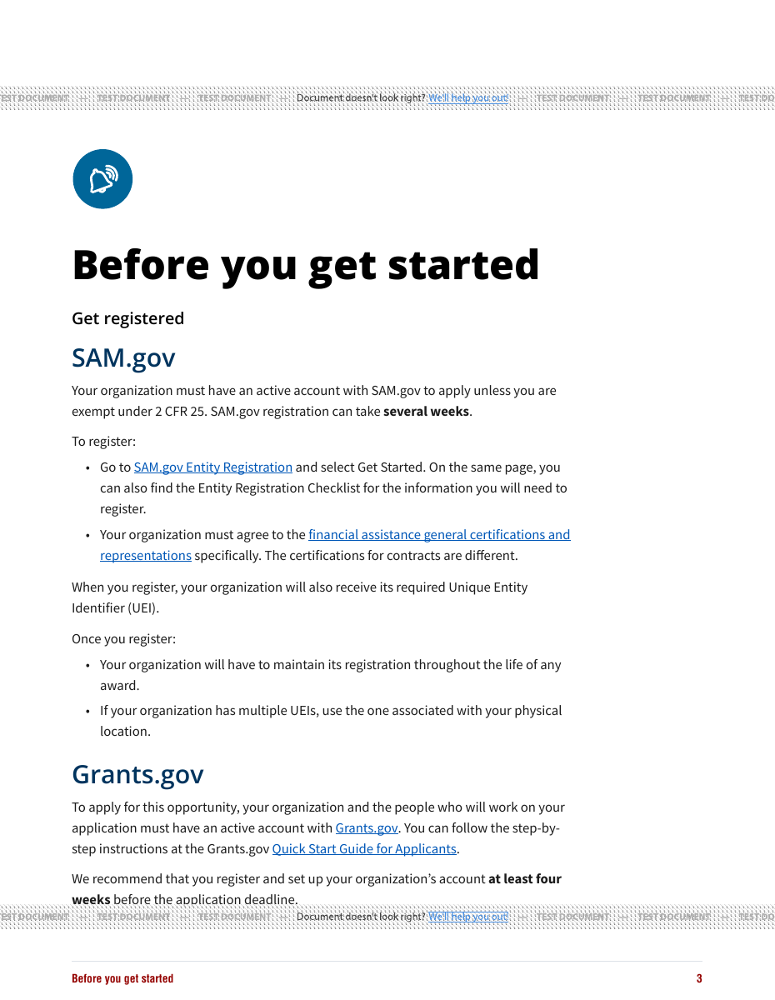
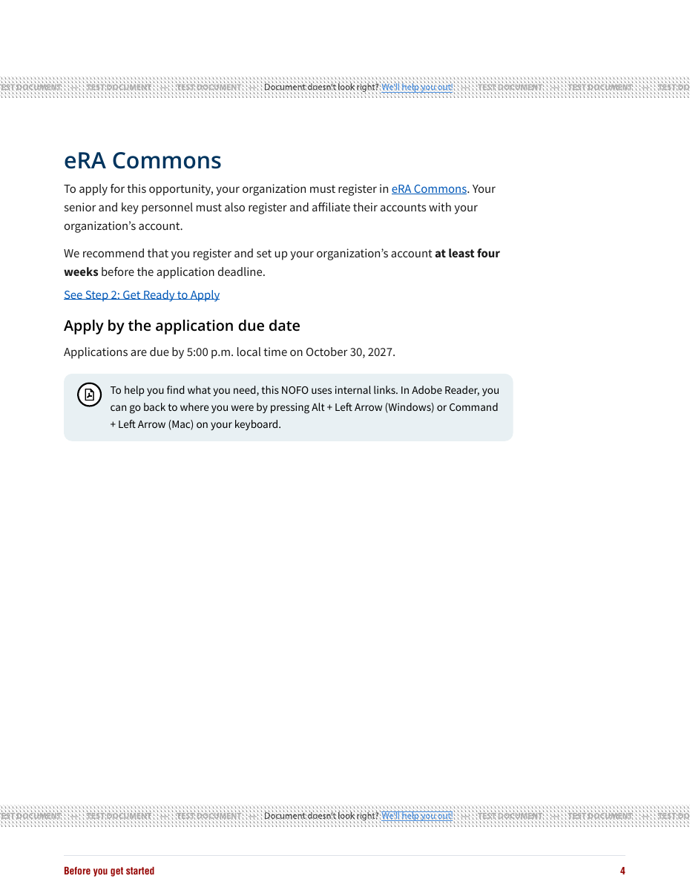
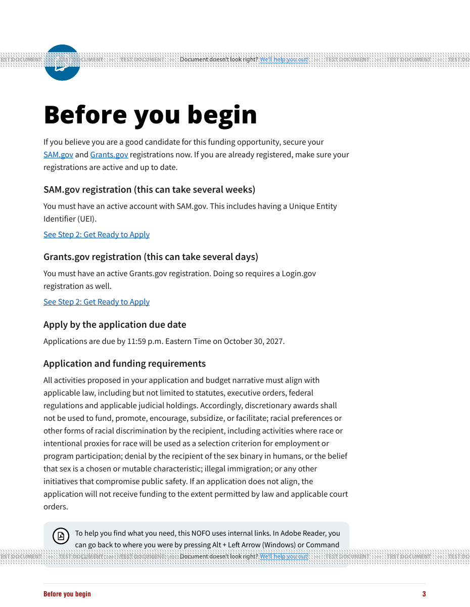
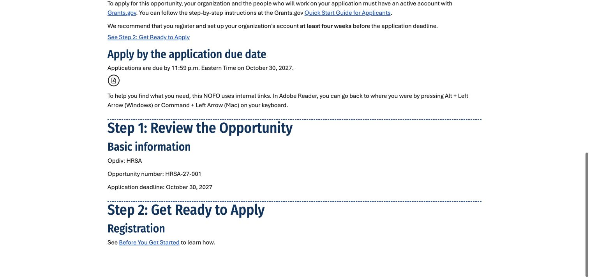

# Introductory family and registration verification

October 13, 2026. Final code reviewed: `826f996e`. This PR combines #1097 and
#804 and is stacked on Metadata PR #1099. Screenshots contain synthetic data;
the private October draft is not committed or sent to a conversion provider.

## Local browser loop

Chrome imported both new and legacy real DOCX fixtures. The new HRSA document
selected Full, displayed Before you get started, included SAM.gov and Grants.gov,
and excluded HRSA-only requirements. Its Word heading-target link returned from
Step 2 to the generated page while preserving authored title-case link text.
The distinctive uploaded introductory body did not appear in output.

A second fixture with a named bookmark and Before You Begin heading selected
legacy HRSA, retained Before you begin and existing requirements, and linked
back from Step 2 correctly.

The combined fixture exercised all four issues: a first Word Title paragraph,
a new introductory heading split across bold/plain runs, conflicting earlier
metadata values, and a trailing Metadata block. Import saved the trailing title,
number HRSA-27-002, agency Synthetic QA Agency and author Synthetic QA Office;
the leading master Title and arbitrary introductory body were absent. The split
heading link resolved without a false broken-link warning.

Using the existing variant control, selecting eRA included both Grants.gov and
eRA Commons without changing the family. Full → None → Full removed the page
and rendered its link as plain text, suppressed the intentionally removed-link
warning, and restored the working link when re-enabled. Stored prose/link
preservation and unrelated missing-link warnings also have regression coverage.

Local records: new `2855860d-3c17-46b3-9079-9d339c752cab`, legacy
`b6828f6c-105c-4f4b-85c0-388ad8086278`, combined
`d1d79fb5-cb8d-4ce6-897e-5e390cd4187f`. Integration checkout contained #1094,
#1096 and this implementation; unrelated open feature PRs were not included.

## Actual synthetic PDF checks

Generated Full, eRA, Sole Source and legacy HRSA PDFs through Builder's existing
`generate_nofo_pdf`, in test mode with [DocRaptor's documented public test key](https://docraptor.com/documentation/article/1067924-trying-docraptor-without-an-account-or-credit-card).
No production credential was used. Relative assets resolved against the public
dev static base URL. The public test provider reported Prince 15.1; this is not
verification of the deployed production converter or final cleared master.

All pages of the three new eight-page synthetic outputs were rendered and
inspected for layout; the introductory pages were also inspected at readable
zoom. Provider test watermarks are expected. The fixtures intentionally contain
very short program sections, so section-start pages have substantial whitespace.

- Full: SAM.gov + Grants.gov, no eRA.
- eRA: SAM.gov + Grants.gov + eRA Commons, both four-week recommendations.
- Sole Source: SAM.gov only, with existing deadline and keyboard help retained.
- New intro spans pages 3–4 in these fixtures. Both running footers read exactly
  Before you get started; TOC points to page 3. No clipped registration content
  or stranded headings were observed.
- Parsed PDF link annotations from Step 2 point to the generated page 3 for all
  three new variants. Source body text is absent. URLs remain the supplied URLs.
- Legacy HRSA retains its original registration/requirements text, page heading
  and Before you begin footer.

## Word export checks and explicit remaining gate

Normal Word-export HTML, not only readability export, contains the maintained
page and a working source-link destination for recognized new/legacy imports.
Historical records with an empty family retain their prior normal export output.
Chrome followed the remapped Step 2 link in the export source successfully.

**Actual provider-generated DOCX bytes were not available locally.** GrabzIt
export remains disabled for this isolated host; production credentials were not
used or its allowlist bypassed. This repository does not author a Word TOC or
running footer in this HTML export template. Do not assume PDF CSS proves Word
footer behavior. Before completing the issues, verify the resulting DOCX's
heading/bookmark targets, link behavior, and any provider-generated TOC/footer
in a dedicated authorized export environment. Record what exists and ensure
there is no stale label, rather than claiming an unverified Word footer.

## Review and tests

Independent review found and verified fixes for split heading runs, false
generated-link diagnostics, obsolete migration-test teardown, and disabled-page
warnings. Final narrow re-review at `826f996e` passed 24 introductory/link/ID
tests with no findings. Earlier independent runs covered 35 migration/import
tests plus 360 legacy HRSA/Composer/Compare tests. Implementation's final focused
run passed 672 tests. Integrated whole-project results are recorded in the PR
after the final run completes.

No merge, deployment, production-record mutation, source-policy change or final
template clearance is established by this evidence. Keep these issues open for
the remaining deployed/final-template and actual DOCX checks.
