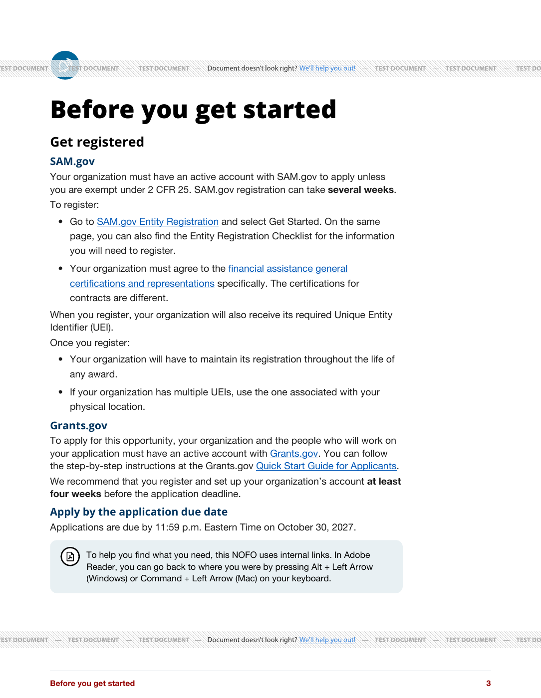
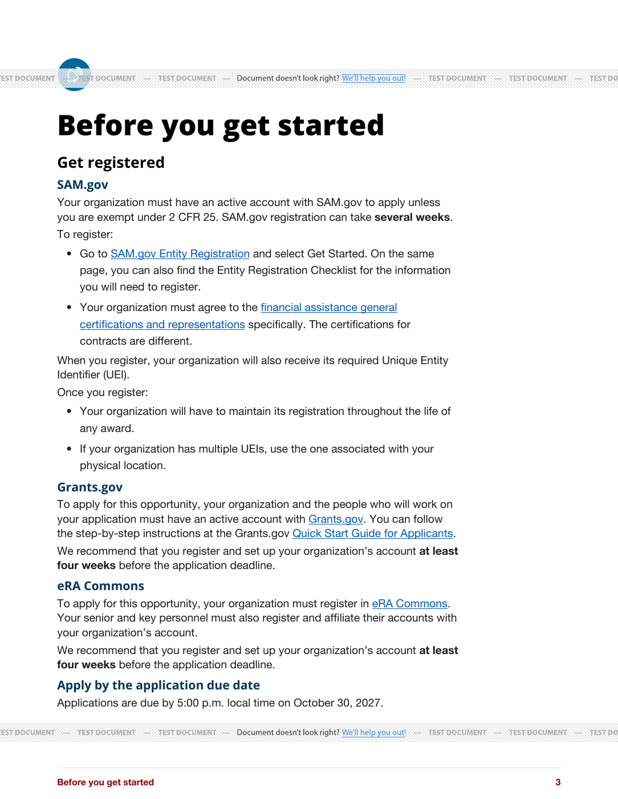
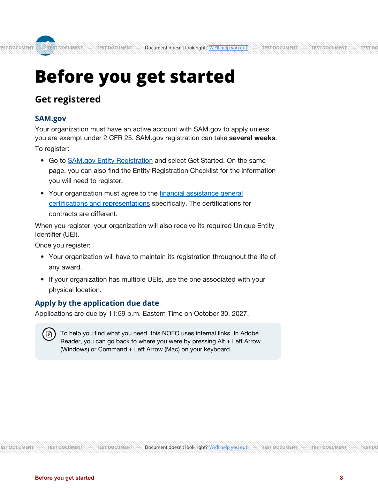

# Compact introductory-page previews

October 13, 2026. New family only: top padding 0, original 80% content width retained, H2 28pt with tighter margins and 45px icon, body remains 11pt with 1.3 line-height, H3 15pt, H4 12pt, tighter paragraph/list spacing. Legacy selectors and wording remain unchanged.

Synthetic Word fixture imported into a disposable in-memory database, then rendered with Builder's normal PDF template. Local CSS was embedded so these previews reflect the proposed stylesheet. DocRaptor public test key, test mode, pipeline 11; no production credentials or private master content submitted. These are review previews, not deployed production or actual Word-export verification. Test-provider watermarks are expected.

Full and Sole Source each occupy one introductory page (page 3 in the fixture). eRA occupies pages 3–4: its registration and deadline fit on page 3, with keyboard help continuing on page 4. Pagination is verified for these representative single-deadline portrait fixtures; unusually long or multiple deadlines and other themes still require validation.

The 18 introductory-page tests pass. No body wording was removed and no body font reduction was applied.
