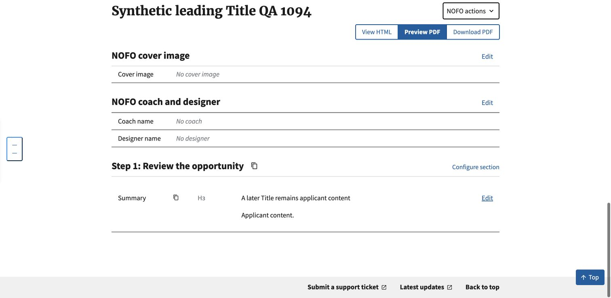

# Leading Word Title import verification

October 13, 2026. Code reviewed: `ece9231e`. Synthetic documents only.

Chrome imported a DOCX with a leading paragraph using Word's Title paragraph
style and another Title paragraph inside Step 1 / Summary. The metadata title
remained Applicant opportunity, the opportunity number remained TEST-1094, and
the later Title paragraph stayed in the saved applicant content. No new import
alert or confirmation was introduced. The isolated integration checkout also
contained the trailing Metadata change for #1096.

The screenshot verifies the saved content, not the original-XML removal itself.
Sixteen regression tests check that removal before Mammoth conversion, including
empty leading Title paragraphs, preceding blank/table/drawing elements, non-Title
styles, source preservation, unchanged shared callers, and re-import rollback.
The later Title can still produce Mammoth's existing formatting warning; this
change does not suppress warnings for paragraphs it leaves untouched.

Independent review found no actionable issue at `ece9231e`; its own runs passed
all 16 new tests plus 268 import/re-import/Composer/Compare regressions and a
separate namespace-preservation check. The implementation's targeted suite passed
291 tests. Full-suite results are recorded in the PR when complete.

This verification made no production record changes and generated no PDF or
Word export. The rule runs during authorized Word import only; existing saved
records and HTML imports are not cleaned on view/export.
