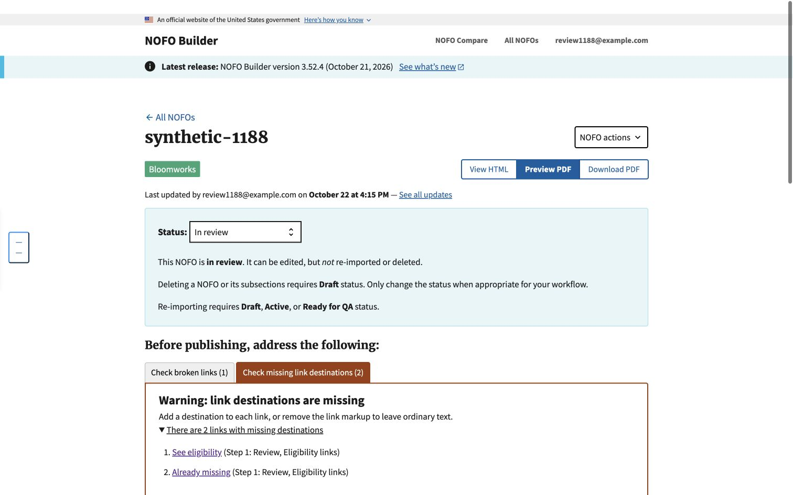

# Missing link destinations — issue #1188

Local synthetic Chrome verification on October 22, 2026, against `fc8dd010`.
The root agent performed this browser flow independently of the implementing
agent. Independent code review was still pending when this evidence was recorded.
No production content, credentials, external link fetching, PDF generation or
Word export was used.

The fixture is an **In review** NOFO with complete PDF metadata, valid heading
levels, two broken internal links, one already-empty destination and a bookmark
target. The external-link check button is hidden in this status.

1. Opened the subsection and changed `[See eligibility](#nonexistent-heading)`
   to `[See eligibility]()`, then selected **Save subsection**.
2. Confirmed that broken-link count changed from 2 to 1 and missing-destination
   count changed from 1 to 2. Expanded the missing-destination list: both
   **See eligibility** and **Already missing** appeared individually, with
   **Step 1: Review, Eligibility links** identifying their location.
3. Reopened the subsection, restored **See eligibility** to the valid
   `#eligibility-links` destination, and removed the other broken link's markup.
   After saving, only **Already missing** remained. Its warning tab remained
   visible and selected as the sole warning.

The screenshot captures step 2, not the final sole-warning state:

Automated coverage exercises the real subsection edit-version/POST/save/redirect
flow, correction/removal, multiple instances, the sole-warning state, existing
destination-less anchor shapes, bookmark exclusions, unchanged inline tooltip,
and absence of network fetching. See `test_link_classification.py`.
