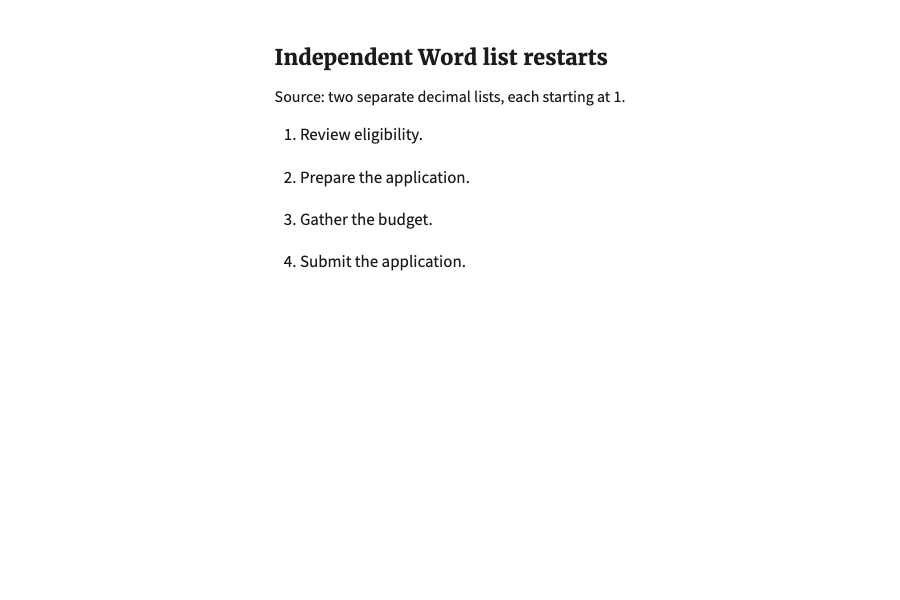
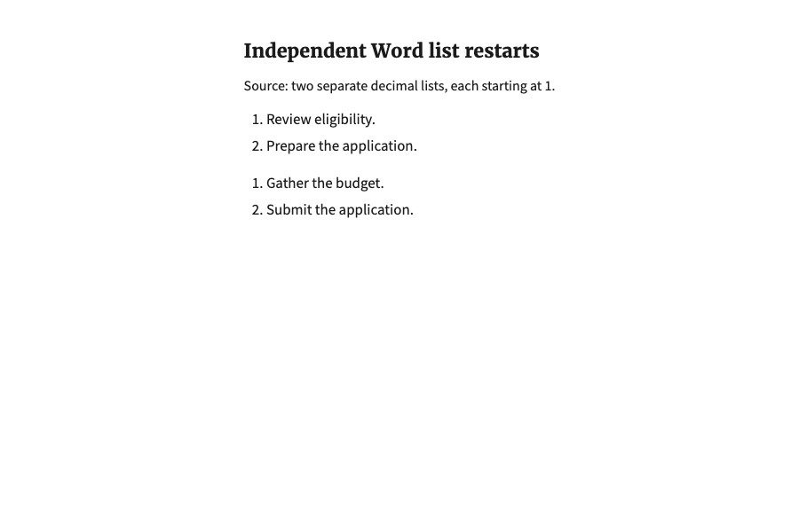

# Independent list restart regression

Review follow-up for #1125 / #1121, October 16, 2026.

A synthetic Word source contains two adjacent decimal numbering instances, each
with two items starting at 1. The real Mammoth/sidecar conversion retains two
ordered lists. Before this fix, HTML-to-Markdown conversion emits two Markdown
lists separated by a blank line, and the configured `safe_markdown` renderer
merges them into one list displaying 1, 2, 3, 4.

The fix retains adjacent same-kind lists as HTML, including both separate roots.
The output displays 1, 2 followed by a separate 1, 2. Standalone simple lists
still use Markdown. Adjacent bullet groups also retain their separate boundaries.
IMPORT-020 documents the behavior.

## Before and after

These are local Chromium render previews at the same 900 × 600 viewport,
using the actual Word conversion, Markdown converter, configured sanitizer and
bundled Builder styles with identical synthetic text. The surrounding comparison
heading is a capture harness, not a new product screen. They are not live editor
uploads, generated-PDF checks or production screenshots.

Before uses PR head `0b2b8d29`; after uses the follow-up implementation.

## Validation

- Both new regression tests fail on the original PR implementation (the render
  test has ordered and unordered subcases).
- 165 focused and compatibility Django tests pass with the fix: native numbering,
  upload/persistence, configured rendering, legacy Markdown/content processing,
  import transforms, endnote imports and citation links.
- The upload regression uses two separate native decimal numbering instances and
  verifies two separately rendered lists after persistence, both starting at 1.
