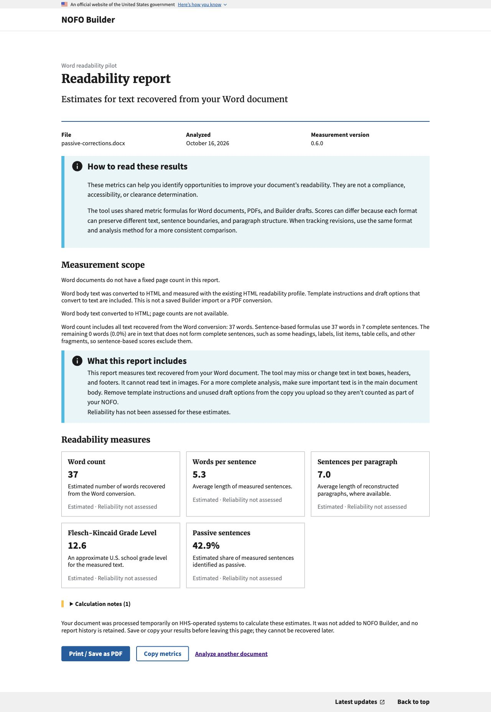
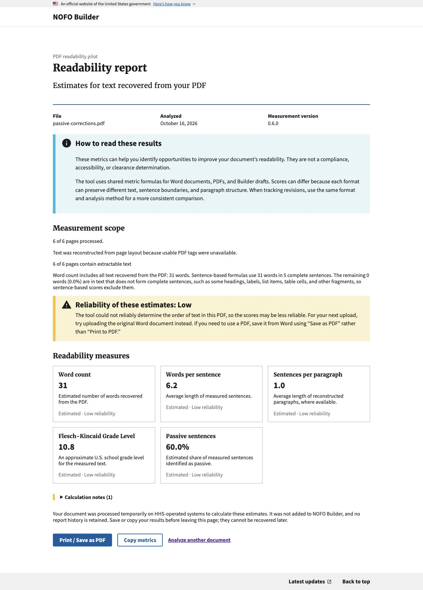
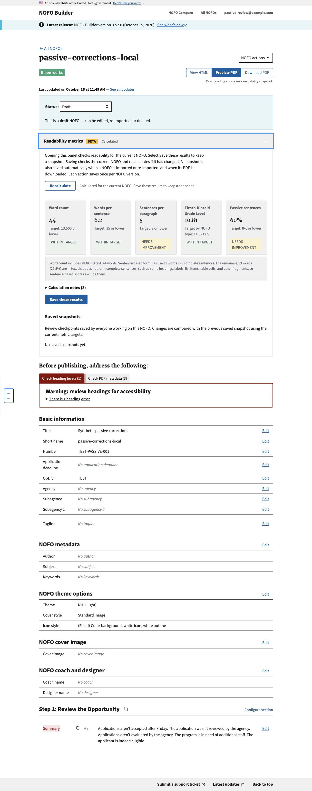

# Local passive-method adoption candidate

Initially prepared October 14, 2026; refreshed October 16 against Builder main
`35e58d81`, for metrics issue agilesix/hhs-nofo-metrics#10 and merged PR #11
(library main commit `b38496f5`).

Local branch: `codex/readability-passive-v4-adoption`.

The staged changes select HTML profile @0.5.0 for both Builder-native HTML and
standalone authenticated DOCX, tagged PDF @0.6.0, generic PDF @0.5.0, and tagged
adapter @0.1.7. Existing version identity checks retain
historical scores and prevent reuse as current scores when the package/profile
changes. No snapshot migration or policy-target change is needed.

Verification used a separate local Python environment with the built 0.6.0 wheel
and the existing Builder dependency libraries. The environment imports the
candidate's installed wheel, including PDF subprocesses, rather than an editable
metrics checkout. The refreshed branch passed 168 tests across source-native
readability, PDF and DOCX analysis, checkpoints and authenticated/public upload
views. A new synthetic DOCX regression verifies that the corrected classifier
changes the passive numerator from two to three without changing sentence totals
or any other metric, and that the actual DOCX worker returns the corrected value.
Existing structured-DOCX tests verify reuse of the corrected HTML profile.
No shared environment was changed.

Final consumer checks against the published wheel: 2,620 Django tests passed
(three existing skips), 57 JavaScript tests passed, migration drift check passed,
and Poetry lock validation passed. The package runtime is Python 3.14.2. The
locked wheel hash matches the independently downloaded published asset. The
historical-score regression retains the old 0.5.4 / HTML 0.4.0 row unchanged,
calculates a new current 0.6.0 / HTML 0.5.0 result, and reuses only that current
measurement on an unchanged repeated calculation.

The dependency step advances Builder from 0.5.4, not 0.5.5. It therefore also
includes the released tagged table-cell continuation correction and adapter
0.1.7. PDF extraction and resulting nonpassive estimates may change. Claims that
only the passive score changes apply to a controlled identical extracted input,
not to every PDF analyzed across the package upgrade.

The library release is published at
https://github.com/agilesix/hhs-nofo-metrics/releases/tag/v0.6.0 from reviewed
main commit `b38496f5b90e88b0491d658a3151b04b299add53`, with all main CI checks
passing. Builder's dependency and lockfile now select its published wheel with
SHA-256 `7fc342f8bc0b7f78cf876ef41de847cf09404cdfe1045db10bd908df338ca81c`.
Poetry 2.5.1 regenerated only the metric package entry and project content hash;
no unrelated dependency versions changed. The actual published wheel is
installed in the isolated Python 3.14 consumer test and local browser runtime.
No pilot flag, access rule, upload validation, temporary-storage policy or metrics
target is changed by profile adoption. No Builder deployment is implied.

The v0.4 method fixes unambiguous be contractions and the `need`/`indeed` errors.
Ambiguous pronoun `'s` remains a documented limitation because it can mean `is`
or `has`. This is not a claim of Word parity or of calibration of the 8% target.

## Independent consumer review and browser loop

A separate reviewer checked implementation `efce21b5` and documentation follow-up
`bd6b1768`, then passed 177 independently selected Django tests against the
published wheel in isolated SQLite. Coverage included actual DOCX/PDF workers,
versioned results, history/checkpoints/import/download and both upload routes.
No actionable finding remained. The lock diff contains only the intended package
URL/version/hash and project content hash, not unrelated dependency changes.

Actual local in-app browser verification used a normal login with a synthetic
account and the published installed wheel, not a stubbed analysis response:

- Word upload returned measurement version 0.6.0, 37 words, seven complete
  sentences and 42.9% passive (three of seven). This recognition fixture includes
  extra metadata sentences, so it is not a five-sentence parity control.
- Untagged synthetic PDF upload returned version 0.6.0, 31 words, five complete
  sentences and 60.0% passive. Generic-extraction low-reliability guidance remained.
- Opening the seeded NOFO editor's existing metrics panel calculated 60% passive
  over the same five core sentences. The deliberately minimal fixture has ordinary
  heading/metadata warnings; those are not defects introduced by this change.
- The tagged-PDF corrected profile is covered by automated worker tests, not
  claimed as a separate browser upload here. No shared or production settings,
  documents, provider calls or public enablement were used.

