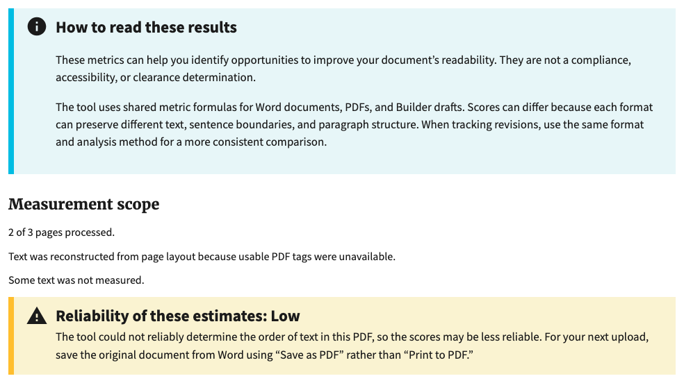
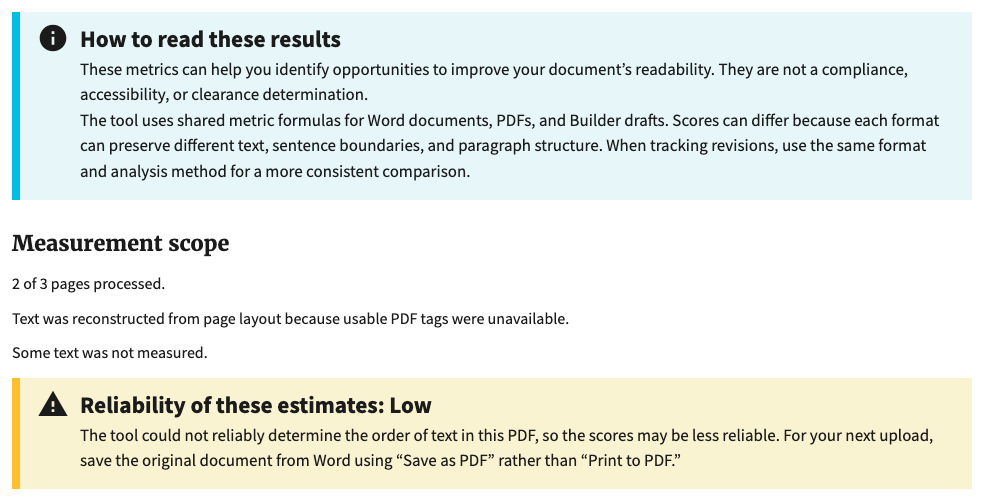

# Alert spacing comparison

Local Chromium captures on October 16, 2026, at a 1100 × 1000 viewport.
Both render the actual report template with the same synthetic test report and
bundled styles. These are template previews, not new upload or deployed checks.

- Before: template from `51742b89`.
- After: template from `9572fc98`, including spacing fix `3e4c35bf`.
- Each image crops the introductory alert, measurement scope, and reliability
  alert. Text and viewport are identical; the crop height follows the content.
- Default introductory paragraph margins change from 16.96px above/below to 0,
  using `usa-alert__text` on each paragraph. The heading retains its standard
  spacing. The reliability alert is unchanged.

## Before

## After

