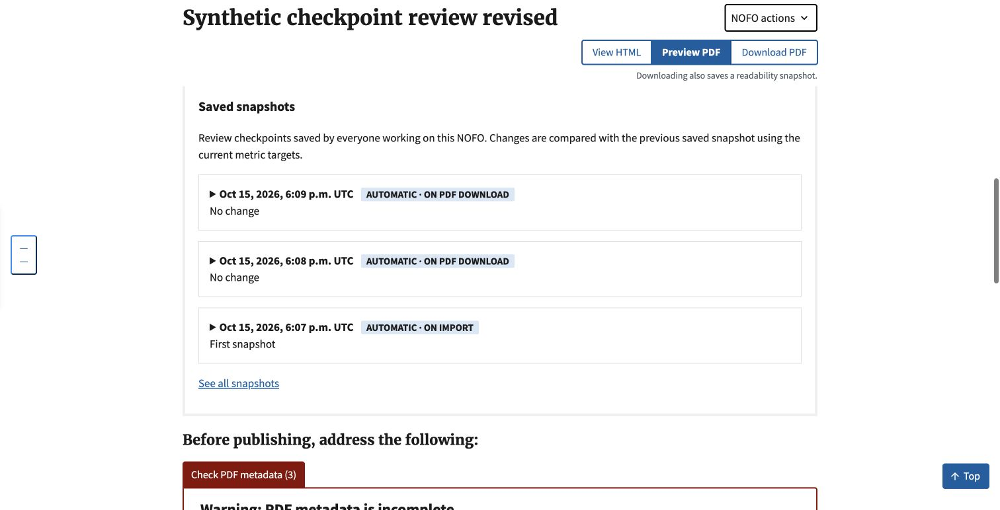

# PDF-download checkpoints after import

Issue: [#1113](https://github.com/HHS/simpler-grants-pdf-builder/issues/1113).
Verified locally on October 15, 2026 using synthetic content only.

## Confirmed cause and bounded fix

The saved checkpoint had a one-to-one relationship with its measurement.
`get_or_create(score=score)` therefore returned the import or manual checkpoint
when the unchanged document was downloaded. The existing frontend already
refreshed the saved-history fragment; there was no new download checkpoint for
it to display. Existing tests explicitly required this old reuse behavior.

Keep one calculation per document revision and measurement contract, but allow
one checkpoint per calculation **and trigger**. Import, re-import, manual save
and PDF download retain separate provenance. Repeating the same action on the
unchanged revision does not add another checkpoint or re-run the metrics engine.
These are workflow milestones, not an audit of every download attempt.

The existing in-place refresh is retained. No full-page reload, new messaging,
new calculation formula, background job, or frontend refresh mechanism is added.

## Verification

- Focused history/import/download/overview suite: 69 tests passed.
- Migration preservation test: passed. Original ID, time, trigger, status and
  result survive; a download can then reference the same measurement and
  duplicate `(score, trigger)` writes remain database-rejected.
- Full Django suite: 2,559 tests passed, with three existing skips.
- `makemigrations --check --dry-run`: no changes detected.
- Commit hooks: Black, isort and repository checks passed.
- Actual Chrome upload of a synthetic `.docx` through the import form, followed
  directly by the edit page without naming or editing: the open panel showed
  one import checkpoint. Download PDF added the download checkpoint in place
  while preserving the open panel and original import checkpoint.
- With the same panel closed, another download kept the two existing
  checkpoints; reopening showed current history.
- Edited the existing NOFO through its title form. With the panel initially
  closed, Download PDF added a checkpoint for the new revision. Reopening showed
  both PDF-download checkpoints and the original import checkpoint.
- The browser saved `test-1113.pdf` (50,819 bytes). The browser automation's
  download-event wait timed out for the blob download, but the application POST
  and history refresh both returned 200 and the saved file was independently
  confirmed in Downloads.
- Regression tests cover successful downloads, failed generation preserving the
  import checkpoint without a success header, metrics failures not blocking the
  PDF, previews/test PDFs not saving, disabled metrics, permissions, unchanged
  repeated actions, distinct triggers, changed revisions and history fragments.

The latest download is after a title edit; the prior download is immediately
after import without edits. The repeated unchanged download creates no third
entry for that same revision.

## Boundaries and rollout

Local PDF delivery used the real download view and a local-only DocRaptor stub
returning an existing synthetic PDF fixture. The actual metrics engine ran.
This verifies checkpoint persistence, browser delivery and UI refresh, not live
DocRaptor generation or production behavior. No shared flags, credentials or
production data were used or changed.

Apply migration `0152_readability_checkpoint_per_trigger` before the new code.
Existing data is preserved. Do not roll the schema back to one-to-one after
separate triggers exist without a data-preservation plan. No merge or deployment
is part of this verification.
