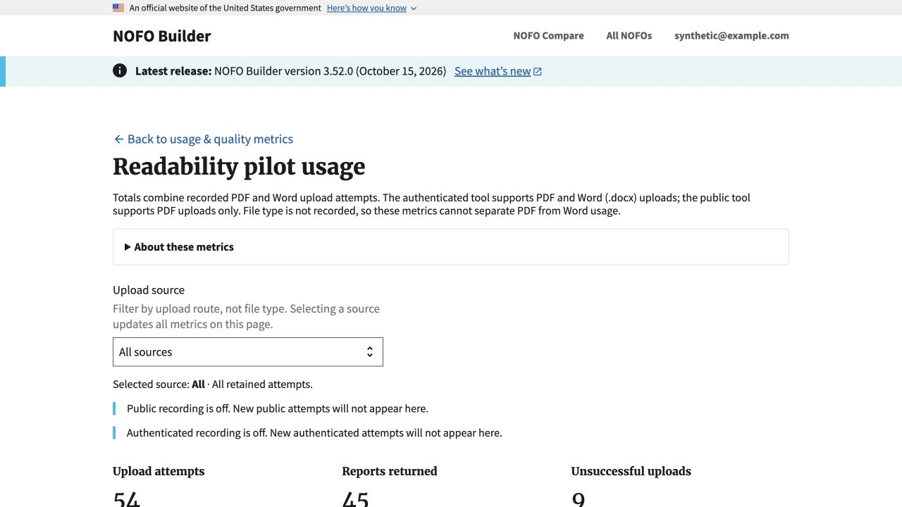
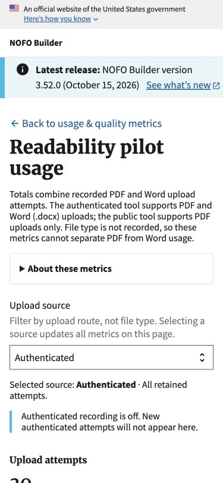
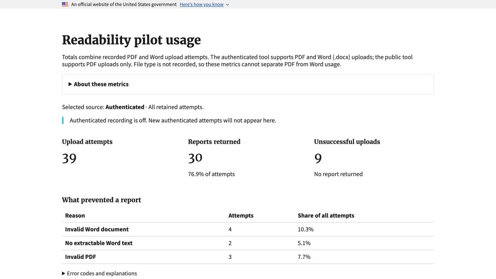

# Readability Checker usage copy (#1119)

Tool-name references use the current **Readability Checker** name. Screenshots
from the original review predate the rename.

October 16, 2026. Local-only synthetic verification. No deployment, pilot
enablement, new telemetry, migration or calculation changes.

## Scope and reuse

Reuse the existing templates, metrics-viewer permission, outcome catalog,
aggregations, source filter, pagination and print styles. The dashboard title,
H1, parent navigation link and pagination label are file-neutral. Format
requirements and tracking limits are visible above the collapsed details so
they remain available in print styling. Source help is visible and associated
with the existing select. PDF-specific and Word-specific errors are unchanged.

The audit also covered summary cards, error explanations, recent attempts,
charts/captions/accessibility labels, durations, status/recording/retention,
empty states and print. Those were already neutral or correctly format-specific
and were retained. The runbook now explains combined-format totals, route
filtering and the absence of a stored file-type dimension. Internal names and
URLs remain unchanged.

## Checks

- Rendered tests cover title, H1 text, parent link, visible filter help,
  file-neutral empty states and pagination preserving the selected route.
- Mixed synthetic outcomes cover public/authenticated/unknown routes,
  successful reports, PDF failures and Word failures. Counts, rates, daily and
  weekly observations and recent rows continue to use the existing route filter.
  A successful row does not identify its format; tests do not invent one.
- Existing tests retain permission gates, exact content-free schema,
  independent recording switches, retention and pagination behavior.
- Local in-app browser: signed in through the normal login form using a
  synthetic metrics viewer. All-source totals were 54 attempts, 45 reports,
  nine failures. Selecting Authenticated retained 39 attempts, 30 reports,
  nine failures, and updated the URL's source parameter.
- Verified the actual rendered H1 font is Merriweather-Bold. At 375 by 812,
  document scroll width was 375 pixels. Heading, scope and help wrapped without
  horizontal page overflow. No stylesheet or typography changes were needed.
- Print-media emulation retained the neutral heading, format explanation,
  selected route, counts and accurate PDF/Word error labels while hiding the
  interactive route selector. Media and viewport overrides were reset.

Automated test counts and latest CI receipt are recorded in the PR. These
screenshots show local browser and print-media presentation, not a native
saved-PDF pagination check, deployed verification or an accessibility audit.
No real uploads, credentials, session cookies or production data are included.

## October 26 wording update

Visible dashboard wording now uses **Readability Checker usage**, **Upload
route**, **Selected route** and **Calculator availability and usage recording**.
The disabled outcome label uses **Calculator disabled**. Internal routes and
settings retain their existing names. The screenshots above are historical
layout evidence from before this wording update, not current-copy captures.
