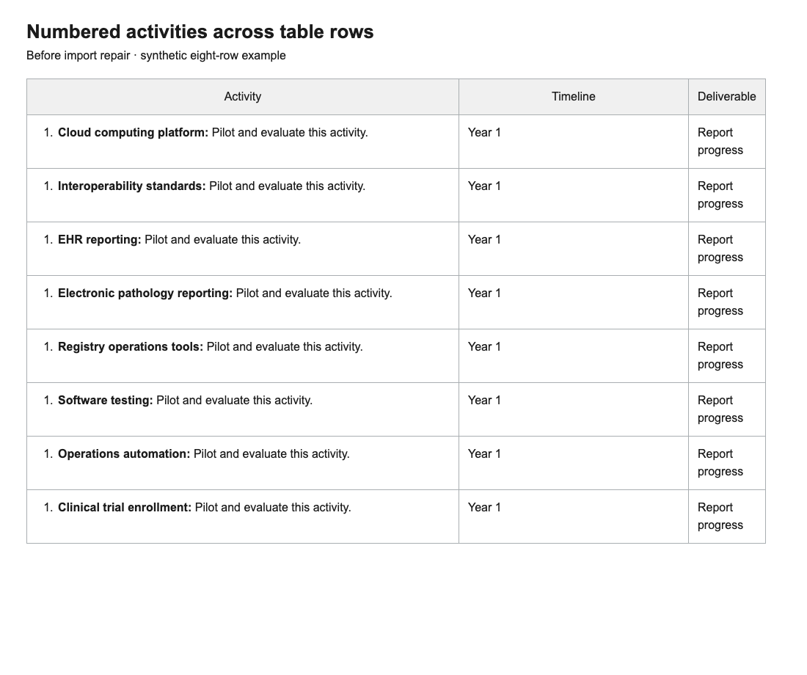
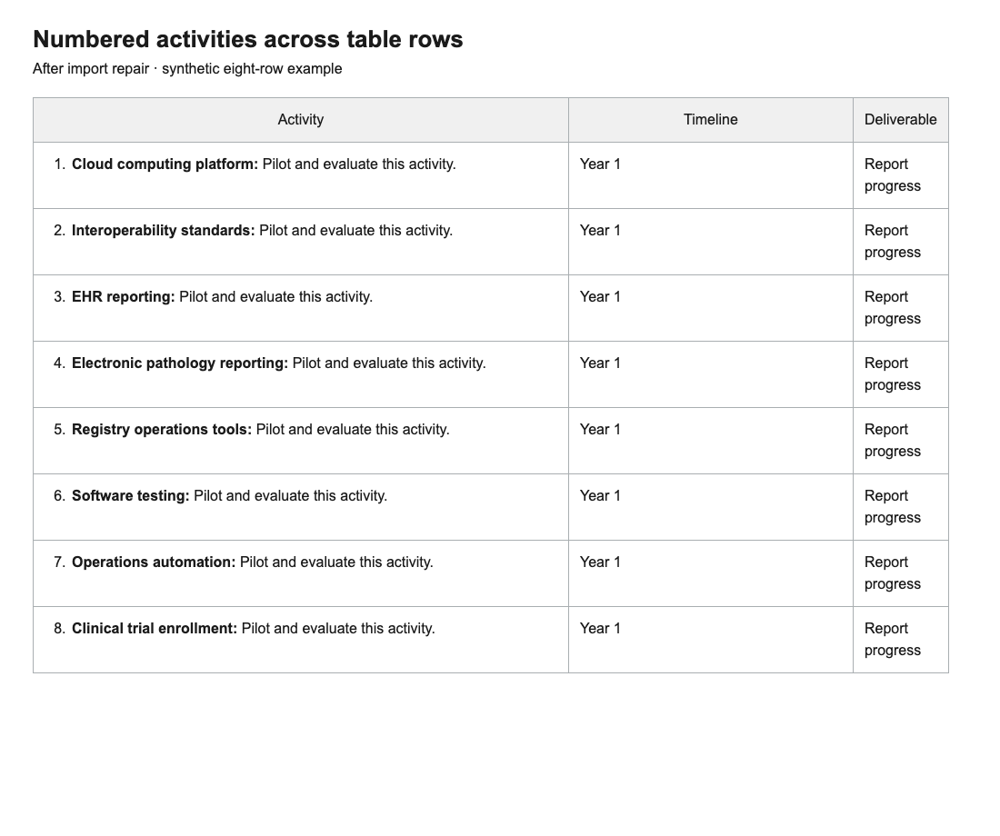

# Numbered items across table rows

Evidence for PR #1127. Both screenshots use identical synthetic HTML with eight
first-column one-item ordered lists. They pass through the shared import
processor, `md`, and the configured `safe_markdown` sanitizer/renderer. Chromium
captures use a 1100 × 920 viewport, bundled Builder styles, and identical capture
layout CSS. The heading is a review harness, not product UI. These are local
render previews, not live editor uploads or generated PDF screenshots.

- Before: upstream `223a6339`, showing eight 1s.
- After: PR branch with the table-row repair, showing 1–8.
- No private source document content is published.

Upstream #1125 now preserves native Word numbering. This PR's IMPORT-067 handles
the remaining HTML/legacy-conversion shape without overriding source-derived
Word lists (IMPORT-066). Explicit HTML starts remain authoritative.

Validation after merging upstream: 142 tests pass covering table-row numbering,
Markdown, shared processing, native list imports, rendering and Word numbering.
