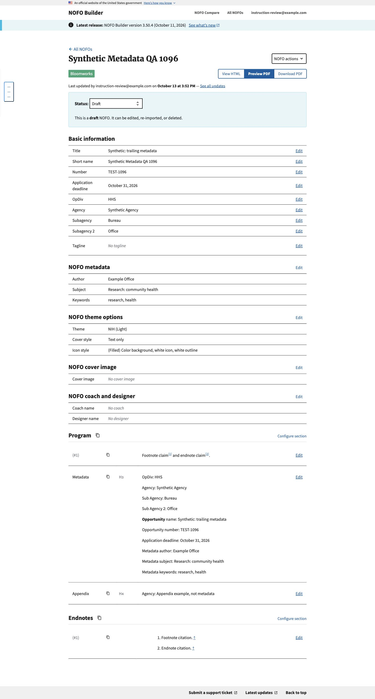
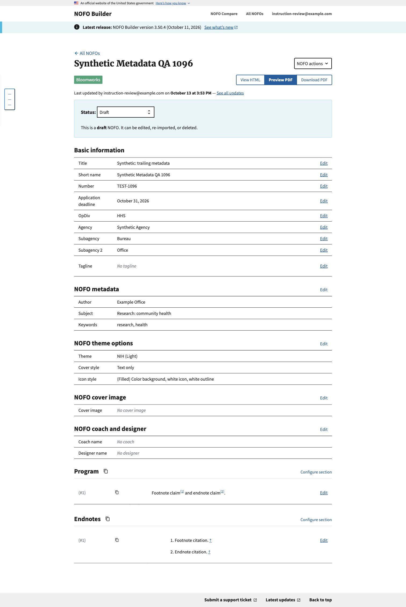

# Trailing Metadata import verification

October 13, 2026. Code reviewed: `2359b3ac`. Synthetic Word fixtures only.

## Chrome checks

The structured fixture has conflicting front-page values (NIH, Front-page
example, OLD-EXAMPLE), a legacy Before You Begin source section, and a lower-level
Metadata heading containing the authoritative fields. Import saved HHS,
Synthetic Agency, Bureau, Office, TEST-1096, October 31, 2026, Example Office,
Research: community health, and research, health. The formatted opportunity-name
label resolved to Synthetic: trailing metadata, preserving its second colon.
The source intro was consumed while the Metadata heading, following Appendix,
and native footnote/endnote content and links remained intact.

The same draft was then re-imported with the legacy fixture, which has no
Metadata heading. Re-import succeeded, retaining the expected legacy field
values and native notes through the ordinary replacement path.

Local record: `c8ad0875-8d96-4e9f-9f16-6e31970908a6`. The isolated integration
checkout contained both this commit and the leading Title fix for #1094.

## Independent checks

Independent review found no actionable issue at `2359b3ac`. All 16 new tests and
the complete nofos app suite passed independently: 1,883 tests, three skips.
An additional number-mismatch confirmation check verified that the draft stays
unchanged before confirmation and uses trailing fields after confirmation.
Unicode normalization, comment-separated fields and lower-level boundaries were
also checked independently. The implementation's final focused suite passed 671
tests. Its earlier full suite passed 2,448 tests with three skips before the final
legacy-intro boundary regression was added; do not treat that earlier run as a
full-suite result for the final commit.

## Scope and remaining checks

No production records, settings or credentials were changed. These screenshots
verify local import/editor behavior, not generated PDF or Word exports. Metadata
source-content suppression is deliberately not included here; that is #802.
Saved documents do not change on view/export. Verify the final cleared master
through the deployed import and normal PDF/Word export paths separately from
these synthetic checks.
